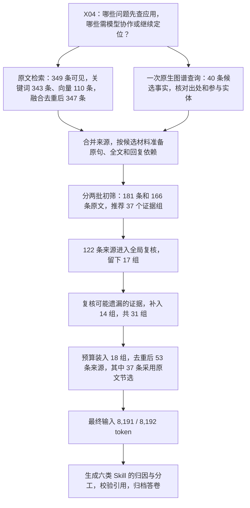

# MyContext 方案 C 实例：X04 完整问答过程

> 哪些应用问题已有证据优先由应用处理，哪些需要模型协作或继续定位？

本题用方案 C（企业上下文）核查项目 A，方案 B（原文关键词与向量检索）作为对照。材料截点是 2026-11-20 23:59（北京时间）。本次直接使用已建好的事实库与索引。下图中的数量取自同一份 C 运行记录。[实际模型输入、输出及选证日志](kl-graph/data/project_demo/v4-longform-runtime/runs/01198eee-a212-45da-89ec-8d001c238de8.json)

## 1. 从问题到模型输入



这里的证据组把需要一起阅读的材料放在一起。例如，判断生成偏差来自哪个环节，要同时查看用户原始输入、应用实际传给模型的内容和模型原始输出。

## 2. 跟踪 A04-S04 如何进入回答

《问题样本接收登记》的 `A04-S04` 有 278 字，事实库中对应 7 条事实：1 条状态、1 条决策和 5 条一般事实（`GENERAL`）。5 条一般事实分别描述如何定位触发请求、核对选路与派发、区分日志缺失与未执行、补齐链路记录，以及只有界面表现时如何记录现象。X04 用于定位原文节选的是下表中的 2 条，表中省略日期前缀。

| 类型 | 库中事实文本 |
| --- | --- |
| 状态 STATUS | 隐式摘要漏调仍需比对模型选路与应用派发记录。 |
| 决策 DECISION | 模型表现异常而输入链路记录不完整时，不指定唯一根因。 |

查询时，两条事实定位到同一条原文的字符区间 `[145, 190)`。回答模型实际读到的 45 字如下。

> 隐式摘要漏调还需比较模型选路与应用派发记录；模型表现异常但无完整输入链路时不指定唯一根因。

初筛把它与 `ASU0-S02`、`ASU0-S04`、`ASU1-S04` 放在同一组。该组在全局复核时已经保留，之后按优先级 3 成功装入。模型引用这四条来源，答出隐式摘要仅 2/4 进入 Skill，需要比较选路和派发记录；样例 SU-NEG01 已经进入 Skill，输出仍丢失了条件和否定，需要输入、输出及裁剪记录供模型侧分析。本次 B 也找到了 `A04-S04`，其所在组在装入时因预算落选。C 的两次分批初筛均命中重排缓存，全局重排和遗漏复核各实际调用一次。[B/C 原始选证决策及答卷](kl-graph/evaluation-artifacts/eval-native-evidence-remaining-bc-2026-11-22/runs.jsonl)

## 3. 用户得到的业务回答

原答卷以进展、变化、未决事项、协同和不确定项输出，下面按用户问的处理责任重排。

| 事项 | 原答卷给出的处理判断 | 代表性引用 |
| --- | --- | --- |
| 翻译 | Word 排版及加密附件的中文提示优先查应用。异常发生在调用回答模型之前。译义错误、无依据补内容需要应用补期望答案和判定说明，再交模型侧分析。 | ATR1-S03、ATR2-S03、ATR0-S04、D09-S03 |
| 摘要 | 隐式漏调要核对模型选路和应用派发。已进入 Skill 却丢失条件或否定的内容问题，交模型侧结合输入、输出及裁剪记录分析。 | ASU0-S04、ASU1-S04、A04-S04 |
| 早报 | 先由数据和应用核查快照、同步与查询范围。截止前的 07:50 消息后来可检索，原稿仍用旧快照，需重跑验证。 | AAM1-S04、AAM2-S03 |
| 公函 | 无依据的文号来自模板默认值，由应用修。签署字段为空而模型原始输出补出签署人，需要模型分析，应用补输出检查，前方确认真实字段。 | ALE1-S04、ALE1-S03、ALE2-S04 |
| 周报 | 请求查 11 月 16–20 日，实际从 11 月 1 日取数且只查文档。模型没有收到 IM-W19，先修应用查询窗口和消息来源，再复查风险结论及引用。 | AWR1-S03、AWR2-S03、AWR2-S04 |
| 润色 | 否定和条件回归未完成。模型侧分析约束保留失败的样例，应用补事实差异检查，测试逐项比对源文。 | APO0-S04、APO1-S04、APO2-S02 |

## 4. 引用校验与评分

程序校验了引用 ID 是否全部出现在实际输入中。随后对照三项参考要点进行语义复核，C 为 3/3，B 为 2/3。差异在隐式摘要漏调的归因边界。本次图谱检索参与了证据组织，最终提示额外附入独立事实 0 条、关系 0 条；回答模型使用了带出处的原文和节选。[逐项评语](kl-graph/evaluation-artifacts/eval-native-evidence-remaining-bc-2026-11-22/review.csv) · [X04 复核报告](kl-graph/evaluation-artifacts/eval-native-evidence-remaining-bc-2026-11-22/report.md)

## 5. 证据组里的 aspects 和 reason 从哪里来？

这两个字段都由选证模型针对**当前用户问题**生成。同一份原文用于回答不同问题时，模型可以选出不同的核查事项，也可以为它配上不同的证据。X04 中，下面这组记录首次一起出现在全局复核的输出中。运行文件的 `coverage.evidence_selection.pre_audit_groups[0]` 保存了当时的结果，遗漏复核之后，`groups[0]` 仍是这一组。[X04 运行记录](kl-graph/data/project_demo/v4-longform-runtime/runs/01198eee-a212-45da-89ec-8d001c238de8.json)

```json
{
  "ids": ["ATR1-S03", "ATR0-S04"],
  "priority": 3,
  "topic": "文档翻译",
  "aspects": ["归属", "责任分工"],
  "reason": "ERR-LANG-T02在加密文档解析失败后由应用渲染中文提示，未进入翻译Skill或调用正常应答模型。格式和异常提示由应用周工处理，测试陈工组织回归。"
}
```

| 字段 | 谁决定、根据什么决定 | 程序如何使用 |
| --- | --- | --- |
| `aspects` | 提示词给出七个事项供模型选择：完成状态、未决问题、适用范围、责任分工、变更、归属、冲突。X04 既问故障归哪个环节，也问后续由谁处理，模型选了“归属”和“责任分工”。 | 装入时，程序按“主题＋事项”判断这组材料能否补足已有覆盖。代码检查事项列表非空、各项为非空字符串，当前没有校验取值是否属于这七项。 |
| `reason` | 模型用自己的话说明这组记录为何有助于回答问题。 | 保存在选证日志中。遗漏复核可把初筛理由作为核查线索。全局复核输入超限时，备用排序流程也可能使用前一轮理由。最终回答提示读取装入的证据正文和节选，不直接读取这段理由。 |

这段理由可以拆开核对。两条最终入选的原文节选分别支持不同的判断。[选证提示词、字段校验和装入排序](kl-graph/project_demo/selection.py) · [最终回答输入构造](kl-graph/project_demo/answer.py)

| 记录 | 实际原文节选 | 能核验的内容 |
| --- | --- | --- |
| `ATR1-S03` | `parse.status=encrypted_document；skill_enter.doc-translator=false；normal_answer_model_called=false；error_renderer.language=zh。` | 加密文档的处理状态、翻译 Skill 未进入、正常应答模型未调用、错误提示语言为中文。 |
| `ATR0-S04` | 格式及异常提示由应用周工处理；译义问题由应用提供期望答案后交模型林工分析；整体回归由测试陈工组织。 | 格式及异常提示由谁处理、哪类问题在什么条件下交给模型侧，以及谁组织回归。 |

**理由中的编号 `ERR-LANG-T02` 没有出现在这两条节选里。** 同轮候选 `ATR0-S02`、`A04-S03`、`XTR1-08` 含有该编号。日志能核验模型看到了这些候选，但没有记录模型写下编号时具体依据哪一条。读者只看这组的两个 ID，可以核对处理路径和分工，要确认具体样例编号还需查其他原文。[X04 运行记录中的候选、证据组和最终节选](kl-graph/data/project_demo/v4-longform-runtime/runs/01198eee-a212-45da-89ec-8d001c238de8.json)

## 6. 选证模型读什么，怎样组证，为什么分批？

### 各轮实际输入

每轮都带 X04 的用户问句、项目 A 和资料截止时间。记录带有记录 ID、来源和正文，还可带项目归属、发生时间、发言人、线程、回复对象及附件引用。第 1 节流程图中的“准备原句、全文和回复依赖”指数据准备；各轮实际读取的字段如下。[选证输入构造](kl-graph/project_demo/selection.py)

| 阶段 | 模型实际读取的材料 | X04 的结果 |
| --- | --- | --- |
| 分批初筛 | 347 条原文记录，包含图谱检索指向的原文。模型读每条的完整正文和元数据，聊天可带 `reply_to`。此轮输入没有单列提炼事实、关系或召回渠道。 | 第一批 181 条，第二批 166 条，合计推荐 37 组。本次两批均命中缓存。 |
| 全局复核 | 初筛推荐了 101 条不同的原文，程序从此前保存的图谱结果中按出处 ID 补回 21 条，例如 `D09-S01`，合计 122 条。有可用事实定位结果时，`content` 为逐字原文节选，其余使用完整记录。`graph_hints` 另附 67 条线索，含 36 条有出处的事实和 31 条事实与实体的 `ABOUT` 关系。 | 模型在同一窗口跨批比较，留下 17 组。 |
| 遗漏复核 | 102 条相关记录、已选 ID，以及初筛认为重要但未被完整保留的组和理由。 | 补入 14 组，共 31 组。随后程序按最终回答预算装入 18 组，去重后得到 53 条记录。 |

初筛前，原生图谱查询已返回 40 条候选事实。例如，`ATR0-S04` 出现在图谱种子记录列表中，也由关键词与向量融合检索命中。两路按记录 ID 合并后，这条记录在第一批出现一次，模型直接读到其中的责任分工原文。将两批 `candidate_ids` 拼起来，与本题原文融合检索的 347 个 ID 逐项相同，因此图谱在 X04 初筛候选池中净增 0 条原文。初筛日志的 `graph_hints = 0` 统计的是该轮提示中显式附带的图谱线索数；图谱召回的事实数和候选原文数另行统计。[候选合并](kl-graph/project_demo/answer.py) · [初筛提示构造](kl-graph/project_demo/selection.py) · [X04 图谱与初筛记录](kl-graph/data/project_demo/v4-longform-runtime/runs/01198eee-a212-45da-89ec-8d001c238de8.json)

全局复核直接读取初筛前已保存的图谱查询结果。库中的提炼事实用于定位出处，当前实现把事实线索的 `text` 填为对应的原文引句，并附上 `evidence_ids`。关系线索还可指明事实涉及哪个实体。补齐聊天回复上文另走 `reply_to` 路径。查看最终回答的 `source_excerpts` 可以核对回答模型读到的原文。第 2 节的 `A04-S04` 对照了同一条材料的库中事实与实际节选。X04 最终采用节选的有 37 条，独立附入的事实和关系均为 0。[图谱事实和关系的构造](kl-graph/kl_graph/query/fact_evidence.py) · [X04 实际模型输入](kl-graph/data/project_demo/v4-longform-runtime/runs/01198eee-a212-45da-89ec-8d001c238de8.json)

### 回复依赖如何保留聊天上文

| 记录 | 发言人 | 群消息原文 |
| --- | --- | --- |
| `XAM3-05` | 数据吴工 | 我提供新快照和源时间清单。 |
| `XAM3-06` | 应用林工 | 我重跑后交测试核对07:50这条是否进入依据。 |

后一条的 `reply_to` 指向前一条。单读回复能看出应用林工负责重跑，连同上文读还能看出数据吴工提供什么。这里有两层机制。选证模型能看到聊天的回复对象；数据层另行检查哪些回复需要上文才能解释。如果正文有指代，或提炼事实中的某个编号需要上文补足，程序会沿显式回复链查找，并核对会话、线程和时间条件。确认依赖后，上文进入候选；装入回答时，程序把入选回复及其依赖一起计入预算。X04 实际装入的依赖是 `XAM3-06 → XAM3-05`。[回复依赖识别](kl-graph/kl_graph/query/fact_evidence.py) · [候选扩充与装入](kl-graph/project_demo/answer.py)

### 组证依据及其可能出错的地方

模型围绕问题寻找**足以支持一个结论的最小原文集合**。单条能回答就单独成组；记录间有引用或回复，或某条提供现象、另一条补足条件、例外或责任时，可以配套成组。模型还要保留项目、环境、版本和时间限制。提示词将直接回答问题或纠正问题前提的证据定为优先级 3，补充必要条件的定为 2，背景定为 1。共同来源或共同提及仅用于寻找可能的配套原文。[组证提示词](kl-graph/project_demo/selection.py)

模型生成的是记录 ID 的组合和对该组合的解释，程序按 ID 取原文。组证错误可能表现为把无关记录配在一起、把原文的有条件判断概括成确定结论，或在理由中写入组内没有充分支持的细节。第 5 节的样例编号展示了最后一种风险。程序会检查 ID 有效、组内无重复、优先级和字段格式合规；它没有逐句验证理由的语义。即使理由没有直接进入最终提示，错误分组、优先级或事项标签仍可能改变最终回答能看见哪些材料。[字段校验及预算排序](kl-graph/project_demo/selection.py)

### X04 为什么恰好分成两批

初筛按候选顺序逐条试装，放入下一条将超过单次选证输入容量时才另开一批。Demo 默认窗口为 32,768 token，预留输出 1,800 token，可用输入容量为 **30,968 token**。本次第一批 181 条，连同提示和元数据计为 **30,942 token**；第二批 166 条，计为 **27,119 token**。第 1 节的 **8,192 token** 用于后续的最终回答输入，实际使用 8,191 token。[窗口及预算配置](kl-graph/project_demo/answer.py) · [分批算法](kl-graph/project_demo/selection.py)

这次 `ATR0-S04` 在第一批，`ATR1-S03` 在第二批。初筛的任何一批都只能看到这对材料的一半；全局复核把两条放进同一个输入窗口后，模型才组出了第 5 节的“归属＋责任分工”。跨批复核也有边界：一条记录如果在初筛落选，图谱事实或明确关系又没有把它带回复核候选，模型在全局复核阶段就没有机会再选它。[X04 各轮候选 ID 与分组结果](kl-graph/data/project_demo/v4-longform-runtime/runs/01198eee-a212-45da-89ec-8d001c238de8.json)

## 7. 为什么初筛没有推荐的 21 条原文又进入了全局复核？

初筛由模型按用户问题推荐证据组。准备全局复核时，程序会合并两份原文 ID 清单：一份来自初筛推荐的组，另一份来自本次图谱查询命中的事实和明确关系所引用的候选原文。X04 的 37 个初筛组覆盖了 101 条不同原文，第二份清单又带回 21 条，合并去重后共 122 条。文档记录只要满足这条出处规则，就有机会进入复核。聊天里的指代和回复依赖另有处理逻辑。[初筛与复核候选合并规则](kl-graph/project_demo/selection.py)

以《模型问题样本交接单》的 `D09-S01` 为例，可以跟踪三个决定。

| 环节 | 运行记录能确认什么 |
| --- | --- |
| 初筛为何没选？ | 第一批读了 181 条原文，推荐了 18 组。其中包含同一交接单的 `D09-S02`、`D09-S03` 等记录，入选理由提到了哪些问题需要模型协助、应用还要补哪些材料。`D09-S01` 说明样本包是什么、谁交给谁、共有多少对。日志只为推荐组保存理由，无法据此确定模型当时略过 `D09-S01` 的具体原因。 |
| 程序为何补回？ | `D09-S01` 在本题候选池中，又出现在图谱事实或明确关系引用的出处 ID 中。程序按上述规则将它纳入全局复核。这个决定可以从代码和两轮候选 ID 的差集核验。 |
| 复核后起了什么作用？ | 全局复核将它与 `D09-S02`、`D09-S03` 等记录编入 `QA-A27` 证据组。最终回答实际引用了 `D09-S01`。其中的原句“QA-A27为应用交给模型团队的通用能力问题包，含27个输入输出对。”直接支持交接方向和数量；组内其他记录支撑具体问题与后续分工。 |

**补回的 21 条都获得了复核机会，其中 2 条进入最终回答模型的输入**，分别是 `D09-S01` 和 `D15-S03`。核验时可比较运行文件中 `batch_groups` 的去重 ID 和 `global_ranking` 调用的候选 ID，再到 `model_input` 查看最终装入的原文节选。[X04 选证与回答记录](kl-graph/data/project_demo/v4-longform-runtime/runs/01198eee-a212-45da-89ec-8d001c238de8.json)
