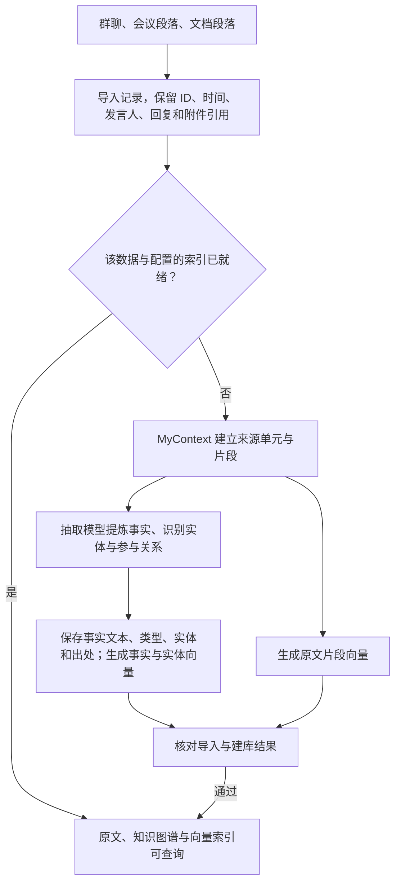
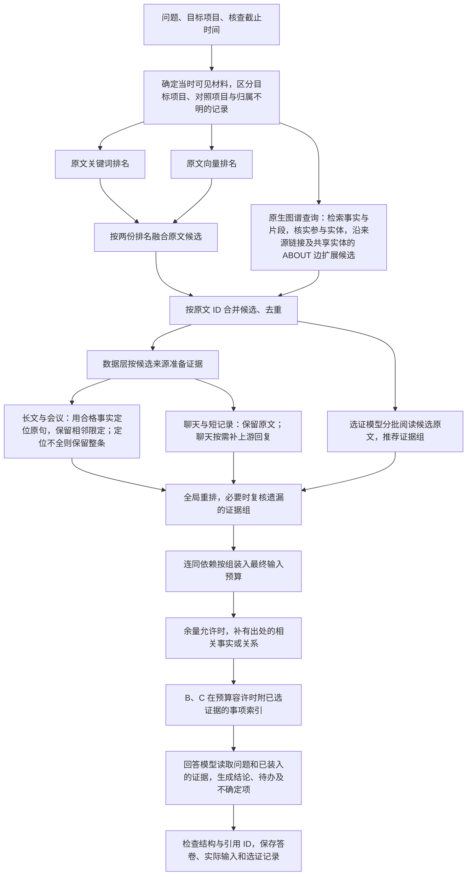
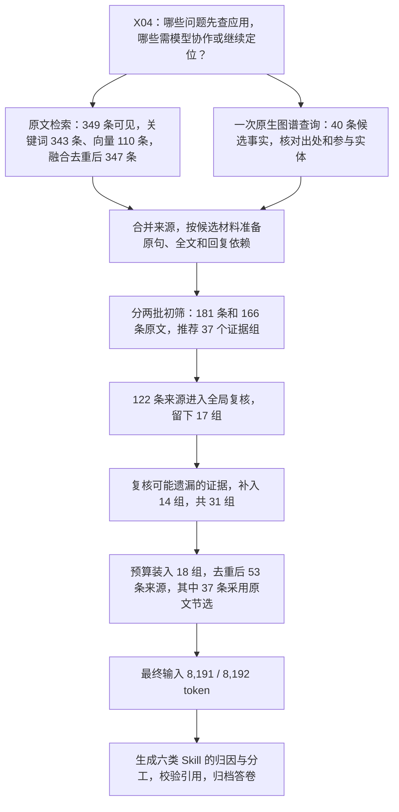
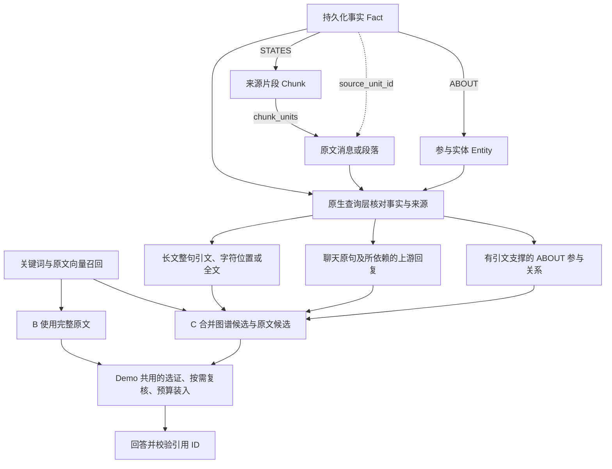
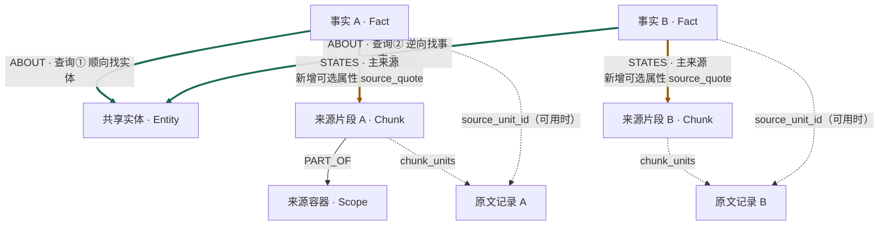
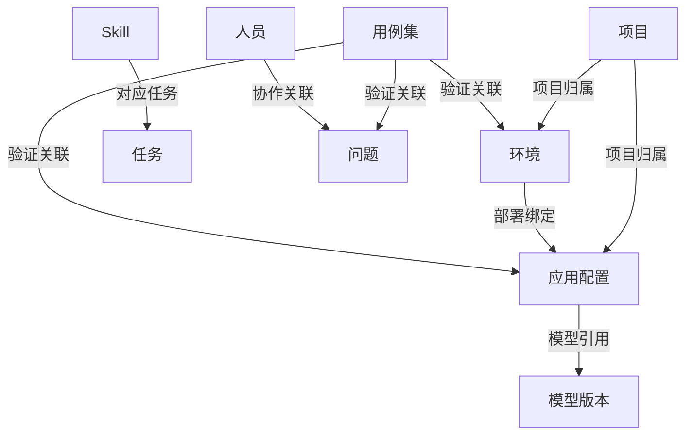
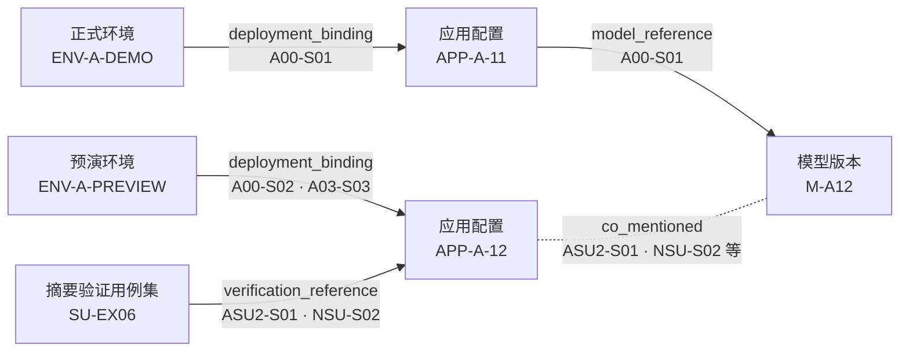
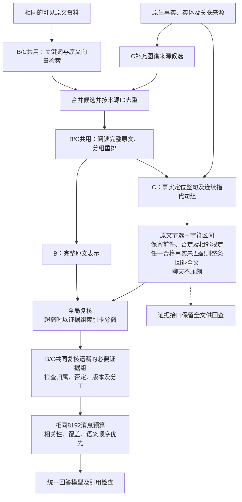

# MyContext 工作图谱增强

本文对照原分析中「三、这些上下文如何存储和持续更新」下的「4．完整工作图谱：节点、边和属性」及其 4.1–4.7 节。原分析和当前工作区使用相同的上游基线 `23c6f609fb1d392f922e19dae7bee174075a2569`。本文最后也简要对照原分析的「四、Agent 如何使用这些信息」。[原分析第 4 节](</mnt/c/Users/jcyli/Downloads/MyContext_主要场景与具体实现分析.md:243>)

## 当前 V5 实现与评测基线（2026-11-23）

当前工作区已恢复到 C 整题通过 **17/20** 的版本。本轮使用 V5 自然表述版的应用核查材料（`app_focus`）。349 条原始记录包括 208 条群聊、120 段文档和 21 段会议记录；原生索引包含 161 个片段、926 条事实、190 个实体和 2,663 条边。回答模型别名为 `chatgpt-codex-default`，原文向量模型为本地 Qwen3-Embedding-0.6B（1,024 维）。B、C 的最终输入预算均为 8,192 token。版本可按该轮清单中的 27 个源码哈希核对。[导入记录](kl-graph/evaluation-artifacts/eval-v5-all20-2026-11-23/import.json) · [配置与源码清单](kl-graph/evaluation-artifacts/eval-v5-all20-2026-11-23/manifest.json)

| V5 正式评测 | B 原文混合检索 | C 企业上下文 |
| --- | ---: | ---: |
| 必要要点得分 | 51/64 | 62/64 |
| 必要要点全部答对 | 12/20 | 18/20 |
| 整题通过 | 12/20 | 17/20 |

按冻结口径 `V5-rubric-1`，整题通过还要求答卷没有与材料冲突或缺乏依据的实质性附加结论。每题先 B 后 C，各运行一次。7 题仅 C 通过，2 题仅 B 通过。这个差距衡量的是事实定位、关联查询、选证与作答共同作用后的端到端结果。单独衡量共享实体查询时，已有两题开关对照：X06 从 2/3 升至 3/3，TR03 两组均为 2/3。X06 的关键来源在两组的复核输入中都出现过，开启查询后才与配套材料一起入选。[20 题正式报告](kl-graph/evaluation-artifacts/eval-v5-all20-2026-11-23/report.md) · [关联查询开关对照](kl-graph/evaluation-artifacts/eval-v5-association-tr03-x06/report.md)

**当前三个失分点。** WR03 的三个要点均答对，另称“未给出修正责任人”，与原文冲突。WR04 得 2/3，能复述历史包版本，却漏写下一轮应核对实际运行的应用包。PO03 得 2/3，区分了两类检查的口径，却漏答两组样例是否重叠及去重后总数未知。当前实现没有针对题号或计数题型的专门补答逻辑。[逐题评分](kl-graph/evaluation-artifacts/eval-v5-all20-2026-11-23/review.csv)

**实验与当前实现的边界。** 后续实验在文档与纪要抽取中增加了 `PROCEDURE` 方法事实，也将“不确定事项”改为绑定问句片段的结构化输出，C 整题通过 9/20。两项改动都已回退。当前仍可讨论 WR03 的通用作答约束，即把“信息缺失”的判断限定在实际核查过的证据范围；这项改进尚待在 17/20 基线上独立验证。WR04 尚无经验证能稳定改善它的通用修复。[实验版报告](kl-graph/evaluation-artifacts/eval-v5-procedures-all20-2026-11-23/report.md) · [WR03 与 WR04 修复分析](WR03与WR04通用修复可行性分析.md)

## 相对原生 MyContext 的修改：数据层与应用层

原生 MyContext 已经能抽取事实和实体，通过 `ABOUT` 记录事实涉及的实体，通过 `STATES` 追溯来源片段，并支持向量检索与图谱查询。相对于上游基线 `23c6f609`，数据层的主要改动是让事实和关系能回到可核验的原文；新增的项目核查 Demo 则决定针对一个问题选哪些证据、怎样装入回答。[图谱设计](kl-graph/docs/graph-design.md)

### 数据层改了什么

| 环节 | 增强版的改动 |
| --- | --- |
| 原文导入与定位 | 为群聊、文档和会议保留来源定位信息。文档可使用来源记录的发生时间，同一场会议的不同段落可保留独立记录 ID，从事实能查回某条消息或具体段落。[来源加载器](kl-graph/kl_graph/ingest/loaders) |
| 新事实抽取与写入 | 抽取提示要求保留交付方向、否定、适用条件和责任依据。引文能在目标正文中唯一匹配时，将逐字引文及字符位置写入主 `STATES` 边。当前评测复用了已建事实库，因此其成绩不能单独衡量新抽取提示的效果。[抽取提示](kl-graph/kl_graph/ingest/llm_extractor.py) · [事实写入](kl-graph/kl_graph/ingest/pipeline.py) |
| 已有事实回查原文 | 核对事实所属记录，用合格事实定位文档和会议的原句，保留必要的相邻限定；定位不全时保留该条全文。聊天保留完整消息，遇到依赖上文的指代时可沿显式回复链补齐。已有的 `/context` 接口增加了 `source_evidence`，其他应用也能读取这些依据。[证据定位](kl-graph/kl_graph/query/fact_evidence.py) · [接口实现](kl-graph/kl_server.py) |
| 图谱关系与关联原文 | 回查命中事实已有的 `ABOUT` 边，用引文和发言身份核实参与实体。沿同一来源、线程、回复或附件联系寻找相关原文时，保留查找路径，便于核验候选记录如何进入查询结果。[关系与来源回查](kl-graph/kl_graph/query/source_graph.py) · [参与实体核验](kl-graph/kl_graph/query/fact_evidence.py) |
| 向量适配 | 向量查询支持可配置的模型指令，当前 Demo 配套使用本地 Qwen3-Embedding-0.6B 的 1,024 维索引。[向量适配](kl-graph/kl_graph/ingest/embedder.py) |

### 应用层改了什么

| 环节 | 新增 Demo 的职责 |
| --- | --- |
| 核查范围 | 接收问题、目标项目和截止时间，确定当时可见的资料，区分目标项目、对照项目和归属不明的记录。[范围处理](kl-graph/project_demo/context.py) |
| B、C 检索方案 | B、C 共用原文关键词和向量检索，融合两路排名。C 额外调用原生 `/ask`，将图谱指向的原文与已有候选按记录 ID 去重，并读取数据层准备的原句和回复依赖。[查询调用](kl-graph/project_demo/context.py) · [候选合并](kl-graph/project_demo/answer.py) |
| 选证与装入 | **分批初筛、生成证据组、全局复核、遗漏复核和按预算装入，均由 Demo 编排。** B、C 共用这段流程。C 在全局复核时还会合入图谱事实及明确关系引用的原文，并在容量允许时附上图谱线索。[选证与预算实现](kl-graph/project_demo/selection.py) |
| 回答与评测 | 回答模型生成项目进展、变化、未决事项、协同及不确定项。Demo 校验引用 ID 是否在实际输入中，保存输入、选证决定与答卷。评测另行核对答案语义，分别记录必要要点和整份答卷的结果。[回答与引用校验](kl-graph/project_demo/answer.py) · [评测入口](kl-graph/project_demo/evaluate.py) |
| 资料与图谱界面 | 数据范围选择器仅展示应用核查材料（`app_focus`）。增加资料来源浏览、记录详情及返回导航，支持查看实体、事实、关系及支撑原文。缺少索引时，界面可用编号和语句生成候选关联；这类浏览关系来自应用侧规则。[上下文浏览](kl-graph/project_demo/context.py) · [前端实现](kl-graph/project_demo/static) |

#### C 的问题修复过程中，应用侧具体改了什么

**按当前保留的 V5 实现，多数修改发生在 B、C 共用的选证和回答流程。** C 单独增加的工作，是把底层返回的事实出处、原文引句和关联路径送到合适的环节。理解两者的分工，可以沿着一条原文从“已召回”到“最终被引用”的过程看。

| 发现的问题 | 应用侧保留的修改 | 生效范围 |
| --- | --- | --- |
| 同一原文可能被多路召回；排在前面也未必能回答问题 | 两条基线检索路径按关键词排名、向量排名融合。C 再合入图谱所指原文，按原文 ID 去重。随后按问句和内容选证，图谱命中本身不占用固定名额。[候选构造](kl-graph/project_demo/context.py) · [合并入口](kl-graph/project_demo/answer.py) | 混合检索由 B、C 共用；图谱来源仅 C |
| 分批时各批只能看到部分材料，某批漏选会让跨记录证据断开 | 初筛把相关原文编成证据组，再跨批全局复核。C 的初筛候选中可以有来自图谱的原文；到全局复核时，还会合入图谱事实和明确关系所引用的原文，因此初筛未推荐的来源也有机会被比较。输入过长时压缩复核材料，保留组内原文 ID。[分批与全局复核](kl-graph/project_demo/selection.py) | 两阶段选证共用；图谱补充仅 C |
| SU04 中，“换文件”和“换候选模型”被归到相同事项，遗漏检查跳过了后者 | 改为按原文 ID 检查。初筛优先级为 2 或 3 的组，只要全局复核未保留其中全部原文，就进入遗漏复核，对照原文判断已选证据能否覆盖同一结论及其条件。恢复的组仍须通过最终预算筛选。[SU04 诊断与固定候选回放](MyContext_C方案诊断与优化.md) | B、C 共用 |
| 一句群聊回复可以说明发生了什么，却不足以说明回复谁、属于哪个项目 | C 读取底层定位好的原文引句和回复依赖，把消息与所需上文一起计算装入成本。AM03 一类归属问题中，若底层追到了有项目归属的附件，应用在预算允许时同时装入对应回复和附件记录，供模型核对。查找回复与附件路径属于数据层。[路径查询](kl-graph/kl_graph/query/source_graph.py) · [应用侧装入](kl-graph/project_demo/answer.py) | C |
| 短消息容易挤掉较长但含有前提、责任或适用范围的材料 | 按组试装，估算包含问题、提示和证据的完整输入。在放得下的组中，依次比较优先级、是否补充新事项或新主题、复核顺序，最后才比较新增 token 成本。C 的额外图谱提示须与问句相关、有已选原文支撑，并能放进剩余预算。[组排序与装入](kl-graph/project_demo/selection.py) · [图谱补充](kl-graph/project_demo/answer.py) | 装入规则共用；图谱提示仅 C |
| 关键条件已经送入回答模型，生成时仍可能漏写 | 预算有余时，为已装入的直接或必要证据附上“主题、事项、原文 ID”索引，提示模型逐项核对影响结论的条件。索引省去选证模型撰写的理由，回答仍引用原文。Demo 校验引用是否出现在实际输入中，并保存选证决定、最终输入和答卷，以便区分选证遗漏、预算淘汰和生成遗漏。[回答构造与引用校验](kl-graph/project_demo/answer.py) · [运行记录](kl-graph/project_demo/app.py) | B、C 共用 |

**SU04 解释了为什么需要同时改选证和回答。** 固定历史候选回放时，改遗漏检查让 C 把“换候选模型须重新验证”的原文送回复核。另一次固定最终原文和顺序的对照中，C 已经拿到这句话，加入事项索引后才明确引用它并答全。最后从检索开始重跑，C 在全局复核就选中了这份登记，得 3/3。三次观察对应不同环节，单看最终得分无法判定是哪一步起了决定作用。[分阶段验证记录](MyContext_C方案诊断与优化.md)

**已撤回的应用侧尝试**也影响对当前方案的判断。

- DeepSeek 阶段曾让 C 完整重读未选原文。在当轮默认五题上，C 平均耗时从 266.39 秒增至 501.38 秒，仍有范围遗漏。当前遗漏复核只对照初筛识别出的重要缺失组与已选证据。[历史成本对照](kl-graph/evaluation-artifacts/eval-v4-deepseek-selection-v2-first-bc-2026-11-21/report.md)
- PO03 的专用计数比较及其应用侧传递逻辑、TR04 的职责与风险配对提示、X01 的预设汇总维度和对象层级均已撤回。AM03 按回复和附件追溯项目的通用能力保留。[题型定制回退记录](MyContext_C方案诊断与优化.md)
- 后续曾要求“不确定项”逐条绑定问句片段和原文引句，同时还改了底层流程事实。该组合版本 C 整卷通过 9/20，随后回退。当前基线为 B 通过 12/20、C 通过 17/20；引用校验只能确认来源进入过模型输入，结论是否得到原文支持仍需语义评判。[组合实验](kl-graph/evaluation-artifacts/eval-v5-procedures-all20-2026-11-23/report.md) · [当前基线](kl-graph/evaluation-artifacts/eval-v5-all20-2026-11-23/report.md)

### 两类关联查询如何找原文

一种查询沿同一文档、会话线程、显式回复或附件引用找相关记录，保存来源之间的路径。对项目归属不明的聊天，还可沿同线程回复追到归属明确的附件；回答阶段把归属依据与对应消息一起核算预算。[来源扩展与附件归属](kl-graph/kl_graph/query/source_graph.py) · [归属材料装入](kl-graph/project_demo/answer.py)

另一种查询实际沿两条持久化的 `ABOUT` 边查找共享实体的事实。从最多 16 条种子来源起步，仅考虑活跃的非人员实体；实体名称须同时出现在两端各自的事实与原文中，且参与边通过引文核验。关联事实超过 64 条的实体跳过，以免宽泛主题带回大量无关材料。结合实体数、问句与事实的字面相关性、种子来源数及原文混合检索排名，最多选 8 条目标来源。查询路径记录在 `coverage.graph.associated_fact_paths`。这条路径可以解释两份材料为何被放在一起；责任、因果及验收结论仍须回到原文判断。[共享实体查询](kl-graph/kl_graph/query/associated_sources.py) · [Demo 调用与记录](kl-graph/project_demo/context.py)

### V4 历史实例：用 X04 和 X07 看两层如何配合

- **X04：数据层找到原句，Demo 把它装入回答。** `A04-S04` 有 278 字，库中对应 7 条事实。其中 2 条用于定位同一段 45 字原文，最终被 C 引用。另看全题候选，初筛推荐了 101 条不同原文，Demo 利用图谱出处补回 21 条，让 122 条进入全局复核。这是对整题的统计，与单条记录的引文定位分别计数。[X04 完整问答过程](MyContext_X04完整问答过程.md)
- **X07：证据已找到，在最终装入时落选。** C 的重排识别了候选包上已有润色局部回归的证据，但对应证据组因预算落选。回答模型随后把输入中缺少材料扩大为“缺少回归证据”。B、C 对题库三个必要要点均得 3/3；复核整份答卷时，B 通过，C 因这项额外误述未通过。[X07 证据流转与评语](kl-graph/evaluation-artifacts/eval-native-evidence-second-bc-2026-11-22/report.md)

因此，B/C 结果衡量的是两者共用 Demo 选证与回答流程时，C 接入事实、图谱及原文依据后的端到端表现。定位成败时，可分别核对数据层找到了什么、Demo 最终装入了什么，以及回答实际引用了什么。

## 原生事实如何进入当前 C 的回答

### 方案 C 全流程

**建库保存原文、抽取事实和出处。每次提问时，系统检索原文与图谱，在候选材料中定位证据，再让回答模型依据实际装入的原文或节选作答。** 建库的抽取、查询时的证据选择、最终生成是三个不同环节。

#### 一、资料怎样进入企业上下文

事实可以改写或拆分原句。数据库通过 `STATES` 将事实连到来源片段，通过 `ABOUT` 将事实连到参与实体。新抽取若提供能在目标正文中唯一匹配的引文，还会保存原话与字符位置。当前演示复用已建好的 ChatGPT 事实库和本地 Qwen3-Embedding-0.6B 的 1,024 维索引。实体会做名称归一，本次导入关闭了周期性实体消歧。[建库入口](kl-graph/project_demo/runtime.py) · [抽取引文的落库逻辑](kl-graph/kl_graph/ingest/pipeline.py)

#### 二、一个问题怎样变成带引用的回答

- **两条召回路径。** B、C 共用关键词与原文向量的倒数排名融合（RRF）。C 还通过原生 `/ask` 取得图谱候选，回查事实来源和参与关系。图谱可以带来原文检索漏掉的来源；同一来源在两条路径上命中时只保留一份，图谱命中本身不额外加分。图中的分支表示信息来源。[查询入口](kl-graph/project_demo/app.py) · [原生图谱回查](kl-graph/project_demo/context.py) · [融合与装入](kl-graph/project_demo/answer.py)
- **按来源准备引文。** 系统批量读取与候选原文关联的事实。在至少 160 个字符的非聊天记录里，状态、决策、待办等业务事实，以及含业务编号的事实，可用于定位。多条事实可命中同一句。一条记录有合格事实定位失败时，就保留该记录的全文供后续选择。聊天保留原话，遇到指代时沿明确的回复关系补上下文。[原文定位与回退](kl-graph/kl_graph/query/fact_evidence.py)
- **选证与预算。** 分批初筛读候选原文。跨批复核可使用事实定位的节选和有依据的图谱提示。重排窗口不足时可用分组笔记辅助排序，最终证据来自原文。初筛优先级为 2 或 3 的组，只要全局复核后有来源落选，就对照已选原文核实其结论及成立条件是否已覆盖。单组与已选原文合计仍超出复核窗口时，原组保留到预算装入阶段。最后按优先级、覆盖情况与剩余空间装入证据组。当前评测的最终输入预算上限为 8,192 token，包含提示和问题。[重排及遗漏复核](kl-graph/project_demo/selection.py)
- **事项索引。** 完成装入后，B、C 取已选且优先级至少为 2 的证据组，预算允许时将其 `topic`、`aspects` 和原文 `ids` 作为 `evidence_index` 附入最终请求。回答模型借此核对条件，事实依据仍来自原文。初筛或复核时生成的 `reason` 不在该索引中。[事项索引与提示](kl-graph/project_demo/answer.py)
- **回答与核验。** 最终模型输出进展、变化、未决问题、协同事项和不确定项。前四类逐项检查文本、时间字段格式和引用 ID；引用必须来自实际输入。`uncertainties` 接受字符串数组，当前只校验该字段的格式。判断引文是否足以支持结论、是否漏掉关键限定，仍属于语义评审。[生成与记录](kl-graph/project_demo/app.py) · [引用校验](kl-graph/project_demo/answer.py)

#### 三、V4 历史实例：X04 从提问到答卷的实际过程

> 哪些应用问题已有证据优先由应用处理，哪些需要模型协作或继续定位？

核查对象是项目 A，材料截点是 2026-11-20 23:59（北京时间）。本次直接使用已建好的事实库与索引。下图中的数量取自同一份 C 运行记录。[实际模型输入、输出及选证日志](kl-graph/data/project_demo/v4-longform-runtime/runs/01198eee-a212-45da-89ec-8d001c238de8.json)

**跟踪一份原文。** 《问题样本接收登记》的 `A04-S04` 有 278 字，事实库中对应 7 条事实：1 条状态、1 条决策和 5 条一般事实（`GENERAL`）。5 条一般事实分别描述如何定位触发请求、核对选路与派发、区分日志缺失与未执行、补齐链路记录，以及只有界面表现时如何记录现象。X04 用于定位原文节选的是下表中的 2 条，表中省略日期前缀。

| 类型 | 库中事实文本 |
| --- | --- |
| 状态 STATUS | 隐式摘要漏调仍需比对模型选路与应用派发记录。 |
| 决策 DECISION | 模型表现异常而输入链路记录不完整时，不指定唯一根因。 |

查询时，两条事实定位到同一条原文的字符区间 `[145, 190)`。回答模型实际读到的 45 字如下。

> 隐式摘要漏调还需比较模型选路与应用派发记录；模型表现异常但无完整输入链路时不指定唯一根因。

初筛把它与 `ASU0-S02`、`ASU0-S04`、`ASU1-S04` 放在同一组。该组在全局复核时已经保留，之后按优先级 3 成功装入。模型引用这四条来源，答出隐式摘要仅 2/4 进入 Skill，需要比较选路和派发记录；另一个已经进入 Skill 的样例仍有语义问题，需要输入、输出及裁剪记录供模型侧分析。本次 B 也找到了 `A04-S04`，其所在组在装入时因预算落选。C 的两次分批初筛均命中重排缓存，全局重排和遗漏复核各实际调用一次。[B/C 原始选证决策及答卷](kl-graph/evaluation-artifacts/eval-native-evidence-remaining-bc-2026-11-22/runs.jsonl)

**最终业务回答（按六类归纳）。** 原答卷以进展、变化、未决事项、协同和不确定项输出，下面按用户问的处理责任重排。

| 事项 | 原答卷给出的处理判断 | 代表性引用 |
| --- | --- | --- |
| 翻译 | Word 排版及加密附件的中文提示优先查应用。异常发生在调用回答模型之前。译义错误、无依据补内容需要应用补期望答案和判定说明，再交模型侧分析。 | ATR1-S03、ATR2-S03、ATR0-S04、D09-S03 |
| 摘要 | 隐式漏调要核对模型选路和应用派发。已进入 Skill 却丢失条件或否定的内容问题，交模型侧结合输入、输出及裁剪记录分析。 | ASU0-S04、ASU1-S04、A04-S04 |
| 早报 | 先由数据和应用核查快照、同步与查询范围。截止前的 07:50 消息后来可检索，原稿仍用旧快照，需重跑验证。 | AAM1-S04、AAM2-S03 |
| 公函 | 无依据的文号来自模板默认值，由应用修。签署字段为空而模型原始输出补出签署人，需要模型分析，应用补输出检查，前方确认真实字段。 | ALE1-S04、ALE1-S03、ALE2-S04 |
| 周报 | 请求查 11 月 16–20 日，实际从 11 月 1 日取数且只查文档。模型没有收到 IM-W19，先修应用查询窗口和消息来源，再复查风险结论及引用。 | AWR1-S03、AWR2-S03、AWR2-S04 |
| 润色 | 否定和条件回归未完成。模型侧分析约束保留失败的样例，应用补事实差异检查，测试逐项比对源文。 | APO0-S04、APO1-S04、APO2-S02 |

程序校验了引用 ID 是否全部出现在实际输入中。随后对照三项参考要点进行语义复核，C 为 3/3，B 为 2/3。差异在隐式摘要漏调的归因边界。本次图谱检索参与了证据组织，最终提示额外附入独立事实 0 条、关系 0 条；回答模型使用了带出处的原文和节选。[逐项评语](kl-graph/evaluation-artifacts/eval-native-evidence-remaining-bc-2026-11-22/review.csv) · [X04 复核报告](kl-graph/evaluation-artifacts/eval-native-evidence-remaining-bc-2026-11-22/report.md)

### 事实、关系与原文的对应

C 在项目和截止时间允许的材料中，用原生事实定位原文，用原生 `ABOUT` 边核对参与实体，再将可引用的材料交给 Demo。上述 V4 实例沿用 ChatGPT 已抽取的 965 条事实、182 个实体和 3,013 条边。此次线上验证复用了该库，新抽取规则的效果须与已有库的查询效果分别看待。[图谱设计](kl-graph/docs/graph-design.md) · [建库记录](kl-graph/evaluation-artifacts/eval-native-evidence-first-bc-2026-11-22/import.json)

| 环节 | 当前实现 |
| --- | --- |
| 写入新事实 | 抽取提示要求保留交付方向、否定和条件，执行人需由目标原文点名或本人承诺。逐字引文在抽取目标正文中唯一匹配时，将 `source_quote` 及字符区间写入主 `STATES` 边。 |
| 读取已有事实 | 用 `source_unit_id` 与 `chunk_units` 核对来源，旧库也能在查询时定位引文。文档、会议中连续指代句和相邻限定可一起保留；一条候选来源中有合格事实定位失败，就使用该来源全文。聊天保留整条原话，沿明确的回复链补足指代，分别记录发言人和出处。 |
| 形成关系 | 对命中事实回查库中已有的 `ABOUT` 边，包括被有限查询视图裁掉的参与节点。问答侧仅采用能在引文中核实的参与关系；人员还要能用唯一发言身份和该来源对应。上下文不足的事实保留可见引文并标记状态，跳过其参与关系。 |
| Demo 消费 | C 读取上述节选与回复依赖，按证据组计入与 B 相同的预算。B、C 共用分批选证、全局排序及有条件的遗漏复核。侧栏在原生索引就绪时浏览原生数据，缺索引时可用编号和句式浏览业务关联。 |

例如，群聊中“我补这两列”这句话的责任人取自该条消息的发言人，两列指什么和涉及哪个样本包则需分别回看上游消息。离线检查记录了 `T08-04 → T08-03 → T08-02` 三个出处。原生 `POST /context` 可按单条事实查看这些依据；Demo 通过同一查询库按本轮候选批量读取节选和回复依赖。[原生证据实现](kl-graph/kl_graph/query/fact_evidence.py) · [来源与参与实体](kl-graph/kl_graph/query/source_graph.py) · [离线记录](kl-graph/evaluation-artifacts/native-evidence-offline-2026-11-22/checks.json)

在这轮 V4 默认五题中，端到端实测为 **B 完整 1/5，C 完整 4/5**。X01 的六份分工材料均进入两边的候选和排序结果。最终 B 装入 28 条来源，六份分工均落选；C 装入 54 条，其中 38 条为事实定位的节选，六份分工全部被引用。该题 C 最终另附的事实和关系条数均为零。可直接观察到的是同一预算内保留的证据更完整，事实定位、图谱召回和排序各自贡献了多少仍待单独对照。[五题报告与判分依据](kl-graph/evaluation-artifacts/eval-native-evidence-first-bc-2026-11-22/report.md)

## 逐节对照

| 原分析 | 原生 MyContext | 当前工作区的差别 |
| --- | --- | --- |
| **4.1 图谱范围** | 介绍通用 `kl-graph` 的逻辑模型和默认 Ladybug 结构。 | 增加面向项目 A 的核查视图。Demo 将所选资料集里的群聊、文档和会议段落导入同一独立图库，按资料范围查询。 |
| **4.2 核心结构** | `Fact → ABOUT → Entity` 表示「涉及谁或什么」，具体业务动作通常由 `Fact.text` 表达。`STATES` 可回到 `Chunk`。 | C 问答回查事实的原生参与实体及带字符位置的引文。原生事实经 `source_unit_id` 和 `chunk_units` 对账后，可定位到单条消息或具体段落。 |
| **4.3 相似关系与社区** | 有实体相似、事实相似、可选的 L0–L3 社区。社区默认关闭。 | Demo 导入时设置 `improve_mode=off`。无索引浏览视图从原文的编号、别名和语句生成候选关联。 |
| **4.4 节点及属性** | 原生五类核心节点为 `Entity`、`Fact`、`Chunk`、`Scope`、`Community`。 | 无索引浏览视图可区分 Skill、任务、用例集、问题、配置等对象。当前持久化增强体现在主来源边的可选引文属性。 |
| **4.5 边及属性** | 枚举定义 12 个边名，默认 Ladybug 声明其中 10 个关系表。 | 无索引浏览视图可输出 `skill_task`、`deployment_binding`、`verification_reference` 等关系。每条带端点、关系类型、原文 ID 和识别标记。多个对象在同一语句出现且规则无法判明具体关系时，显示为 `co_mentioned`。 |
| **4.6 实例** | 用「张三调整项目验收日期」举例，沿 `Fact → Chunk → Scope` 回查。 | 下面用 V3 资料中的环境与配置关系展示实际输出，并能打开支撑判断的原文段落。 |
| **4.7 模型边界** | `SourceUnit`、`ChunkUnit` 等是导入和追溯结构。 | Demo 继续利用这些结构。兼容补丁增加了文档的可信原文时间、同一会议下的独立段落 ID，以及消息或段落的来源定位。 |

[原分析 4.1–4.7](</mnt/c/Users/jcyli/Downloads/MyContext_主要场景与具体实现分析.md:245>) · [关系生成规则](kl-graph/project_demo/context.py) · [原生事实到原文的映射](kl-graph/project_demo/context.py) · [原生导入配置](kl-graph/project_demo/runtime.py) · [会议段落加载](kl-graph/kl_graph/ingest/loaders/minutes_loader.py) · [文档时间加载](kl-graph/kl_graph/ingest/loaders/wiki_loader.py)

原生查询代码核对事实的来源单元是否属于对应片段。Demo 提供当前资料范围内可见的消息或段落。若事实缺少来源单元，只在片段恰好对应一条原始记录时回退；有多条记录且无法精确定位的候选事实会跳过。对照材料可保留给回答模型，明确仅属于其他项目的事实会从核查事实候选中排除。[精确来源检查](kl-graph/kl_graph/query/source_graph.py) · [项目范围筛选](kl-graph/project_demo/context.py) · [V3 原文定位校验](kl-graph/project_demo/dataset.py)

## 增强后的图谱结构

### 方案 C 使用的原生工作图谱

**方案 C 在同一张原生工作图谱上扩展了两处：写入时给主来源边增加可选的原文引证，查询时沿已有参与边找出相关事实，并核对两端的原文。** 与上游基线 `23c6f609` 相比，`Fact`、`Entity`、`Chunk`、`Scope` 以及下图的边类型均为原生定义。图中只展开与这两处增强有关的路径。[原生模型](kl-graph/kl_graph/models/types.py) · [底层改动清单](MyContext底层相对原生版的增强清单.md)

**读图时，实线箭头一律表示库中原生边的方向。** 绿色 `ABOUT` 边上的①②标出增强查询的读取顺序；尤其是②，库存方向仍是“事实 B → 实体”，查询从实体反查指向它的事实 B。棕色 `STATES` 边标出写入增强的位置。虚线表示原生的来源字段和片段成员映射，用来核对事实对应的消息或段落。

| 在原图上的位置 | 增强版具体做什么 |
| --- | --- |
| **写入：事实 → 主来源片段** | 抽取时要求给出带条件和否定的支持原句；程序确认它在目标正文中逐字且唯一匹配后，在主 `STATES` 边上保存 `source_quote`，内含 `quote`、`start`、`end`。无法唯一匹配时，只保留片段出处。[抽取提示](kl-graph/kl_graph/ingest/llm_extractor.py) · [建边实现](kl-graph/kl_graph/ingest/pipeline.py) |
| **查询：事实 A → 实体 ← 事实 B，再回到两端原文** | 新查询沿两条已有 `ABOUT` 边寻找共享非人员实体的事实，再利用两端各自的来源核验参与关系，返回可复查的路径。查询时还可按已定位的事实给出原文节选、限定句和聊天回复依据。图里的 A、B 无需另存一条直接关系。[共享实体查询](kl-graph/kl_graph/query/associated_sources.py) · [来源核验](kl-graph/kl_graph/query/source_graph.py) · [原文节选](kl-graph/kl_graph/query/fact_evidence.py) |

以 X06 的实际记录读图：从来源 `AWR2-S02` 中的事实出发，沿①找到消息实体 `IM-W19`，沿②反查来源 `AWR2-S03` 中的事实，后者说明最终模型没有收到这条消息。两份材料被关联起来的依据是它们指向同一条消息；要判断消息是否已入索引，还需读取直接说明索引状态的 `XWR1-05`。[X06 关联路径与原文对照](kl-graph/evaluation-artifacts/eval-v5-association-tr03-x06/report.md)

## 上下文查看页在缺少索引时怎样展示资料

索引就绪时，“上下文查看”读取上述原生库；方案 C 的图谱查询也使用这个库。索引未就绪时，浏览页仍可扫描已导入的原文，按编号、别名和句式临时列出候选实体与关联，点击条目可回看依据。此时事实列表为空。候选关联仅用于浏览，不写回原生库；方案 C 仍要求原生索引就绪，不会切换到这些候选关系作答。[浏览页的数据来源](kl-graph/project_demo/context.py) · [方案 C 的索引就绪检查](kl-graph/project_demo/app.py)

### 缺索引时页面可识别的关系方向

每条箭头表示代码可识别的一种端点组合，按具体原文生成实例。以 `verification_reference` 为例，它表示用例集与问题、配置或环境存在验证关联，是否通过需回看原文。其他同句对象可形成 `co_mentioned`，其端点顺序只用于去重。[关系方向及匹配条件](kl-graph/project_demo/context.py) · [共同提及去重](kl-graph/project_demo/context.py)

### V3 缺索引浏览示例

- `ENV-A-PREVIEW → APP-A-12` 可回查 `A00-S02` 和 `A03-S03`。`ENV-A-DEMO → APP-A-11` 可回查 `A00-S01`。发布核对记录还提及项目 B 的 `APP-B-12`，因此核查时需保留项目、环境和应用包三个条件，才能判断变更是否已经落到所问环境。[应用运行登记](</mnt/c/Users/jcyli/Downloads/项目A_Demo应用增强数据_v3/corpus/documents/A00_应用运行登记.md>) · [候选配置发布核对](</mnt/c/Users/jcyli/Downloads/项目A_Demo应用增强数据_v3/corpus/documents/A03_候选配置发布核对.md>)
- `SU-EX06` 通过验证关联指向 `APP-A-12`。两条摘要记录也提到 `M-A12`，图中以虚线表示规则识别到的共同提及。[文档摘要回归记录 ASU2-S01](</mnt/c/Users/jcyli/Downloads/项目A_Demo应用增强数据_v3/corpus/documents/ASU2_文档摘要回归记录.md:9>) · [摘要联调纪要 NSU-S02](</mnt/c/Users/jcyli/Downloads/项目A_Demo应用增强数据_v3/corpus/meetings/NSU_文档摘要联调议题摘录.md:13>)
- 别名和同名对象也用来源限定。`SK-TR` 有「文档翻译」「翻译线」和 `doc-translator` 等显式别名，联调纪要把它关联到 `CASE-T17`。应用林工 `U21` 与模型林工 `U26` 按资料中明确的角色和编号分别识别。该规则适用于这类带标识的资料，只有「林工」时仍需更多依据。[Skill 任务登记](</mnt/c/Users/jcyli/Downloads/项目A_Demo应用增强数据_v3/corpus/documents/A02_应用Skill任务登记.md>) · [翻译联调纪要](</mnt/c/Users/jcyli/Downloads/项目A_Demo应用增强数据_v3/corpus/meetings/NTR_文档翻译联调议题摘录.md>) · [角色协作登记](</mnt/c/Users/jcyli/Downloads/项目A_Demo应用增强数据_v3/corpus/documents/A01_应用角色协作登记.md>)

对 `app_focus` 的 349 条原文重算，应用层图谱得到 **84 个实体、101 条关联**。其中 **84 条是共同提及**，**17 条是由句式规则识别的业务关联**，包括 6 条 Skill–任务、3 条模型引用、3 条验证关联、2 条部署绑定、2 条项目归属和 1 条协作关联。`clause_reference` 记录的是规则识别方式。验证是否通过、审批是否生效、谁实际承担责任，仍需读对应原文。这些数字是早期V3模拟资料的应用层输出。V5 正式评测使用的原生图谱规模见文首。[实体与关系计算](kl-graph/project_demo/context.py) · [工作台列表查询](kl-graph/project_demo/context.py)

## 与「四、Agent 如何使用这些信息」的关系

项目核查的 C 方案调用原生 `/ask` 获取事实和片段候选，关闭该接口的最终答案合成。原生查询代码在 Demo 提供的资料范围内返回精确引文、回复依赖及有据的参与关系。Demo 将入选原文交给统一回答模型，并可用剩余预算附加有来源的事实与关系。“方案对比”页和本轮正式评测使用 B 原文检索、C 企业上下文。“项目核查”页单次提问时还可选择 A 全量原文。原分析中个人画像和数字分身的供给链路属于另一部分，本次工作集中于项目证据核查。[原分析第四章](</mnt/c/Users/jcyli/Downloads/MyContext_主要场景与具体实现分析.md:473>) · [C 方案查询](kl-graph/project_demo/context.py) · [核查和引用校验](kl-graph/project_demo/app.py)

## 历史版本的证据处理及验证（2026-11-21）

本轮定位到五个问题：UTF-8字节上界挤压中文输入、全局复核超窗被跳过、短句按成本优先挤掉完整说明、C事实只能在完整原文后追加，以及回答遗漏必要限制。B/C共同修正分词估算、全局复核回退、相关性与覆盖优先的装入策略和回答完整性要求。C额外把已提炼事实用于定位紧凑原文，先构造节选再计入预算，详见[根因诊断](MyContext_C方案诊断与优化.md)。

这是查询与证据处理流程图，不是持久化图谱新增边。索引卡只用于排序，不能冒充回答证据；C节选由原文直接截取，不能把抽象事实改写成假引文。另附事实仍按原有证据与剩余预算规则筛选。

同一数据、模型和预算下，默认TR04、AM03、PO03、X01、X03各跑BC一次：B完整3/5、部分2/5，C完整5/5，无A、失败或重试。C平均最终消息4163.2 token，B5956.2，少约30.1%；X01中C保留51条来源，B29条。24项相关测试及7个子测试通过。完整判定为助手逐要点语义复核，非独立盲评；不能外推到全部问题。C本轮最终显式关系文本为0，增量主要体现为事实支持的证据压缩，尚未单独证明关系推理增益。[完整报告](kl-graph/evaluation-artifacts/eval-v4-c-repair-bc-2026-11-21/report.md)

## 当前实体消歧的启用范围

**已使用基础身份识别与上下文辅助，但未启用原生完整实体消歧流程。**

| 机制 | 当前状态与边界 |
| --- | --- |
| 抽取阶段上下文辅助 | LLM提示要求使用完整名称、处理明确真名/别名形式，并结合聊天元数据解析代词。属于抽取要求，不保证每次判断正确。 |
| 原生名称归一与去重 | `normalize_entity_name`去首尾空白并转小写，`entity_id_from_name`按归一名称生成ID，相同名称合并。这不是可靠的同名不同人识别；当前ID不含项目或组织命名空间。 |
| 无索引浏览视图中的显式编号/别名 | 从明确登记中关联`SK-TR`、`doc-translator`等名称；通过`U21 应用林工`与`U26 模型林工`区分人员，含糊的裸称“林工”没有可靠规则归属。 |
| 问答中的人员参与关系 | 原生查询核对发言姓名、稳定身份标识和主来源。可见范围内同名对应多个身份时，省略无法归属的人员关系。 |
| 原生周期消歧 | 有拼音、字符、向量和结构等候选信号及LLM判断，输出带置信度的`ENTITY_SIMILAR`边，不直接硬合并节点；当前Demo未启用。 |

代码依据：Demo导入在[runtime.py](kl-graph/project_demo/runtime.py)明确设置`improve_mode=off`；完整消歧位于[entity_disambiguation.py](kl-graph/kl_graph/periodic/entity_disambiguation.py)，由周期优化调用。[名称归一](kl-graph/kl_graph/ingest/pipeline.py)与[应用层编号/别名](kl-graph/project_demo/context.py)属于另外两层机制。

V5 当前索引中有 921 条 `ABOUT` 边、926 条 `STATES` 边，`ENTITY_SIMILAR` 为 0。沿共享实体查证是使用已有参与边的查询操作，运行时无需周期消歧。[关联查询实现](kl-graph/kl_graph/query/associated_sources.py)

对历史 V4 运行库`graph-abc47ce2060b88a7/knowledge.db`只读核查：182个实体、3013条边，边类型为ABOUT、AUTHORED_BY、MENTIONS、PART_OF、REPLY_TO、STATES、TEMPORAL，`ENTITY_SIMILAR`为0。2026-11-21 旧版第一梯队的 C 5/5 和 2026-11-22 V4 第一梯队的 C 4/5 都是在周期消歧关闭时取得的。后续若要处理跨群简称、同名人员、无编号对象，需要专门验证候选关联和误合并；本次仅核实与记录，没有启用或重建消歧流程。

## V4 历史第二梯队验证（2026-11-21）

同版实现继续运行固定SU04、LE03、WR04、X05、X07五题，B完整5/5，C完整3/5，后者在LE03、X05部分答对；无A、失败或重试。与第一梯队合并，10题完整回答率两组均80%，不能把第一梯队优势解释为稳定整体优势。C平均最终消息仍比B少18.1%。

LE03暴露全局重排会丢弃已召回的关键正式版本证据；X05则是原生事实正确，但“所有编号须在同一句”的原文定位规则丢失含“该包”指代的未入包句。这说明事实提炼、原文节选和语义完整性必须分别验证：精确字符出处与更多来源不能保证关键限定保留。本轮没有开启原生实体消歧，也未在测试中修复这两处新问题；后续需验证跨句指代、必要限定覆盖和全文回退。[完整对照与复现](kl-graph/evaluation-artifacts/eval-v4-second-tier-bc-2026-11-21/report.md)

## V4 历史验证：事实保真与必要证据保护（2026-11-21）

跨句事实现在回查连续原文句组；任一合格业务事实无法可靠定位则使用完整原文，`fact_projection_audit`记录未匹配原因。全局重排后B/C共同进行必要遗漏复核，装入不再奖励粗粒度事项标签数量，而按必要性、覆盖与语义顺序在相同预算内选证。流程图已同步，持久化图谱schema及实体消歧状态未变。

**第一梯队B完整4/5、C完整5/5；第二梯队B完整5/5、C完整5/5；合并10题B完整9/10、C完整10/10。** 两个第二梯队原失分均修复。X01显示C的事实驱动节选在同预算保留更多必要原文，C平均最终消息比B少7.1%。该结果支持本组回归中的有效增量，尚不证明独立关系推理或普遍模型优势；原生漏抽事实与复杂指代仍是边界。24项针对性测试通过，未运行A。[完整修复与两梯队报告](kl-graph/evaluation-artifacts/c-fidelity-repair-2026-11-21/report.md)。

## 历史 DeepSeek 实验的初筛遗漏修复（2026-11-21）

> 成本纠正（2026-11-21）：全面重读未选原文的方案未通过成本收益验证，已从默认业务路径撤下，仅保留显式诊断入口。评测调度与Demo服务已停止，不再自动发起模型测试。v2仅完成C的TR04、AM03、PO03，X01/X03中断，B未提交；不能据此给出五题或B/C对照结论。独立分批和提示改进仍保留，但低成本替代方案尚未验证。 [停止记录](kl-graph/evaluation-artifacts/eval-v4-deepseek-selection-v2-first-bc-2026-11-21/report.md)。

> 模型切换补充（2026-11-21）：当时 Demo 切换为DeepSeek `deepseek-flash`/`high`，embedding保持Qwen0.6B/1024维，按用户要求在独立目录复用ChatGPT事实和图谱，该轮为“ChatGPT建图＋DeepSeek查询/回答”。本文9/10与10/10等成绩均为此前ChatGPT版本，不代表DeepSeek成绩。[接入配置与验证](kl-graph/evaluation-artifacts/deepseek-switch-2026-11-21/report.md)。

> **DeepSeek high 默认五题已完成（2026-11-21）：C为2/5完整、3/5部分，B为3/5完整、2/5部分；必要要点均16/19，技术失败均0。** C在X01责任分工上更完整，但PO03未明确样例重叠未知；两者在X03均遗漏部分修补验证范围。本轮不能证明C优于B。C的X01/X03关键来源已召回，却在初筛被丢弃，最终输入预算尚有余量；下一步应检查初筛覆盖与遗漏复核，而非直接归因于embedding维数。当时只完成验证及定位，未修改冻结实现或重新生成答卷。 [本轮逐题结果与诊断](kl-graph/evaluation-artifacts/eval-v4-deepseek-high-first-bc-2026-11-21/report.md)。

### 原因补充

切换模型时，选证窗口由32768扩大为131072，预留输出也改变，可用初筛输入从约3.1万扩大至6.55万。两版五题各方案的候选集合一致，但原来两批阅读变为一批。X01/C的初筛从40组、84条独立来源降为6组、27条来源；X03/C从36组、63条来源降为13组、33条来源。这是模型与分批配置共同变化的观察结果，不能仅归因于模型能力，也没有证据支持把已召回材料的遗漏归咎于embedding维数。

### 已实现的共同改动

- 将每批初筛输入与模型上下文分开：新增`DEMO_SELECTION_BATCH_TOKENS`，默认24000；最终输入仍8192，DeepSeek思考与输出上限仍65536。
- 移除“每批最多20组”的固定限制；按必要事实形成组，保留具体范围、必要动作和执行状态，不能把对象名称覆盖当作事实覆盖。
- 新增`candidate_coverage`：对所有初筛未选来源，使用完整原文复核必要性；补入证据再经过统一全局排序、原有遗漏审计和最终预算装入。B/C规则一致，不使用参考答案、题号或预设来源ID。
- 初筛和新增复核的独立批次最多两路并发，合并顺序仍按原批次排列；每次请求保留用量、缓存、结构校验和来源记录。
- 新增未选ID与已复核ID集合审计，以及找回初筛漏掉动作、窗口扩大不改变批次上限、复核指令开销触发重新分批等测试。相关33项测试通过，最终测试命令排除2项A测试。

本轮同时调整分批和遗漏保障，验证用于评估整套修复效果，不是单因素消融。只验证默认五题，先全部C、再全部B；历史事实与图谱不重建，模型和最终输入预算不变。新增复核增加模型调用，耗时和用量与正确率一并报告。

该轮中间记录见[本轮记录](kl-graph/evaluation-artifacts/eval-v4-deepseek-selection-repair-first-bc-2026-11-21/report.md)。修改前DeepSeek为C2/5、B3/5，均16/19要点；不能把实现完成等同于修复已通过业务验证。

第一轮修复C为3/5完整：X01关键原文已保留，但回答当前状态与未知项不一致；X03去重局部验证来源被新增复核找回后仍在全局复核丢失。因此停止继续提交该版B，保留已在途TR04-B，并在v2对B/C共同补充整体判断的逐项验证范围要求和当前状态/未来安排一致性要求。[v2重新验证](kl-graph/evaluation-artifacts/eval-v4-deepseek-selection-v2-first-bc-2026-11-21/report.md)。
