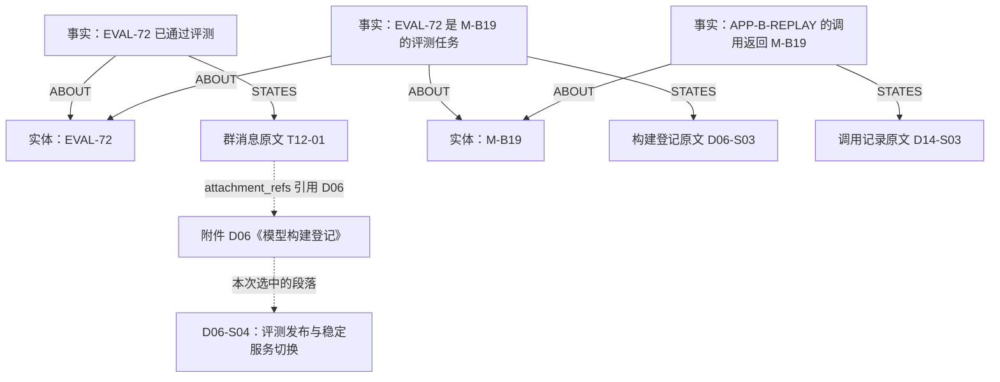
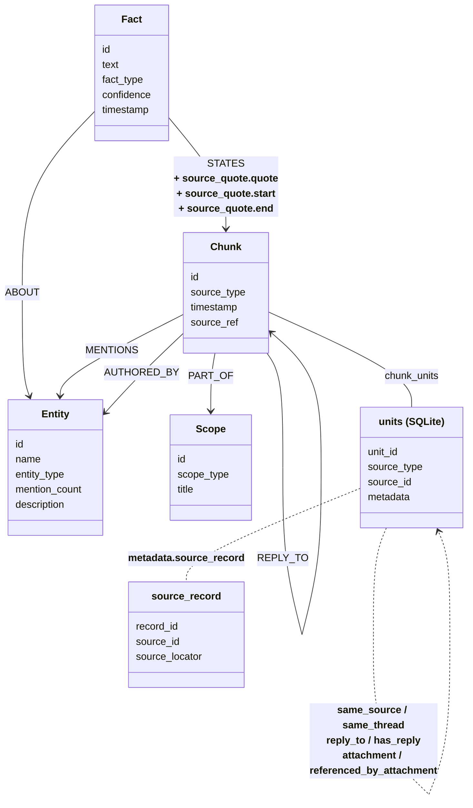

# 企业上下文能力验证

## 1. 验证思路

在项目核查场景中，业务人员经常需要判断“这次交付能否放行、还有哪些前提未满足、由谁跟进”。本实验要验证：在原文检索的基础上，加入事实抽取与定位，能否让这些判断更准确？在已有事实的基础上，加入图谱召回与关联，能否进一步改善判断？

**核查问题 → B、F、G 各自提供证据 → 按预先固定的规则在相同预算内装入 → 同一回答模型每组作答一次 → 业务人员匿名评分。**

| 作答流程 | B 提供给回答模型 | F 提供给回答模型 | G 提供给回答模型 | 对照回答的问题 |
|---|---|---|---|---|
| 简化流程 | 与问题相关的原文段落 | 原文段落，以及通过事实检索定位到的引句和出处 | F 的证据，以及图谱召回的材料、关联路径、匹配依据和两端原文 | 在相同输入上限下，哪种证据能让业务人员得到更准确、有出处的核查结论？ |

三组逐题使用同一问题、相同范围内的材料、同一回答提示和模型。盲测前固定各路候选的排序合并、去重及超出预算时的取舍规则。简化流程省去 Demo 的分批初筛和多轮模型复核；表中各组交付的证据经规则装入后，直接由回答模型使用。

选取未参与调优的项目核查问题，提前确定每题的业务判断、关键条件和可接受的原文依据。评分时隐藏方案名称，让业务人员对照材料判读答卷。逐题记录哪些判断从错变对、哪些从对变错。例如，两组都检索到了验收单，只有一组认出它属于旧版本，并据此正确指出本次交付仍缺验收，这才构成该题最终判断的改善。

**F 对 B** 衡量事实检索、引句定位和必要回复上文的合计增量；**G 对 F** 衡量图谱召回、共享实体关联和多步来源扩展的合计增量；**G 对 B** 衡量完整方案相对原文基线的总体增量。如果收益在多个独立项目中重复出现，可以据此说明：在这些项目核查任务和统一的简化作答流程下，相应能力改善了最终判断。

## 2. 方案定义

| 方案 | 允许使用的信息和能力 |
|---|---|
| **B：原文检索** | 对原文做关键词和向量检索，允许通用的分段、相关段落选取、去重和按固定规则选证。B 是三组共用的原文基线；当前实现满足实验需要即可冻结。 |
| **F：B＋事实抽取与定位** | 在 B 的基础上独立检索带出处的事实，再回到原文选取支撑句，保留条件、否定、时间和例外。即使某条原文没有被 B 命中，F 也可以经事实找到它。可沿明确回复补齐解释该事实所需的上文。F 使用已有出处关系，关闭用于扩展和排序候选的独立图谱通道。 |
| **G：F＋图谱召回与实体关联** | 复用 F 的事实库、事实定位和基础选证规则。额外允许沿实体、关系召回相关事实和来源，并沿文档、线程、回复或附件扩展证据。关联路径、匹配依据和两端原文可一起进入最终回答输入，均占用证据预算。 |

## 3. B、F、G 接入能力表

✓ 表示接入，— 表示关闭。下表定义拟评测的简化流程。

| 环节 | 接入能力 | B | F | G | 边界或示例 |
|---|---|:---:|:---:|:---:|---|
| 数据范围 | 按核查时点确定可见材料 | ✓ | ✓ | ✓ | 同一资料集、目标项目和截止时间 |
| 原文检索 | 关键词和原文向量检索 | ✓ | ✓ | ✓ | 共用原文分段、排名融合和按原文记录 ID 去重 |
| 直接引用 | 补查直接回复和明确附件 | ✓ | ✓ | ✓ | 继承现有基线，对关键词排名前 20 条命中做一层补查 |
| 事实检索 | 按问句独立查找带出处的事实 | — | ✓ | ✓ | 复用同一事实库，可以经事实找到原文检索遗漏的记录 |
| 事实定位 | 从事实找到原文引句 | — | ✓ | ✓ | 保留原文位置及必要限定；定位不可靠时，以该条记录的完整正文参与预算装入 |
| 事实的回复上文 | 沿回复补齐理解事实所需的前文 | — | ✓ | ✓ | 如“按上面那个版本重跑”，可补入指出具体版本的消息；实际装入保留各条消息的来源 ID |
| 图谱召回 | 经实体、关系及其出处召回候选证据 | — | — | ✓ | 增加原文检索、事实检索之外的召回通道 |
| 共享实体关联 | 沿同一实体寻找关联来源 | — | — | ✓ | 保留共同指向的实体、匹配依据和两端原文 |
| 来源扩展 | 沿同一文档、线程、回复或附件继续查找 | — | — | ✓ | 允许多步扩展，即使当前原句已可独立理解 |
| 附件项目归属 | 根据附件的项目字段自动判定原消息归属 | — | — | — | G 仍可找到并引用附件；三组均关闭这项专门的归属判定 |
| 证据装入 | 按预先冻结的排序、去重和预算规则装入 | ✓ | ✓ | ✓ | 最终输入上限相同，关联说明和支撑原文也计入预算 |
| 多轮模型选证 | 分批初筛、全局复核、遗漏复核和按模型生成的证据组装入 | — | — | — | 统一采用简化流程 |
| 最终回答与评分 | 每题每组作答一次，匿名评判业务结论 | ✓ | ✓ | ✓ | 相同模型、提示、输出预算、引用校验和评分口径 |

### 事实定位如何保留相邻两句

**建库时，`STATES` 边从事实指向来源块（chunk）。** 如果抽取的引句在目标正文中只出现一次，代码还会在主来源块对应的边上保存引句和起止位置。同一抽取项投影到多个来源块时，一项事实可以有多条 `STATES` 边。边数取决于关联了几个来源块，与引句包含几句话无关。[来源块与引句的写入逻辑](kl-graph/kl_graph/ingest/pipeline.py#L2474)

**查询时，F 和 G 都在来源记录的正文内定位引句。** 以一条文档记录“例会开始。今天核对的是候选版本 V2。该版本尚未验收。会议结束。”为例。将事实“候选版本 V2 尚未验收”交给当前定位函数，实际返回一个记录 ID（`示例记录`）和一个字符区间 `[5, 27)`，对应原文“今天核对的是候选版本 V2。该版本尚未验收。”后句的“该版本”需要前句说明对象，代码会保留相邻前句，并把连续的区间合并。定位不可靠时，整条记录以完整正文参与装入，最终入选且预算容许时，回答模型才会读到它。[相邻句与区间合并](kl-graph/kl_graph/query/fact_evidence.py#L79) · [事实定位与全文回退](kl-graph/kl_graph/query/fact_evidence.py#L154) · [回退实例](MyContext_C方案诊断与优化.md)

**如果前后文分属两条群消息，证据里可以出现两个记录 ID。** 后一条是事实的主来源。如果它含有需要解释的指代，或缺少事实中提到的对象，查询代码会沿明确的 `reply_to` 查找可见的被回复消息。补入上文后，两条消息各保留自己的 ID。仅有发送时间相邻不足以触发补查，这个查询步骤也不会新增 `STATES` 边。[回复上文的判断与回查](kl-graph/kl_graph/query/fact_evidence.py#L174)

## 4. F、G 的固定证据装入规则（盲测前冻结的建议稿）

B 保留现有关键词与向量的倒数排名融合（RRF）。三组共用其原文排名和普通段落表示。F 增加一份独立事实排名，G 在相同的原文、事实排名上再增加一份有出处的图谱排名。**按来源记录决定哪些证据值得先读，再按支持结论所需的最小完整原文决定能否装入。** 下文是拟评测规则，参数尚未在新项目上验证。

### 4.1 调研依据与本实验的取舍

| 可借鉴的方法 | 对本实验的设计启示 |
|---|---|
| RRF 原论文按名次融合不同检索结果，Elasticsearch 将排名常数和每路窗口作为显式参数。 | B 内部保留既有 RRF。F、G 合并不同能力的输出时另设一层排名融合，对原文、事实、图谱分别计名次，绕开词频、向量相似度与图路径分数的量纲差异。把 B 整体视为一路、下文的窗口和同分规则，均是本实验的设计选择。[RRF 原论文](https://cormack.uwaterloo.ca/cormack/cormacksigir09-rrf.pdf) · [Elasticsearch 文档](https://www.elastic.co/docs/reference/elasticsearch/rest-apis/reciprocal-rank-fusion) |
| Microsoft GraphRAG 的 Local Search 同时取图谱数据和原始文本，在预算内构建上下文；其示例允许给不同材料配置比例。 | 采用“关系带出处、全部计入预算”的思路。项目核查既有一条原文即可回答的问题，也有必须对齐两份材料的问题，本轮不预留固定图谱席位，也不按固定比例穿插。[GraphRAG Local Search](https://microsoft.github.io/graphrag/query/local_search/) · [微软配置示例](https://microsoft.github.io/graphrag/examples_notebooks/local_search/) |
| MMR 在相关性与文本冗余之间权衡；长上下文研究观察到，同一证据所处的位置会影响回答。 | 对已知重复的原文区间做精确去重。项目材料常只差“已／未”、日期或版本，主实验不按语义相似度删掉另一份记录。三组都按最终优先级呈现，避免 G 固定在开头或末尾。[MMR 原论文](https://www.cs.cmu.edu/afs/cs/Web/People/jgc/publication/MMR_DiversityBased_Reranking_SIGIR_1998.pdf) · [Lost in the Middle](https://aclanthology.org/2024.tacl-1.9/) |

### 4.2 排名：F 加一份事实榜，G 再加一份图谱榜

1. **原文榜 O。** 同一题只生成一次 B 的原文融合结果，F、G 复用同一快照。排名单位取数据版本内的原文记录 ID（如一条群消息或一段文档），同一文档的不同段落保留各自 ID。
2. **事实榜 T。** 用冻结的同一向量模型，以问句独立检索事实文本，按相似度降序、事实 ID 升序。排除截止时间以后、出处不可核验或无权读取的候选。将命中映射到来源记录，同一记录只取其最佳事实命中确定名次，其余命中仍可贡献必要引句。先去重再连续编号。仅因 B 命中原文而顺手查到的事实可以改善节选，不能据此在 T 榜加票。
3. **图谱榜 H：先在图谱通道内部排路径。** 仅 G 启用。候选路径须有可核对的起点、终点、关系和支持原文；原文或事实种子原样返回、没有新增关系依据时不计图谱票。对同一批路径分别排三次：① 起点相关性，依据起点在 O、T 中较好的名次；② 关系具体程度，直接回复或附件优先于共享实体，再到同线程或同文档，多跳取最弱关系，同级时短路径优先；③ 终点原文与问句的关键词相关性（BM25）。**“同值同名次”在每一项内单独计算。** 例如 3 条路径的关系同为一步直接附件，其余路径的关系得分均较低，则这 3 条在第②项都排第 1，下一档从第 4 开始。它们在第①、③项仍可能排在不同位置。每条路径把自己的三个名次分别换算为 `1/(20+名次)`，三项各算一次，相加就是等权倒数排名融合（RRF）。融合后按分数降序排列，同分依次比较跳数、各跳标识和原文区间；每个终点保留最佳路径，得到 H 榜。从 H 榜交付关联时，两端所需原文一并计入预算。[轻量路径打分与并列规则](kl-graph/project_demo/path_ranking.py)
4. **统一计分：用各通道的成榜名次排装入候选。** 这一步称为“外层”，前面生成 O、T、H 各自名次的过程称为“内层”。各榜按不同来源取前 50 个，数量不足时取实际数量。对一个候选来源，`o`、`t`、`h` 分别是它在原文榜 O、事实来源榜 T、图谱榜 H 的名次，从 1 开始。外层取 `k=20`，每榜贡献 `R(r)=1/(20+r)`，未入该榜贡献 0。B 沿用 O 的顺序；F 的普通来源候选计 `R(o)+R(t)`；当前轻量 G（`bundled`）的带路径候选计 `R(o)+R(t)+R(h)`。独立原文候选仍按前两项竞争。**外层使用的是各榜排出的名次**，每榜只贡献一次，不再累加内部的关键词、向量或路径分数，也不把 F 的合并名次另算一票。[装入候选与计分代码](kl-graph/project_demo/evidence_packing.py#L95)
5. **可复现的平局。** 融合分高者先；同分先比最佳单榜名次，再按来源记录 ID 升序。平局判断用精确分数或固定精度，禁止依赖数据库返回顺序。若 H 为空，G 必须复现 F 的排名与装入；若 T 为空且没有可用事实节选或回复依赖，F 必须复现 B。

#### 内层和外层各自在排什么？以 FG06 为例

| 排序位置 | 输入 → 产出 | 当前规则 |
|---|---|---|
| 原文通道内部 | 关键词排名、原文向量排名 → 原文榜 O | RRF，`k=60`。F、G 复用 B 的这份榜。 |
| 事实通道内部 | 事实向量命中 → 按出处归并后的事实来源榜 T | 按同源最靠前的有效事实命中排名，这里无需再做 RRF。 |
| 图谱通道内部 | 起点、关系、终点三项路径排名 → 按终点归并后的图谱榜 H | 等权 RRF，`k=20`。 |
| 各通道之间（外层） | O、T、H 中的来源名次 → 尝试装入回答输入的先后顺序 | 等权 RRF，`k=20`。实际是否装入还取决于剩余预算。 |

以润色调用记录 `APO1-S03` 为例，**图谱内部**先比较 372 条候选路径。通向这条记录的附件路径在起点、关系、终点三项分别排第 252、并列第 1、第 37；其中关系一项共有 87 条路径并列第 1，下一档为第 88。这条路径得分为 `1/272 + 1/21 + 1/57 ≈ 0.06884`。各路径排好后按终点归并，该记录在 198 个终点中排第 13，所以 `h=13`。[当次路径快照](kl-graph/evaluation-artifacts/eval-v5-fg01-fg06-path-ranking/FG06-pool.json)

**到外层**，同一记录未入 O 榜前 50，在 T 榜排第 30，在 H 榜排第 13。F 的候选得 `1/50 = 0.02000`；G 带路径的候选得 `1/50 + 1/33 ≈ 0.05030`。图谱内部的 0.06884 已完成“排出第 13 名”的作用，传到外层的是这个名次，换算成的一票为 `1/(20+13)`。两个 20 使用相同的排名常数，各自作用于不同的一次排序。[FG06 三榜名次](kl-graph/evaluation-artifacts/eval-v5-fg-main10/FG06-retrieval.json) · [原文内部融合实现](kl-graph/project_demo/answer.py#L100) · [原文排名常数](kl-graph/kl_graph/utils/helpers.py#L54)

#### k 如何影响一条证据的优先级

RRF 是倒数排名融合（Reciprocal Rank Fusion）。来源在某榜排第 `r`，该榜贡献 `1/(k+r)` 分，未上榜贡献 0。**`k` 是排名常数，决定榜首比榜尾多占多少优势。** 较小的 `k` 更重视靠前的名次；较大的 `k` 让同一榜内各名次的贡献更接近，于是同时进入多榜的来源更容易胜出。每榜取多少条由独立的窗口参数控制，本方案建议窗口为 50。[Elasticsearch 的排名常数与窗口定义](https://www.elastic.co/docs/reference/elasticsearch/rest-apis/reciprocal-rank-fusion)

| 同一核查问题的两条候选 | 外层 k=20 | 外层 k=60 |
|---|---:|---:|
| 甲仅在事实榜排第 1 | 1/21 ≈ **0.0476** | 1/61 ≈ 0.0164 |
| 乙在原文榜、事实榜都排第 50 | 2/70 ≈ 0.0286 | 2/110 ≈ **0.0182** |

项目核查中，一条决定性的限定条件可能只被事实或图谱一路找到。本方案希望这种单路强命中有机会排在两路弱命中之前，因此外层建议从 20 起步。这个算例说明了参数的取舍，实际效果仍需开发集回放。

#### G 怎样使用 F 的两路排名

**G 对原文榜、事实榜、图谱榜做一次三路等权 RRF。** 例如某来源在原文榜排第 2、事实榜排第 1、图谱榜排第 5。F 给它 `1/22＋1/21` 分。G 中，能提供完整关联路径和两端原文的候选再加 `1/25` 分。若关联组放不下，独立原文候选仍按前两项的和参与装入。F 的最终名次无需再次转换成分数。这样，G 关闭图谱榜就能准确还原 F，每个来源的图谱增量也可以单独核对。

#### 主实验是否需要独立的 reranker 模型

**首轮建议三组都直接按 RRF 装入。** G 的原文、事实及实体召回使用已有向量索引，候选路径使用 §4.2 的轻量排序。独立的交叉编码重排模型（cross-encoder reranker）则会在候选召回后，把问句与每个候选的文本一起送入模型，重新判断两者的相关性。它有机会改善候选排序，也会增加逐候选推理成本。[Sentence Transformers 的检索与重排说明](https://sbert.net/examples/sentence_transformer/applications/retrieve_rerank/README.html)

**两组主测试完成后，建议继续使用当前基线，暂不把独立 reranker 设为默认环节。** 表中分别统计回答模型收到的证据能支撑多少完整业务要点，以及答卷实际覆盖多少。B/F 的 F 采用 LE04 同输入技术重试后的可交付答卷。F/G 中的 FG07 复用了 B/F 中的 PO03，两批题不能合算为 20 道独立盲题。[B/F 十题报告](kl-graph/evaluation-artifacts/eval-v5-bf-main10-2026-11-25/report.md) · [F/G 十题报告](kl-graph/evaluation-artifacts/eval-v5-fg-main10/report.md)

| 主测试 | 方案 | 最终输入支撑的完整要点 | 答卷实际覆盖的完整要点 |
|---|---|---:|---:|
| B/F 十题 | B | 28/30 | 25/30 |
| B/F 十题 | F | 29/30 | 28/30 |
| F/G 十题 | F | 28/30 | 26/30 |
| F/G 十题 | G 轻量版 | 28/30 | 25/30 |

按每行 30 个完整要点计算，当前输入尚缺 1～2 个，另有 1～3 个已获证据支撑却在答卷中遗漏。例如 SU04 的 F 收到了“切换候选模型须重新验证”的直接回复，FG07 的 G 收到了足以判断“两组样例交集未知”的材料，但答卷均漏了相应限定。重排有可能让这些限定更醒目，现有实验尚未测出它对这类遗漏的影响。[SU04 逐项核对](kl-graph/evaluation-artifacts/eval-v5-bf-main10-2026-11-25/atom-review.csv) · [FG07 逐项核对](kl-graph/evaluation-artifacts/eval-v5-fg-main10/atomic-review.csv)

若要验证重排，优先复用以下两题的候选快照。两题都有已经召回、足以改变业务判断的原文，能直接检查它在排序和装入时的去留。

- **FG04 检验直接证据能否入选。** 对“回放实际调用哪个服务”这一问，两份构建和调用登记在共享原文榜排第 14、第 23。G 装入了群内发布讨论，两份登记都因剩余预算不足落选。可观察重排能否保住足以核实项目、服务和构建的登记原文。[FG04 的 G 装入记录](kl-graph/evaluation-artifacts/eval-v5-fg-main10/FG04-G-input.json)
- **FG06 同时检验能补进什么、会丢掉什么。** 润色调用记录在 F 的事实榜排第 30，装入时落选。G 已经通过附件关系保住了它，能确认该次请求实际进入润色技能。重排时既要检查 F 能否补进这条记录，也要检查 G 能否保住附件路径和两端原文。[FG06 的 F 装入记录](kl-graph/evaluation-artifacts/eval-v5-fg-main10/FG06-F-input.json) · [G 装入记录](kl-graph/evaluation-artifacts/eval-v5-fg-main10/FG06-G-input.json)

此前 FG01、FG06 对比的是轻量路径排序和向量相似度排序。向量版为 FG01 补进了一条关键晨报回复，两题答卷合计仍同为 4/6 个完整要点。独立交叉编码 reranker 的效果还需另行测量。[两种路径排序对照](kl-graph/evaluation-artifacts/eval-v5-fg01-fg06-path-ranking/report.md)

**建议先离线比较证据，再决定是否作答。** 每个方案固定自己的候选快照，对比现行排序与融合后重排。各方案使用同一重排模型、候选上限、输入模板和 8192 token 预算，将事实引句与必要上文、图谱路径与两端原文分别作为完整候选评分。先记录新装入和被挤掉的关键依据、输入支撑的完整要点数及额外耗时。若出现净改善，再对变化的最终输入用同一回答模型作答、匿名评分，并在未用于调优的题目上确认收益是否重复。

### 4.3 去重与证据完整性：同一正文只写一次，额外信息要保住

| 输入情形 | 装入规则 |
|---|---|
| 同一原文既有普通段落命中，又有多个事实命中 | 按“数据版本＋记录 ID＋原文字符区间”管理文本。合并重叠或相邻区间，保留段落顺序、来源 ID 和必要前后句。若普通段落与事实引句分别带来了不同条件，两段都保留；较短的事实节选可替代对应整条候选正文的前提，是现有定位核验通过且覆盖直接命中的必需段落。全文已在包内时，引句只引用位置。事实 ID、排名来源留在审计记录中。 |
| 定位失败、聊天有指代，或出现不同版本的相似文字 | 定位失败沿用整条记录回退；事实解释依赖的回复与引句成组。不同签署人、版本、时点、状态的记录分别保留，即使措辞相似。若一份记录更新、撤销或反驳另一份，只在原文有明确依据时标注联系。 |
| G 声称两端有关联 | 最小可用组为“起点可引用原文＋实际路径与匹配依据＋终点可引用原文”。多跳路径须能回查每一跳，若某一步依赖正文判断，附该步引句；显式回复或附件跳可用已验证的记录 ID、关系类型及元数据表示。任一步越过截止时间、权限边界或缺少出处就不输出这项关联。共享实体只陈述“两端均提及该对象”，不得升级成同一任务、归属或因果。 |
| 同一终点还有独立的原文或事实命中 | 关系组能装下时复用已入选端点，只增加缺少的区间及路径；路径复用同一规范化 ID。若关系组放不下，允许终点按它在 O、T 两榜的分数，作为独立证据重新竞争；仅图谱命中的终点不能带着图谱分数退化成一条孤立结论。 |

### 4.4 预算与取舍：高相关的完整证据优先

- **预算口径。** 初版建议沿用 8,192 token 的完整回答输入上限，实际取它与“模型上下文上限减输出预留”中较小者。序列化完整请求后用冻结的计数器计数，包含系统提示、问句、引用 ID、元数据、原文、回复上文和路径；服务端实际计费另记。若仅固定提示就超限，记录配置失败。[当前输入预算实现](kl-graph/project_demo/answer.py)
- **确定性装入。** 每个方案先将自己启用的榜单按第 4.2 节的规则统一计分，排成一个试装队列。高分候选先试，按它加入后完整请求实际增加的 token 判断能否装入。候选、预算和计数方式固定时，相同输入会得到相同结果。[候选计分](kl-graph/project_demo/evidence_packing.py#L95) · [预算试装](kl-graph/project_demo/evidence_packing.py#L189)

  1. **排队的单位是准备交付的一组证据。** F、G 都允许“仅凭事实榜入选”：如果原文榜 O 没有命中该来源，事实来源榜 T 命中且出处可核验，就直接按 T 的名次试装事实定位到的原句及必要上文。若 O、T 同时命中，则先把普通段落与事实引句合并，按 O、T 合计分试装。G 若还有图谱榜 H 命中，可以另建带完整路径及两端依据的候选，按实际命中的 O、T、H 合计分排队。
  2. **轮到候选时，只计算新增内容。** 已有的原文区间可以复用。完整候选能放下就装入；若内容和路径均已覆盖，直接跳过。若完整候选暂时超出预算，先试队列里的下一项。后续候选成功装入后，再检查暂缓项需要补入多少内容。不会为高分候选截掉条件、否定或路径依据。
  3. **备用引句也要按分数排队。** 只有同源 O/T 合并版超预算，且事实节选确实比合并版短时，才启用“事实引句＋必要上文”的备用候选。它只按 T 榜名次与剩余候选竞争。G 的独立原文候选同样只按自身 O、T 命中计分。所有剩余候选都放不下时停止，预算可以留空。

**“只装事实”可以省掉什么？** 在当前简化流程中，事实文本用于检索和定位，回答模型看到的是从来源记录中截取的原句。仅 T 命中时，原句可直接排队；O、T 都命中而合并版超预算时，较短的原句才作为备用候选按 T 重新竞争。这两种情况都可以省去普通段落或整条正文，但都保留原文依据。若能读取文档却无法可靠定位到句子，系统改用整条来源记录试装；若出处不可核验，该事实不能单独作为证据入选。[事实命中与出处核验](kl-graph/project_demo/evidence_retrieval.py#L70) · [从原文区间生成回答输入](kl-graph/project_demo/evidence_packing.py#L143)

例如 BF01 的运行登记 `A00-S01` 有 353 个字符，未进入原文榜前 50，但进入了事实来源榜。F 最终交给回答模型的是该记录字符区间 `[122, 208)`的 86 字原句及其记录号。这就是一次仅按事实榜入选、只交付相关原句的实例。[BF01 的 F 实际输入](kl-graph/evaluation-artifacts/eval-v5-bf-main10-2026-11-25/TR03-F.json)

**输出顺序指回答模型收到的证据列表 `source_excerpts` 的顺序。** 第 4.2 节的分数决定哪个候选先试；一个候选可能带来多条原文，也可能复用先前装入的原文。因此，“第几次试装”和“模型输入中的第几条”可以不同。B、F、G 均按以下方式组织已入选的证据。

| 看哪一层 | 模型实际看到什么 |
|---|---|
| 不同记录之间 | 原文记录按首次成功装入的顺序各占一项。后来又命中同一记录，只在原位补充引句或路径，已有记录保持原来的位置。 |
| 同一记录内部 | 引句按它们在原文中的字符位置先后排列。重叠或相邻区间合并，两个不相邻的区间之间用 `[…]` 标明省略。记录的 `id` 和 `source_ranges` 可用于回查原文。 |
| G 的关系说明 | `paths` 放在路径终点那条记录上，用 `origin` 和 `target` 标明两端记录 ID。两端原文各在自己的位置，起点可被多条路径共用。 |

**FG06 实例。** G 的最终证据列表第 2 条是群消息 `XPO2-01`（“数字和日期那两条检查都过了”）。第 22 次试装时，调用日志 `APO1-S03` 连同附件路径成功入选，这份日志出现在最终列表第 29 条。模型在第 29 条读到日志正文和指回 `XPO2-01` 的附件关系；群消息正文仍只在第 2 条出现一次。G 的图谱榜名次（第 13）、候选试装次数（第 22）和最终证据位置（第 29）分别回答“图谱通道排第几”“什么时候试装”“模型在哪里读到”。[FG06 G 的完整输入和试装日志](kl-graph/evaluation-artifacts/eval-v5-fg-main10/FG06-G-input.json) · [区间合并与输出实现](kl-graph/project_demo/evidence_packing.py#L79)

**预算影响能否入选。** 系统按相关性排名试装，长度只用于检查完整证据是否放得下。较短的候选可能在较长的候选超预算后入选；系统保留引句的必要限定和关系两端的依据。已装入的材料也不会因为后面出现其他组合而被撤换，因此这套贪心规则可复现，但不保证在固定预算内覆盖最多的业务要点。

- **FG08 的实际试装。** F 剩余 146 token 时，先试得分 `1/50` 的 `D07-S03`，还要增加 286 token，于是暂缓。紧接着试得分略低（`1/51`）的 `XLE3-07`，只需增加 82 token，成功装入。两项始终按分数顺序试装，最终入选的是当时能完整放下的那项。[FG08 F 装入日志，第 43、44 次试装](kl-graph/evaluation-artifacts/eval-v5-fg-main10/FG08-F-input.json)

### 4.5 冻结前验收与盲测记录

首轮只在旧开发题上做离线装入回放。固定检索快照、资料版本、可见范围、模型及指令、各榜召回深度、50 个来源的融合窗口、排名常数、平局规则、引句模板、计数器和预算。复跑同一快照须产生相同的来源、区间、顺序与输入指纹。在旧题上检查否定与前件能否一起保留。对 X06，逐项核对候选来源、共享实体路径的两端以及最终回答输入，定位证据在哪一步保留或落选。它们用于排查丢失或错连，不能用作新盲题的成绩。

另用边界用例核对：同一事实复制多次后分数不变；增加同一终点的重复路径后分数不变；同一记录的两个不同限定均保留；相似的相反结论不互相去重；缺一端的关系不输出；禁用 H 后回到 F；完整请求恰好达到上限时可入选，多 1 token 时继续试其他完整候选。开发集可离线比较融合窗口 20/50、外层排名常数 20/60 对“单路关键来源落选率、两端完整率、重复 token、预算排除”的敏感性。变更主配置需在看到盲题前留下理由。

盲测每题保存各路原始名次、融合贡献、入选区间、路径 ID、已复用端点、新增 token 和淘汰原因。运行状态区分“检索成功但零命中”与“检索器失败”；失败不能静默当作空榜降级。**主结果仍是匿名评审的最终业务判断。证据指标用于解释 F、G 为什么改变了答案，或为什么即使多找到材料也没有改善。**

**简化流程以必要要点覆盖为验收口径。** 逐题并列记录“最终输入可支撑的要点数 / 全部必要要点数”和“答卷实际覆盖的要点数 / 全部必要要点数”，另报两者各自的全覆盖题数。输入侧只核对实际发送的引文、元数据和路径依据，同一点的全部业务条件可由一条或多条可见原文共同支撑；答卷侧按同一要点核对表达与引用。逐点比较可定位“依据装入时就缺失”或“依据已装入但答卷漏答”。附加结论的可靠性留给后续环节。[默认五题输入与答卷的逐点对照](kl-graph/evaluation-artifacts/eval-v5-bfg-light-default5-2026-11-25/input-point-coverage.csv)

结果表同时记录每题 B、F、G 实际进入最终输入的去重原文记录数和完整输入 token 数，G 另列带路径的目标数。同一条原文无论命中几路、包含几段或被几条路径复用，都按一个记录 ID 计。结合必要要点是否有原文覆盖解读条目数；另列每题最终答卷实际引用的去重原文数及其占装入数的比例。按答卷的 evidence_ids 与最终输入交叉核实，跨题分别计数；有引用不保证正确覆盖必要要点。[五题实测对比](kl-graph/evaluation-artifacts/eval-v5-bfg-light-default5-2026-11-25/report.md)

## 5. 初版代码与使用口径

简化实验入口为 `POST /demo/experiments/bfg`。一次请求可共享原文、事实及图谱排名快照，也可只运行 B 或 F。B 单独运行只查原文；F 单独运行增加事实向量检索及可核验的出处、回复上文；G 使用原生实体向量召回、持久化的 ABOUT 边及明确的来源关系。首版默认只装入证据，显式开启作答后，每组生成一份答卷。匿名答卷和对照密钥分别保存。[使用示例](kl-graph/project_demo/README.md#bfg-简化对照实验)

| 首版参数 | 实际取值或行为 |
|---|---|
| 原文与事实 | B 复用关键词、直接回复和附件补查，加原文向量前 20 个片段的内部 RRF；F 增加独立向量检索前 200 条事实，再按可核验的来源去重。普通节选在长记录中选与问句词项重合最多的完整自然段，并保留并列段落及相邻限定，单段记录保留全文。 |
| 图谱查询起点 | 用问句做实体向量检索，取前 10 个实体。同时，从原文榜和事实来源榜各取前 16 个来源作为起点。这里的“前 10”是实体与问句的匹配名次。 |
| 图谱候选路径 | 从起点沿已有关系寻找目标记录。例如，沿群消息的附件引用找到日志，或沿共同实体找到另一条事实的来源。共享实体须有可见原文和事实的 `ABOUT` 关联可核对，按实体、来源取代表事实，每个实体最多取 64 条相邻事实。沿同文档、同线程、回复或附件关系扩展时保留实际经过的各跳。仅返回起点本身不计图谱分。 |
| 图谱路径排名（轻量版） | 分别比较三项：① 起点记录在原文榜和事实来源榜中的最好名次；② 关系类型和步数，例如直接附件、直接回复的优先级高于同线程；③ 问句与终点原文引句的关键词匹配程度（BM25）。用等权 RRF（`k=20`）合并三项名次，每个终点保留综合排名最好的一条路径，形成图谱榜。每题额外编码 0 条路径文本。[轻量排序实现](kl-graph/project_demo/path_ranking.py#L49) |
| 融合与作答 | B 内层沿用 k=60，F、G 外层 k=20，每榜最多 50 个去重来源。最终完整请求受统一预算限制，默认上限 8,192 token；运行记录注明计数方式、实际装入量与指纹。 |

**FG06 的“图谱榜第 13”怎样读？** 群消息 `XPO2-01` 引用了附件 `APO1`，G 沿引用找到了其中的调用日志 `APO1-S03`。在当题 372 条候选路径中，这条路径的起点相关性排第 252，一跳附件关系并列第 1，日志引句与问句的关键词匹配排第 37。三项融合、按终点归并后，日志在 198 个不同终点中排第 13。这个名次表示轻量版综合判断这段日志值得优先查看。[FG06 候选快照](kl-graph/evaluation-artifacts/eval-v5-fg01-fg06-path-ranking/FG06-pool.json)

**20 道 F/G 主测试采用轻量版 G。** FG01、FG06 另做过向量版对照：两版共用起点、候选路径和原文节选。向量版对同一批路径的文本逐条编码，按问句向量和路径文本向量的余弦相似度排序。两版的差别发生在候选路径已经找到之后。因此，解读 20 题结果时，图谱增量指沿关系查找来源、再用上述轻量规则排序所带来的增量。[两种路径排序的同题对照](kl-graph/evaluation-artifacts/eval-v5-fg01-fg06-path-ranking/report.md)

开发时可直接核对运行记录的 `snapshot` 和 `groups`。前者是预算之前的各路证据，后者中的 `messages` 是回答模型实际会收到的输入。默认五题的逐题得分、原始答卷和输入指纹见[轻量版 G 回归报告](kl-graph/evaluation-artifacts/eval-v5-bfg-light-default5-2026-11-25/report.md)。正式比较仍以盲题匿名评分为准。[检索实现](kl-graph/project_demo/evidence_retrieval.py) · [融合与装入实现](kl-graph/project_demo/evidence_packing.py)

### V5 的事实抽取提示词沿用了哪些原生规则？哪些改动来自项目核查？

**V5 建库沿用原生 MyContext 的抽取提示词，并在中英文共用抽取流程中增加了三条事实规则。** 对照本项目采用的上游基线 `23c6f609`，原生模板已经要求一起抽取实体与事实、每条事实只表达一个主张、保留数字和版本、区分请求与待办。原生也已要求把被引用的消息当作只读上下文，用于理解目标消息中的指代，避免把上文的陈述算到回复人名下。[中文抽取模板](kl-graph/kl_graph/ingest/llm_extractor.py#L589) · [英文抽取模板](kl-graph/kl_graph/ingest/llm_extractor.py#L508)

| 新增的抽取规则 | 核查时具体解决什么问题 |
|---|---|
| 归属执行责任时，须有目标原文明示执行人，或有当事人的承诺。 | 甲回复了乙，可以确定对话对象。要把待办记到乙名下，还需要能证明乙被指派或作出承诺的文字。 |
| 保留交付和绑定的方向，区分交付物、接收方和执行者。 | “样本包已交给模型组”能确认交付物和接收方。谁整理、谁发送，原文省略时应保留为未知。 |
| 每条事实附支撑它的逐字原句，连同前提和否定一起保留。 | 提炼“尚不能指定唯一根因”时，同时保留“输入链路不完整”这个前提。核查人员据此能判断结论在什么条件下成立。 |

原句也进入了建库流程。模型输出的“原句”映射为可选字段 `source_quote`。原生已有从事实指向原文块的 `STATES` 边；增强版在引句能与目标正文逐字且唯一匹配时，把原句和起止字符位置写到主来源边上。这样，核查人员可以从事实回到支撑判断的具体句子。中文提示词的版本标记相应由 `zh-source-aware-v6` 升至 `zh-source-aware-v7`。[引句输出字段](kl-graph/kl_graph/ingest/llm_extractor.py#L471) · [唯一匹配与出处写入](kl-graph/kl_graph/ingest/pipeline.py#L2474) · [提示词版本](kl-graph/kl_graph/ingest/extraction_strategy.py#L14)

**这些改动受本项目材料启发，适用范围是整套抽取流程。** 当时的诊断记录了抽取可能混淆承诺人、交付物和接收方的问题。开发者据此调整了所有抽取目标共用的规则。三条新增指令均未写入项目名、样本编号、题号或参考答案，同样可以用于其他项目的材料交接、职责分工与验收记录。[当时的问题诊断](MyContext_C方案诊断与优化.md#L94) · [新增中文规则](kl-graph/kl_graph/ingest/llm_extractor.py#L618)

**解读评测成绩时，B/F 衡量的是采用这版提示词的“事实抽取＋事实检索＋原句定位”的合计增量，F/G 则共用同一份事实库。** 两组实验都未在相同条件下分别用原生和增强提示词建库对照，因此三条改动各自贡献了多少分、换数据集后收益是否重复，仍待独立验证。

### F 的 200 条候选事实、50 个候选来源和最终输入分别指什么？

**200 按事实计数，50 按不同的原文记录计数。** 同一份文档可以包含多条原文记录，一条记录也可以支撑多条事实。F 按记录 ID 归并同源事实，把事实来源榜前 50 个来源与原文检索榜一起排序，再按 token 预算装入原文节选。

| 阶段 | BF01（TR03）实测 | 计数对象 |
|---|---:|---|
| 检索事实库 | 200 条事实 | 与问句匹配的候选事实，每题最多取 200 条 |
| 核验出处并按记录归并 | 126 个来源 | 能定位到原文的不同记录 ID，同一记录支撑多条事实时只占一个名次 |
| 从事实来源榜选候选 | 50 个来源 | 事实来源榜的前 50 名，进入与原文检索榜的合并排序 |
| 装入回答模型的最终输入 | 49 条原文记录 | 两榜合并、去重并按预算取舍后，实际送给模型的记录数。完整请求使用了 8,140/8,192 token |

例如，配置登记 `A00-S01` 在 BF01 的事实来源榜排第 17，随后进入最终输入。模型读到的是把正式入口、应用包与语言配置对应起来的原句。“前 50”只限定事实通道送入合并排序的来源数；最终输入可以包含两榜的来源，最终答卷写出多少项结论取决于问题和证据。[BF01 运行存档](kl-graph/data/project_demo/v5-natural-runtime/runs/1a1d850a-6b78-4945-92a0-228e58b37e01.json) · [F 的最终输入与答卷](kl-graph/evaluation-artifacts/eval-v5-bf-main10-2026-11-25/TR03-F.json)

### 后续验证采用排名装入与双层评分

后续使用 `evidence_policy: "rank"`、轻量版 G 及原证据预算。分项查询与新增信息装入作为历史对照归档。默认五题的结果按原子项、完整业务要点并列统计，分别检查最终输入及实际答卷。

本次将原 19 个业务要点拆成 70 项，复用同一批历史输入和答卷。原子项答卷覆盖为 B 51/70、F 54/70、G 48/70；完整要点答卷覆盖为 B 12/19、F 12/19、G 11/19。此次细分适用于默认五题，其余题仍以已冻结的 V5 业务要点计分。[逐题对照与评分口径](kl-graph/evaluation-artifacts/eval-v5-bfg-light-default5-2026-11-25/atomic-review/report.md)

#### 表 1　每题覆盖了多少原子评分项

“输入”指最终交给回答模型的证据能支撑多少项，“答卷”指实际回答了多少项。每行第二列是该题满分。

| 用例 | 原子项总数 | B 输入 | B 答卷 | F 输入 | F 答卷 | G 输入 | G 答卷 |
|---|---:|---:|---:|---:|---:|---:|---:|
| TR04 翻译演示分工 | 8 | 7 | 7 | 7 | 7 | 7 | 7 |
| AM03 晨报旧快照 | 10 | 10 | 10 | 10 | 10 | 10 | 10 |
| PO03 润色样例计数 | 8 | 8 | 7 | 8 | 8 | 8 | 7 |
| X01 六类 Skill 汇总 | 31 | 19 | 18 | 18 | 18 | 14 | 14 |
| X03 预演与正式环境 | 13 | 9 | 9 | 11 | 11 | 10 | 10 |
| **合计** | 70 | 53 | 51 | 54 | 54 | 49 | 48 |

#### 表 2　每题覆盖了多少完整业务要点

同一个业务要点下的全部原子项都有依据，输入才计 1 个完整要点；答卷写全这些原子项，答卷才计 1 个完整要点。用例顺序和方案列与表 1 相同。

| 用例 | 完整业务要点总数 | B 输入 | B 答卷 | F 输入 | F 答卷 | G 输入 | G 答卷 |
|---|---:|---:|---:|---:|---:|---:|---:|
| TR04 翻译演示分工 | 3 | 2 | 2 | 2 | 2 | 2 | 2 |
| AM03 晨报旧快照 | 3 | 3 | 3 | 3 | 3 | 3 | 3 |
| PO03 润色样例计数 | 3 | 3 | 2 | 3 | 3 | 3 | 2 |
| X01 六类 Skill 汇总 | 7 | 3 | 3 | 2 | 2 | 2 | 2 |
| X03 预演与正式环境 | 3 | 2 | 2 | 2 | 2 | 2 | 2 |
| **合计** | 19 | 13 | 12 | 12 | 12 | 12 | 11 |

#### 表 3　五题完整性汇总

前两行汇总表 2 的要点数；后两行按题统计，只有表 2 中达到该行满分的题才计入分子。

| 完整性指标 | 每格的分子 / 分母 | B | F | G |
|---|---|---:|---:|---:|
| 输入能支撑的完整要点 | 证据足以支撑的完整要点数 / 19 个要点 | 13/19 | 12/19 | 12/19 |
| 答卷实际写全的要点 | 实际写全的要点数 / 19 个要点 | 12/19 | 12/19 | 11/19 |
| 输入足以支撑整题 | 输入支撑该题全部要点的题数 / 5 题 | 2/5 | 2/5 | 2/5 |
| 答卷实际答全整题 | 答卷覆盖该题全部要点的题数 / 5 题 | 1/5 | 2/5 | 1/5 |

### 原排名策略 B/F 主测试十题

TR04、AM03、PO03 复用归档，另外七题各运行 B 和 F。按首轮交付，B 整题答全 5/10、F 7/10。LE04 F 有一次引用校验失败，复用原输入重试后，整题答全为 B 5/10、F 8/10。按可交付答卷统计，原子项为 B 65/71、F 69/71，完整业务要点为 B 25/30、F 28/30。TR03 与 X07 可追溯到额外装入的事实出处。G 沿用此前五题归档，本组未调用。[十题输入、答卷及逐项复核](kl-graph/evaluation-artifacts/eval-v5-bf-main10-2026-11-25/report.md)

#### 输入覆盖与答卷得分的差额

以下按 LE04 F 同输入重试后成功交付的答卷统计。“输入能支撑”表示审核人可以从模型实际收到的材料得出结论，允许结合多条原文。“答卷覆盖”要求最终答复写出该业务判断。简化流程只按输入生成答卷，没有逐项补问遗漏。

| 差额来源（F 减 B） | 输入原子项 | 答卷原子项 | 输入完整要点 | 答卷完整要点 |
|---|---:|---:|---:|---:|
| X07：摘要、公函的目标语言路径仍待回归 | +2 | +2 | +1 | +1 |
| TR03：项目 A 正式环境当前使用的语言配置 | 0 | +1 | 0 | +1 |
| PO03：两组样例的交集未知 | 0 | +1 | 0 | +1 |
| 其余 7 题 | 0 | 0 | 0 | 0 |
| **十题合计** | **+2** | **+4** | **+1** | **+3** |

X07 的两条待验路径属于同一个业务要点。F 从事实出处取得两项明确依据并写入答案，因此多了 2 个原子项、1 个完整要点。TR03 和 PO03 的两组输入均已足够：TR03 的 B 写了新补丁未上线，却漏了现行配置 LANG-01；PO03 的 B 写了两组检查口径不同，却漏了样例是否重叠未知。F 各多写出一个条件，恰好各补全一个业务要点。

SU04 则是两组都漏答。即使 F 装入了换模型后须重核六例的直接回复，答卷也只交代了原配置和候选评测状态。这个遗漏影响两组的绝对得分，对两组差额贡献为零。单次答卷能定位遗漏发生的环节，无法单独确定模型省略该条件的原因。[逐原子项输入与答卷对照](kl-graph/evaluation-artifacts/eval-v5-bf-main10-2026-11-25/atom-review.csv)

#### 事实定位如何影响证据集中程度与漏答

**原主测十题中，在相同的 8,192 token 上限下，B 的最终输入支撑 68/71 个原子项，F 支撑 70/71 个。** 新增两项均来自 BF19（X07）。用户问两个补丁影响哪些功能、哪些已经验证；原文 `A03-S02` 用同一句话交代了“摘要与公函的目标语言路径尚无对应回归结果”。B 可以通过原文检索找到这句话，但该记录在本次原文综合榜没有进入前 50。F 通过已提炼的事实找到同一条来源，在事实来源榜排第 9，原句随之进入最终输入，答卷也覆盖了两项。两个限定在原文里本就写在一起，这题体现的是事实检索为关键句增加了一条进入最终输入的路径。[十题逐项统计](kl-graph/evaluation-artifacts/eval-v5-bf-main10-2026-11-25/summary.csv) · [BF19 的 B 输入与答卷](kl-graph/evaluation-artifacts/eval-v5-bf-main10-2026-11-25/X07-B.json) · [BF19 的 F 输入与答卷](kl-graph/evaluation-artifacts/eval-v5-bf-main10-2026-11-25/X07-F.json)

**补充题 BF16（X04）能进一步看清关键记录在哪一步落选。** 核查隐式摘要漏调时，需要同时查模型选了哪条路径、应用实际派发到了哪里。下表的“原文综合榜”是关键词和向量排名合并后的前 50 条来源，B、F 共用；“事实来源榜”按检索到的事实对出处排名，F 可以沿这条路径取回原句。

| 原文记录 | 原文给出的排查依据 | 原文综合榜 | 事实来源榜 | 哪组最终读到 |
|---|---|---|---|---|
| `XSH2-02` | 摘要漏调需要继续对照派发链 | 第 6 | 未进前 50 | B、F |
| `A04-S04` | 隐式摘要漏调还需比较模型选路与应用派发记录 | 未进前 50（关键词单榜第 20） | 第 15 | F |
| `XSU1-04` | 先保留模型选路输出与应用实际派发两个记录 | 未进前 50 | 第 10 | F |

B 已装入原文综合榜的全部 50 条记录，使用 7,434/8,192 token。关键词检索已经命中 `A04-S04`，它在合并排名、截取前 50 条时落选。仅扩大最终输入窗口，这条记录仍在候选之外。B 的输入和答卷都交代了要查应用派发，都漏了模型选路（13/14 个原子项）；F 装入另两条明确要求核对两端的原句，答卷写出了应对照同一次调用的模型选路输出与应用实际派发记录（14/14）。这次比较验证了事实来源榜在现有排序规则下的增量。改用按句检索或调整原文候选数能否取得同样结果，有待单独比较。[BF16 检索排名](kl-graph/evaluation-artifacts/eval-v5-bf-all20/X04-retrieval.json) · [B 的最终输入](kl-graph/evaluation-artifacts/eval-v5-bf-all20/X04-B-input.json) · [F 的最终输入](kl-graph/evaluation-artifacts/eval-v5-bf-all20/X04-F-input.json) · [逐项评分](kl-graph/evaluation-artifacts/eval-v5-bf-all20/atom-review.csv)

##### BF01、BF11：为什么输入足以答全，答卷仍有遗漏？

“输入足以答全”表示审核人可以从回答模型实际收到的材料中得出全部必要判断。评分允许结合多条记录，也允许据材料指出哪些事情仍然未知。下表按“输入可支撑的原子项 → 答卷实际覆盖的原子项”记录这两题。

| 用例 | B 已答对的业务判断 | B 漏写的限定 | B 输入 → 答卷 | F 输入 → 答卷 |
|---|---|---|---|---|
| BF01（TR03） | 预演通过不能外推到正式环境，新补丁尚未上线 | 正式环境当前登记的语言配置是 `LANG-01` | 7/7 → 6/7 | 7/7 → 7/7 |
| BF11（PO03） | 风格评审与数字检查口径不同，不能报“润色八条完整通过” | 两组样例是否重叠未知，去重后的样例数也未知 | 8/8 → 7/8 | 8/8 → 8/8 |

**为什么同一条配置登记 `A00-S01` 在事实来源榜排第 17，在原文综合榜却排第 68？** BF01 的原问是“‘语言问题已修好’这句话能覆盖正式环境和全部异常分支吗？”用户没有提供 `LANG-01` 或 `APP-A-11`。两条检索路径都使用这个问句，但用来与问句匹配的文本、参与排名的候选和合并名次的方法各有不同。

| 检索路径 | 实际参与匹配的内容 | `A00-S01` 的名次如何产生 |
|---|---|---|
| B 的原文检索（F 也共用） | 关键词检索使用记录标题、项目提示和正文。原文向量检索使用索引中的原文片段，这条登记所在片段共 353 个字符，除语言约束外还写了应用绑定、服务、路由、去重和核查方法。 | 关键词榜第 **35**。原文向量检索取前 20 个片段，映射得到的 67 条来源中没有它。按两路名次融合，它只有关键词一路的得分 `1/(60+35)`。复算原文综合榜排第 **68**，只保留前 50，因此 B 未装入。 |
| F 增加的事实检索 | 建库时有一条事实被单独向量化，库内文字为“[2026-11-18] ENV-A-DEMO的语言约束配置为LANG-01。”问句可以直接与这句话匹配。 | 该事实在本次返回的 200 条事实中排第 **18**。按命中顺序核验出处并归并时，前 17 条事实只对应 16 个不同来源（第 8 和第 15 条都来自 `XTR1-08`）。因此 `A00-S01` 成为第 **17** 个来源，进入候选并最终装入。 |

复算使用了运行时保存的关键词榜和向量榜，得到的原文前 50 条及其顺序与存档一致。事实来源的名次取决于该来源首次出现可核验事实的位置；同源事实随后可以补充引句，同一来源只占一个名次。[BF01 运行存档](kl-graph/data/project_demo/v5-natural-runtime/runs/1a1d850a-6b78-4945-92a0-228e58b37e01.json) · [原文排名合并](kl-graph/project_demo/answer.py) · [事实检索与出处归并](kl-graph/project_demo/evidence_retrieval.py)

**BF01 的回答模型实际读到了什么？** F 在检索阶段命中了提炼后的事实“ENV-A-DEMO的语言约束配置为LANG-01。”，用它定位到《应用运行登记》的 `A00-S01`。在模型实际收到的 `source_excerpts` 中，这一项保留了记录号和原文位置，正文只有下面这句：

> ENV-A-DEMO绑定APP-A-11，调用service-a-stable，即M-A12/1112；路由ROUTE-02、语言约束LANG-01、去重DEDUP-01。

**建库时，`A00-S01` 作为一条完整记录保存。** 它的正文有 353 个字符，在原文索引中也只对应一个覆盖全文的片段。系统提炼语言配置这条事实时，另外记下了支撑它的原句及其在正文中的字符区间 `[122, 208)`。这个区间指向同一条记录中的 86 个字符，核查人仍能通过 `A00-S01` 读到完整的前后文。[完整运行登记](datasets/项目A_Demo应用增强数据_v5_自然表述版/corpus/documents/A00_应用运行登记.md)

**回答 BF01 时，只有事实检索这一路选中了这条登记。** F 根据事实找到上面标出的配置原句，把它作为候选证据，再检查能否装进本题的输入预算。最终送给模型的是这 86 个字符和原记录号，足以核对正式入口、应用包和语言配置。引句的长度取决于原文如何表达这项事实。需要结合相邻句子才能理解条件时，可以选入多句；对于正文可读、无法可靠定位到具体句子的文档，代码会取整条记录作为候选，再按预算决定是否装入。[事实定位代码](kl-graph/kl_graph/query/fact_evidence.py) · [装入代码](kl-graph/project_demo/evidence_packing.py) · [BF01 的实际输入与答卷](kl-graph/evaluation-artifacts/eval-v5-bf-main10-2026-11-25/TR03-F.json)

原文、事实使用不同的候选集合及检索深度，现有日志能还原名次和截断过程，无法把名次差单独归因于文字变短或某个词的作用；两榜名次之差也不能当作事实提炼带来的固定提升。[原文登记](datasets/项目A_Demo应用增强数据_v5_自然表述版/corpus/documents/A00_应用运行登记.md) · [事实文本的向量化实现](kl-graph/kl_graph/ingest/pipeline.py) · [原文向量检索实现](kl-graph/project_demo/context.py)

**BF01 的差别在于能否直接引用正式配置。** B 收到的记录分别写明正式入口使用 `APP-A-11`（`ATR0-S03`）、该包的加密文档分支返回中文（`ATR1-S02`）、异常提示渲染器在 `LANG-01` 下固定使用中文（`XTR1-06`），以及 `LANG-02` 尚未部署到正式入口（`ATR2-S03`）。评分认可这组间接依据。B 的答卷写到了“正式入口尚未部署 LANG-02”，已经回答能否外推，但仅凭这句话，读者仍无法知道线上用的是哪一版。F 另有配置登记 `A00-S01`，一条原文就把正式入口 `ENV-A-DEMO`、应用包 `APP-A-11` 和语言约束 `LANG-01` 对应起来。F 在答卷中引用了这条登记，写明了现行配置。这为“直接引句减少了跨记录拼接”提供了具体依据，单次作答仍无法确定它对漏答概率的影响。[BF01 的 B 输入与答卷](kl-graph/evaluation-artifacts/eval-v5-bf-main10-2026-11-25/TR03-B.json) · [BF01 的 F 输入与答卷](kl-graph/evaluation-artifacts/eval-v5-bf-main10-2026-11-25/TR03-F.json)

**BF11 的差别在于答卷是否说清“八条”怎么数。** 这道题同时涉及检查范围和样例数量。即使两组合计涉及八个不同样例，六条风格评审与两条数字检查也不足以证明每个样例都通过了完整检查。B 已经写清这个理由。数量上还要核对做数字检查的两条是否也参加过风格评审。两组输入都包含文字相同的 `APO0-S02`、`APO1-S04`、`XPO2-03`，交代了两类检查各自的数量和范围，却没有给出样例之间的对应关系。F 在答卷的“不确定事项”中明确写出样例是否重叠未知，B 漏掉了这一层。两组据以判断的关键原文相同，本题能确认 F 这次多写清了一项，无法据此把差异归因于事实定位。[BF11 的 B 输入与答卷](kl-graph/evaluation-artifacts/eval-v5-bfg-light-default5-2026-11-25/PO03-B.json) · [BF11 的 F 输入与答卷](kl-graph/evaluation-artifacts/eval-v5-bfg-light-default5-2026-11-25/PO03-F.json)

按 LE04 的 F 在相同输入上重试成功后的口径，原主测十题中 B 漏答了输入已能支撑的 3 项，F 漏答了 1 项。SU04 中，F 即使拿到了“换模型须重验”的直接回复，仍遗漏了这一动作。漏答率能否稳定下降，仍需在更多独立题目和重复作答中验证。[逐原子项的证据与答卷位置](kl-graph/evaluation-artifacts/eval-v5-bf-main10-2026-11-25/atom-review.csv)

##### 单条事实更集中，整份输入也会更省吗？

**当答案取决于长记录里的一项具体条件时，事实提炼可以提高与当前问题相关的信息密度。** 这种情况可以称为“高信噪比”：用户关心的条件更集中，其他内容带来的干扰更少。原文包含的内容更丰富，例如核查服务调用与去重规则时，同一份登记中的其他字段也有用。

BF01 展示了两项不同的收益：

| 环节 | BF01 的观察 | 能说明什么 |
|---|---|---|
| 检索关键配置 | 原文登记在综合榜排第 68。用同一问句检索事实时，“正式环境使用 LANG-01”这条事实排第 18，对应来源排第 17，进入候选。 | 整条记录落选时，其中一项关键条件仍有机会被单独找到。两套榜单的候选和检索深度不同，个例的名次差不足以推断事实普遍排得更高。 |
| 将依据交给模型 | F 从 353 个字符的记录中取出 86 个字符的原句，已经足以核对正式入口、应用包和语言配置。 | 若要提供同一份依据，引用原句可少装入 267 个字符。本次 B 没有装入这条登记，所以 F 相对 B 的实际收益是用一小段引文补进了直接依据。 |

**20 题整体上，F 多支撑了 5 个原子项，也使用了更多输入 token。** 每题的最终输入上限相同，均为 8,192 token。下表按每份计分答卷对应的最终输入统计，每千 token 的覆盖数按“可支撑原子项合计 × 1,000 ÷ 实际输入 token 合计”计算。

| 方案 | 输入可支撑的原子项 | 实际输入 token 合计 | 每千输入 token 支撑的原子项 |
|---|---:|---:|---:|
| B 原文检索 | 171/195 | 155,742 | 1.10 |
| F 原文＋事实 | 176/195 | 163,224 | 1.08 |

因此，当前可观察到的价值是：**事实让部分关键条件能独立参与检索，原文定位让这些条件能用较短的引句进入最终输入。** 整份输入是否节省 token，还取决于两路检索合并后装入了多少其他证据。在本组题中，F 的要点覆盖更广，每千 token 的覆盖数略低。[20 题逐题输入用量与覆盖统计](kl-graph/evaluation-artifacts/eval-v5-bf-all20/summary.csv)

#### 事实机制的推广建议

**团队反复查同一批材料，只能说明预先整理的成本有机会摊薄。关键词和向量索引也能反复使用。真正值得比较的是：面对同一个问题，事实机制能否帮你找到原文检索容易漏掉、而且会改变决定的那句话。**

拿实际测过的 X07 来说。用户问：“这两个补丁影响哪些功能，哪些已经验证了？”提问时，用户知道补丁名，却未必知道还应该专门追问“摘要和公函的目标语言测过没有”。发现这种容易漏掉的范围，恰好是用户希望系统完成的工作。

- **B 搜原文。** 《候选配置发布核对》有一条 324 个字符的记录，大部分讲如何检查异常和语言设置，中间 58 个字符写明了实际验证结果。虽然记录里就有补丁名，它在这次原文检索的综合排名中仍未进前 50。B 从其他材料找到了“损坏附件还没测”，但最终输入漏了摘要和公函两项。[原始记录 A03-S02](datasets/项目A_Demo应用增强数据_v5_自然表述版/corpus/documents/A03_候选配置发布核对.md) · [X07 的 B 输入与答卷](kl-graph/evaluation-artifacts/eval-v5-bf-main10-2026-11-25/X07-B.json)
- **F 多了一条找到同一句话的路。** 建库时，“摘要的目标语言路径尚无对应回归结果”和“公函的目标语言路径尚无对应回归结果”已被分别提炼出来，可以各自参与检索。用户仍然只问原来的问题。那条记录这次排到事实来源榜第 9，F 把交代验证范围的原句送进最终输入，答卷也就多说清了这两项。[X07 的 F 输入与答卷](kl-graph/evaluation-artifacts/eval-v5-bf-main10-2026-11-25/X07-F.json)

这说明了**事实机制在什么条件下值得用**：如果你问“这次可以发布哪些功能”，系统往往能找到相关文档，却漏掉里面一句“仅在预演验证”或“这个分支还没测”，而这句话足以改变发布决定，那么把这些具体结论提前整理成可单独查找的条目，就有价值。反过来，如果你问的事项在原文里已经写得集中、容易检索，B 就可以做得很好。这 10 题里，B 的输入已经支撑 **68/71** 个原子项，F 是 **70/71**，新增的两项都在 X07。[十题对照报告](kl-graph/evaluation-artifacts/eval-v5-bf-main10-2026-11-25/report.md)

所以我会把推广条件说得更具体：**先看现有检索是否经常漏掉影响决策的限定条件，再看这些材料是否会反复使用。前者决定事实机制有没有业务增量，后者影响这份增量值不值得投入。**

短记录中的直接查找、一次性问答，以及关键词加向量检索已经能稳定找全依据的任务，可以继续使用 B。扩大部署前，宜用其他真实项目的未知题，在相同预算下比较首次答全率、关键限定遗漏和人工回查时间，再结合事实抽取及随资料更新的维护成本判断是否值得推广。

#### 怎样找到支持结论的原句，供核对和复用

**“带出处”就是能找到原文里支持这个说法的那句话。** 提炼事实时，系统记下它来自哪条文档记录、会议记录或群消息。核查人可以按记录号读到原句和前后文，核对这句话说的是谁、在什么条件下成立、适用于哪段时间。

以 X07 为例，业务人员可以把事实概括为“这次语言补丁的翻译提示已有局部验证，摘要和公函的目标语言路径仍待验证”。这条概括的出处是项目 A 的《候选配置发布核对》，记录号为 `A03-S02`，记录时间为 2026 年 11 月 20 日 16:00。F 的最终输入还保留了原句及其在该条记录正文中的字符区间 `[139, 197)`。[原始文档中的 A03-S02](datasets/项目A_Demo应用增强数据_v5_自然表述版/corpus/documents/A03_候选配置发布核对.md) · [X07 实际装入的引句及位置](kl-graph/evaluation-artifacts/eval-v5-bf-main10-2026-11-25/X07-F.json)

> LANG-02修复了翻译TR-X02异常提示；未覆盖损坏附件TR-X03，摘要与公函的目标语言路径尚无对应回归结果。

这份出处可以支持两次不同的核查。验收人员问“翻译的损坏附件分支测过了吗”，能回到原句核对“未覆盖损坏附件”；发布人员问“能否宣布摘要和公函的语言路径也通过了”，能从同一句核对到“尚无对应回归结果”。两次都能复用已经抽取的事实和定位，无需为每个问题重新抽取整份材料。若后来补做了回归，判断当前状态还要核对较新的记录。实际能摊薄多少成本，取决于材料被查询的频率和更新频率。

### 按问题分项检索与新增信息装入的对照

简化接口可以显式指定 `evidence_policy: "facet_novelty"`。该策略保留整句，按明确列举的对象与共同事项补查，各通道按最佳名次合并。在相同预算下优先考虑尚少覆盖的对象，对与已装原文字面重复的片段降权。对象名称、原文出处和路径两端仍可回查。默认 `rank` 对应上一轮已验证的 RRF 装入规则。

同一默认五题共 19 点。分项策略使 B、F、G 的输入支持分别由 13、12、12 变为 14、12、11，实际答卷分别由 12、12、11 变为 10、9、10。TR04 的 B 补进了损坏附件待验的依据。X01 查齐六类名称，但部分状态、环境限定和下一步责任被挤出。当前五题支持保留原规则为默认。[分项实验逐题对照及判分依据](kl-graph/evaluation-artifacts/eval-v5-bfg-facets-default5-2026-11-25/report.md)

### 回复依据、来源关系与同源区间并集

F、G 从显式回复链补齐事实引句所依赖的上文。指向前文的表达、事实中缺失的编号，以及父消息中能逐字补足的事实片段，都可以触发补查。各消息保留独立的 ID、作者和原文区间；在事实通道中，已识别为必需但缺失的上文会使该项事实退出候选。这是可核验的规则，对未表达清楚、缺少文字依据的指代仍有识别边界。

G 分开记录“已经访问过的来源”和“有元数据作证的关系”。两个来源都已命中，仍可形成明确的回复或附件候选。同一对来源既在同一线程又有回复时，候选用回复关系说明二者如何连接。多跳保留发现路径，后来找到的连边不会覆盖原路径。候选经路径排名后仍按每个目标保留最佳路径，实际装入还受统一预算约束。

同源原文和事实引句取区间并集适合作为默认规则。例如一段写明“预演通过”，另一段写明“生产环境尚未验证”，两段需同时保留。F、G 先按原文榜和事实榜的合计分试装完整并集。若并集超预算且独立事实通道能提供更小的完整证据组，引句和全部必要上文按事实榜原始名次重新竞争。例如事实榜第 2 的候选回退后计 1/22 分，排在事实榜第 1 的独立候选之后。已装入的区间可以复用，剩余预算仍不足时整组跳过。运行记录中的 `fact_fallback` 标明这次试装的单榜名次、分数、预算结果和新增成本。

## 6. 决策门槛：何时排查、修复和扩大使用

| 决策 | 什么证据足以采取行动 |
|---|---|
| 排查一次失败 | 一个可复现的案例就够。先用保存的快照、最终输入和答卷，逐组追踪同一条关键依据，确认它在哪一步丢失：召回、原文节选、预算装入，还是模型读到后漏答。 |
| 修改代码 | 能定位失分环节，能提出与题号、措辞和标准答案无关的修复，并能检验它是否挤掉其他问题所需的证据。同一机制在多题或真实业务中重复出现，会增强修改依据。单例若已证实实现错误或暴露严重业务风险，也足以启动修复。修复落在发生问题的层：事实或关联错误由数据层处理，装入时丢失由应用层处理。 |
| 重启专项验证 | 真实核查出现有明确代价的问题。例如，原文检索反复漏掉长文中的例外条件，可比较 F 与 B；人员需要反复对照会议、消息和附件，才能确认是否属于同一次变更，可比较 G 与 F。按业务代价预先选定指标，例如最终错判率，或在判断准确性相当时的人工核查时间。 |
| 作为默认能力上线 | 在未参与调优、能代表目标业务的任务上，按冻结口径确认收益可重复，并与建库、维护和查询成本一并比较。若收益集中在某一类任务，优先在该场景启用。 |

**当前判断：冻结 B、F 和轻量版 G，允许离线排查，暂缓围绕默认五题调参。** 五道历史回归题中，B、F、G 分别通过 1、2、1 题，必要要点分别得 12、12、11 分（满分 19）。F 在 PO03 多答出样例交集未知，B 在 X01 更完整地交代了翻译的准入边界。这些结果支持保留 B 为基线、F 为可选能力，并暂停 G 的专项调优。事实和图谱在其他业务场景中的价值仍待真实任务检验。[默认五题逐项评分](kl-graph/evaluation-artifacts/eval-v5-bfg-light-default5-2026-11-25/report.md)

TR04 已达到排查门槛。三组均漏答损坏附件复测；已确认 G 找到了相关原文，但轻量图谱榜将该记录排在第 148 名，超出 50 名窗口，最终输入也缺少这项待办。B 的关键原文在融合后排第 85；F 的直接待办事实未进前 200，另一个包含该限定的引句所在来源排第 121，均在试装前落选。[三组逐环节回放](kl-graph/evaluation-artifacts/eval-v5-bfg-light-default5-2026-11-25/report.md)若要据此改排序，需能解释新规则对哪一类问题有效，并检查同样的预算下会失去哪些原本能入选的依据。[TR04 候选与最终输入对照](kl-graph/evaluation-artifacts/eval-v5-g-path-ranking-2026-11-25/report.md)

## 7. 怎样出题才能检验图谱能力的增量

F 已能从原文和事实库独立找到依据。G 复用这两条通道，并可经图谱召回事实和原文、沿共享实体或来源关系扩展候选。**F/G 主测试要回答的是，在相同输入预算下，这组图谱能力能否让核查人员更常得到有据可查的正确判断。** 一道题可以同时用到几种能力。F 与 G 的分差支持评价图谱能力的整体增量，单凭分差无法算出某个通道的独立贡献。

### 7.1 题目应提供哪些检验机会

| 主要目的 | 业务问题怎样设计 | 如何看出图谱可能起了作用 |
|---|---|---|
| 图谱召回 | 从用户通常记得的一条线索问起。真正改变判断的记录可能藏在另一份交接单、另一段回复或附件里。即使大家对对象身份毫无疑问，也有出题价值。 | 预先标出要找的原句和它能证明什么。检查 G 有没有找到 F 未找到的依据，或者让 F 已找到但未能装入的依据进入最终输入。 |
| 实体关联与归属 | 给出容易混淆的真实对象，也保留可核对的区分线索。例如两个项目都有“19 版”，原通报和转发又可能确实指同一个风险。 | 看答卷能否把记录归到正确运行，既合并确实相同的事件，又分开外观相似的不同事件。两端的原文必须支持具体关系。 |
| 依据不足 | 材料能证明一部分事实，但缺少作出下一步判断所需的对应关系。例如知道两组各测了几条，却找不到逐条样例名单。 | 看答卷是否说清已知事实、缺少哪项对应依据、因此哪项结论仍不能签认。只答“信息不足”得不到其余要点分。 |
| 直接原文对照 | 保留一条清晰记录即可答全的日常核查，例如确认正式环境和预演环境各绑定哪个包。 | 两组都有机会答全。若 G 多找的相似记录挤掉明确依据或带来错误归属，应记为代价。 |

出题时先定业务判断，再标能支撑它的原句、可能的查找线索，以及错连后会做出的错误决定。保留真实材料里的自然表述与干扰项，两组可以使用任何有效的证据组合。如果 F 直接找到了采购消息，它应当和沿图谱找到同一消息的 G 一样得分。仅仅出现更多节点、更多路径，或引用更多原文，都不足以提高答卷分数。

### 7.2 V5 两批 F/G 测试题与完整结果

本节集中列出 FG01–FG20 的题库、正式成绩和两批合并结论。FG01–FG10 是首批，FG11–FG20 是补充批。查单题得分见[二十题逐题表](#逐题覆盖与原始答卷)；要追查首批四道分差题在哪一步拉开差距，见[第 7.4 节](#74-首批四道分差题的证据复盘)。

#### 第一批主测试题 FG01–FG10

十题共用 V5 应用核查材料，截止 2026 年 11 月 20 日。每题设一个主要观察目的。其中 X06、PO03 原题复用并沿用 V5 的完整业务要点、验收文字及禁止错误。PO03 也沿用历史八个原子项。其余八题重新组织问法和评分点，使用已有材料。各类题数用于确保覆盖面，不能代表日常核查中各类问题的发生比例。

| 题号 | 主要目的 | 核查人员要作的判断 | 关键原文及核对内容 |
|---|---|---|---|
| FG01（X06） | 召回 | 晨报漏更新、周报漏采购风险，可以登记为同一缺陷吗？ | 晨报旧快照及未重跑见 `AAM1-S03/S04`。周报实际请求见 `AWR1-S03`，而“采购消息在索引中本来可查”在群回复 `XWR1-05`。 |
| FG02 | 召回 | 排版复测通过后，翻译的遗留问题进了哪份交接材料，还缺什么才能做可训练性检查？ | `D08-S03` 指出未结的译义问题。`D09-S02/S03` 把它接到样本包及现有字段，`D15-S03` 给出后续检查的启动条件。 |
| FG03 | 召回 | 新快照重跑晨报时，该用哪两条消息核对 08:00 边界，旧稿应如何改？ | 交接回复 `XAM3-05/06/07` 提到要核对的时间。`AAM1-S01` 保留两条消息的原话，`AAM2-S02` 说明旧稿为何把十点安排写成已确定。 |
| FG04 | 归属 | “19 版通过”的截图对应哪次回放，能否给项目 A 的候选签通过？ | `T12-01/02/03/04` 和 `D14-S02/S03` 把通过记录接到 B 的回放，把仍在评测的任务接到 A 的候选。 |
| FG05 | 归属 | 周报里的预装延期通报和转发是否合并？采购回签风险是否也随之关闭？ | `AWR1-S01/S02` 同时保留原通报、转发、另一条群消息及第二版措辞。正确台账对同一已解除风险计一次，并单列待回签风险。 |
| FG06 | 归属 | 两份“12 月 10 日现场支撑”反馈分别属于哪次调用，能共用一次回归结论吗？ | `ASU1-S01/S02/S03` 和 `APO1-S01/S02/S03` 分别记录摘要与润色的输入、输出、入口及应用包。`A04-S02` 交代两项的处置状态。 |
| FG07（PO03） | 依据不足 | 六条风格评审和两条数字检查通过，能报八条完整通过吗？ | `APO0-S02`、`APO1-S04`、`XPO2-03` 支持两种检查口径，无法确定样例交集；还须核对未回归的约束及正式包状态。 |
| FG08 | 依据不足 | 草稿上的“示例部长甲”能对应到实际签署人、据以填写日期并外发吗？ | `ALE1-S01/S03` 可查输入、模板及模型输出。`ALE2-S03/S04` 说明待前方确认的字段和人工审阅边界。可追到名字的来源，仍缺真实签署依据。 |
| FG09 | 直接原文 | 已审的六条摘要样例怎样预演，现场能临时换输入吗？ | `A05-S01` 一条即写明显式入口、环境、应用包、模型和已审输入。 |
| FG10 | 直接原文 | 已发布的 12 包属于谁，项目 A 正式和预演各用哪一包？ | `A03-S03` 一条即写全项目和环境。`XSH1-01/02` 也可共同支撑同一判断。 |

正式提问使用题库中的完整问句。评分文件另存每题的完整业务要点、原子项、可接受的原文组合、易混对象和典型错误。上表的线索供审核人使用，未预设系统实际走了哪条路径。[十道完整试题](datasets/项目A_Demo应用增强数据_v5_自然表述版/evaluation/fg_main10/questions.jsonl) · [逐题参考答案与评分依据](datasets/项目A_Demo应用增强数据_v5_自然表述版/evaluation/fg_main10/reference_answers.jsonl)

#### 第二批补充题 FG11–FG20

从同一份 V5 的 349 条可见材料另编 10 题，沿用第一批 F 与轻量 G（`bundled`）及相同的 8,192 token 输入预算。题库和评分标准在运行前冻结，线上结果见本节的逐题覆盖表。共 30 个完整业务要点、66 个原子项。两组均可直接命中原文得分，评分依据和诊断线索独立于题面。

| 题号 | 本批核查内容 | 与首轮疑问的对应 |
|---|---|---|
| FG11–13 · 图谱召回 | 语料群两项待办与供数日期、客户交付说明、中文错误提示的实际调用 | 复核 FG01 的短回复遗漏、FG04 的附件选段和 FG06 的终点日志收益。 |
| FG14–16 · 跨记录归属 | 两位林工的公函待办、三个环境的实际调用、采购风险在取数链上的失效环节 | 区分同名人员和不同运行；追查共享实体是否让关键记录进入答卷，记录图谱路径挤掉直接依据的代价。 |
| FG17–18 · 错连与依据不足 | 用另一条成功摘要解释漏调、按共用写作入口补填第四个场景 | 延伸 FG07 对未知事项的独立评分，检查是否把真实存在的联系外推为具体归因或身份。 |
| FG19–20 · 直接原文对照 | 预演环境运行配置、场景确认与采集回归的职责 | 与 FG09–10 同样保留常规任务；额外路径也可能影响完整登记的装入。 |

逐题题面、参考答案、扣分边界和实际来源组合见[第二批题库与评分表](datasets/项目A_Demo应用增强数据_v5_自然表述版/evaluation/fg_next10/README.md)。运行时读取[问题文件](datasets/项目A_Demo应用增强数据_v5_自然表述版/evaluation/fg_next10/questions.jsonl)，审核时读取[评分文件](datasets/项目A_Demo应用增强数据_v5_自然表述版/evaluation/fg_next10/reference_answers.jsonl)。本批复用同项目的业务事件，单独报告其成绩。

#### 两批二十题的完整结果

首批 FG01–FG10 沿用已核对的正式答卷，FG11–FG20 按预先冻结的题面和评分项完成线上作答。两批均采用排名装入、同一 V5 索引、同一回答模型配置（`chatgpt-codex-default`）和 8,192 token 输入上限。G 使用轻量路径排序与 `bundled` 交付。补充批每题 F、G 各生成一份有效答卷。评分核对实际传入的节选和答卷正文，允许等价原文与同义表述。模型引用了某份资料时，仍要检查它是否把该项判断写进了答卷。

##### 逐题覆盖与原始答卷

每格按 **输入支持数/该题总数 → 答卷覆盖数/该题总数** 阅读。例如，原子项 6/7 表示七个必要判断中有六个得到支持或被写出；同一业务要点下的原子项全部满足，该完整要点才得一分。每题有三个完整业务要点。末列可打开两份完整答卷。

| 题目 | F 原子项 | G 原子项 | F 完整业务要点 | G 完整业务要点 | 答卷 |
|---|---:|---:|---:|---:|---|
| FG01 晨报与周报缺陷 | <span style="color:#d32f2f">9/10</span> → <span style="color:#d32f2f">6/10</span> | <span style="color:#d32f2f">9/10</span> → <span style="color:#d32f2f">7/10</span> | <span style="color:#d32f2f">2/3</span> → <span style="color:#d32f2f">0/3</span> | <span style="color:#d32f2f">2/3</span> → <span style="color:#d32f2f">1/3</span> | [F](kl-graph/evaluation-artifacts/eval-v5-fg-main10/FG01-F-answer.json) · [G](kl-graph/evaluation-artifacts/eval-v5-fg-main10/FG01-G-answer.json) |
| FG02 翻译样本交接 | 8/8 → 8/8 | 8/8 → 8/8 | 3/3 → 3/3 | 3/3 → 3/3 | [F](kl-graph/evaluation-artifacts/eval-v5-fg-main10/FG02-F-answer.json) · [G](kl-graph/evaluation-artifacts/eval-v5-fg-main10/FG02-G-answer.json) |
| FG03 晨报取材边界 | 6/6 → 6/6 | 6/6 → 6/6 | 3/3 → 3/3 | 3/3 → 3/3 | [F](kl-graph/evaluation-artifacts/eval-v5-fg-main10/FG03-F-answer.json) · [G](kl-graph/evaluation-artifacts/eval-v5-fg-main10/FG03-G-answer.json) |
| FG04 评测截图归属 | 7/7 → 7/7 | <span style="color:#d32f2f">6/7</span> → <span style="color:#d32f2f">5/7</span> | 3/3 → 3/3 | <span style="color:#d32f2f">2/3</span> → <span style="color:#d32f2f">1/3</span> | [F](kl-graph/evaluation-artifacts/eval-v5-fg-main10/FG04-F-answer.json) · [G](kl-graph/evaluation-artifacts/eval-v5-fg-main10/FG04-G-answer.json) |
| FG05 周报风险归并 | 9/9 → 9/9 | 9/9 → 9/9 | 3/3 → 3/3 | 3/3 → 3/3 | [F](kl-graph/evaluation-artifacts/eval-v5-fg-main10/FG05-F-answer.json) · [G](kl-graph/evaluation-artifacts/eval-v5-fg-main10/FG05-G-answer.json) |
| FG06 摘要与润色调用 | <span style="color:#d32f2f">9/10</span> → <span style="color:#d32f2f">9/10</span> | 10/10 → 10/10 | <span style="color:#d32f2f">2/3</span> → <span style="color:#d32f2f">2/3</span> | 3/3 → 3/3 | [F](kl-graph/evaluation-artifacts/eval-v5-fg-main10/FG06-F-answer.json) · [G](kl-graph/evaluation-artifacts/eval-v5-fg-main10/FG06-G-answer.json) |
| FG07 润色样例交集 | 8/8 → 8/8 | 8/8 → <span style="color:#d32f2f">7/8</span> | 3/3 → 3/3 | 3/3 → <span style="color:#d32f2f">2/3</span> | [F](kl-graph/evaluation-artifacts/eval-v5-fg-main10/FG07-F-answer.json) · [G](kl-graph/evaluation-artifacts/eval-v5-fg-main10/FG07-G-answer.json) |
| FG08 公函签署字段 | 8/8 → 8/8 | 8/8 → 8/8 | 3/3 → 3/3 | 3/3 → 3/3 | [F](kl-graph/evaluation-artifacts/eval-v5-fg-main10/FG08-F-answer.json) · [G](kl-graph/evaluation-artifacts/eval-v5-fg-main10/FG08-G-answer.json) |
| FG09 摘要六例预演 | 6/6 → 6/6 | 6/6 → 6/6 | 3/3 → 3/3 | 3/3 → 3/3 | [F](kl-graph/evaluation-artifacts/eval-v5-fg-main10/FG09-F-answer.json) · [G](kl-graph/evaluation-artifacts/eval-v5-fg-main10/FG09-G-answer.json) |
| FG10 12包发布归属 | 3/3 → 3/3 | 3/3 → 3/3 | 3/3 → 3/3 | 3/3 → 3/3 | [F](kl-graph/evaluation-artifacts/eval-v5-fg-main10/FG10-F-answer.json) · [G](kl-graph/evaluation-artifacts/eval-v5-fg-main10/FG10-G-answer.json) |
| FG11 语料群里的两项待办 | 7/7 → 7/7 | 7/7 → 7/7 | 3/3 → 3/3 | 3/3 → 3/3 | [F](kl-graph/evaluation-artifacts/eval-v5-fg-next10/FG11-F-answer.json) · [G](kl-graph/evaluation-artifacts/eval-v5-fg-next10/FG11-G-answer.json) |
| FG12 客户询问交付范围 | 7/7 → 7/7 | 7/7 → 7/7 | 3/3 → 3/3 | 3/3 → 3/3 | [F](kl-graph/evaluation-artifacts/eval-v5-fg-next10/FG12-F-answer.json) · [G](kl-graph/evaluation-artifacts/eval-v5-fg-next10/FG12-G-answer.json) |
| FG13 从中文错误提示回查调用 | 7/7 → 7/7 | 7/7 → 7/7 | 3/3 → 3/3 | 3/3 → 3/3 | [F](kl-graph/evaluation-artifacts/eval-v5-fg-next10/FG13-F-answer.json) · [G](kl-graph/evaluation-artifacts/eval-v5-fg-next10/FG13-G-answer.json) |
| FG14 公函回归里的两位林工 | 7/7 → 7/7 | 7/7 → 7/7 | 3/3 → 3/3 | 3/3 → 3/3 | [F](kl-graph/evaluation-artifacts/eval-v5-fg-next10/FG14-F-answer.json) · [G](kl-graph/evaluation-artifacts/eval-v5-fg-next10/FG14-G-answer.json) |
| FG15 三条运行流水归档 | 7/7 → 7/7 | <span style="color:#d32f2f">6/7</span> → <span style="color:#d32f2f">6/7</span> | 3/3 → 3/3 | <span style="color:#d32f2f">2/3</span> → <span style="color:#d32f2f">2/3</span> | [F](kl-graph/evaluation-artifacts/eval-v5-fg-next10/FG15-F-answer.json) · [G](kl-graph/evaluation-artifacts/eval-v5-fg-next10/FG15-G-answer.json) |
| FG16 采购风险在哪个环节漏掉 | 8/8 → 8/8 | 8/8 → 8/8 | 3/3 → 3/3 | 3/3 → 3/3 | [F](kl-graph/evaluation-artifacts/eval-v5-fg-next10/FG16-F-answer.json) · [G](kl-graph/evaluation-artifacts/eval-v5-fg-next10/FG16-G-answer.json) |
| FG17 两次“压成三点”能否共用归因 | 7/7 → 7/7 | 7/7 → <span style="color:#d32f2f">6/7</span> | 3/3 → 3/3 | 3/3 → <span style="color:#d32f2f">2/3</span> | [F](kl-graph/evaluation-artifacts/eval-v5-fg-next10/FG17-F-answer.json) · [G](kl-graph/evaluation-artifacts/eval-v5-fg-next10/FG17-G-answer.json) |
| FG18 四类场景中的缺项 | <span style="color:#d32f2f">5/7</span> → <span style="color:#d32f2f">5/7</span> | <span style="color:#d32f2f">6/7</span> → <span style="color:#d32f2f">6/7</span> | <span style="color:#d32f2f">2/3</span> → <span style="color:#d32f2f">2/3</span> | <span style="color:#d32f2f">2/3</span> → <span style="color:#d32f2f">2/3</span> | [F](kl-graph/evaluation-artifacts/eval-v5-fg-next10/FG18-F-answer.json) · [G](kl-graph/evaluation-artifacts/eval-v5-fg-next10/FG18-G-answer.json) |
| FG19 预演环境的复现配置 | 5/5 → 5/5 | 5/5 → 5/5 | 3/3 → 3/3 | 3/3 → 3/3 | [F](kl-graph/evaluation-artifacts/eval-v5-fg-next10/FG19-F-answer.json) · [G](kl-graph/evaluation-artifacts/eval-v5-fg-next10/FG19-G-answer.json) |
| FG20 核查准备的三项责任 | 4/4 → 4/4 | 4/4 → 4/4 | 3/3 → 3/3 | 3/3 → 3/3 | [F](kl-graph/evaluation-artifacts/eval-v5-fg-next10/FG20-F-answer.json) · [G](kl-graph/evaluation-artifacts/eval-v5-fg-next10/FG20-G-answer.json) |

##### 分批与总体完整性

“输入足以答全”指输入支撑了该题的全部三个业务要点；“整题答全”指答卷写全了这三个要点。两列均以该批题数为分母。

| 范围 | 方案 | 输入原子项 | 答卷原子项 | 输入完整要点 | 答卷完整要点 | 输入足以答全 | 整题答全 |
|---|---|---:|---:|---:|---:|---:|---:|
| FG01–10 | F | 73/75 | 70/75 | 28/30 | 26/30 | 8/10 | 8/10 |
| FG01–10 | G | 73/75 | 69/75 | 28/30 | 25/30 | 8/10 | 7/10 |
| FG11–20 | F | 64/66 | 64/66 | 29/30 | 29/30 | 9/10 | 9/10 |
| FG11–20 | G | 64/66 | 63/66 | 28/30 | 27/30 | 8/10 | 7/10 |
| 两批合计 | F | 137/141 | 134/141 | 57/60 | 55/60 | 17/20 | 17/20 |
| 两批合计 | G | 137/141 | 132/141 | 56/60 | 52/60 | 16/20 | 14/20 |

首批中，输入已支撑、答卷仍遗漏的原子项为 F 3 个、G 4 个；按完整业务要点计为 F 2 个、G 3 个。

首批十题共 20 份答卷。16 份新生成，均首轮通过格式与引用校验。FG01、FG06 的 G 和 FG07（原 PO03）的 F、G 共 4 份，在核对完整输入、指纹及运行配置后复用。首批按冻结口径复核必要要点，尚未经独立业务人员盲评。[完整评测报告](kl-graph/evaluation-artifacts/eval-v5-fg-main10/report.md) · [逐原子项的输入依据与答卷位置](kl-graph/evaluation-artifacts/eval-v5-fg-main10/atomic-review.csv) · [逐业务要点评分](kl-graph/evaluation-artifacts/eval-v5-fg-main10/business-review.csv)

##### 二十题中，G 实际沿哪些材料关系找到了证据？

**20 道题中，每道题的最终输入都包含沿回复和附件找到的证据；只有 FG13 包含连续追查两步的路径。** 下表按 FG01–FG20 各自 `G-input.json` 中实际装入的 `paths` 统计。同一关系在一题中出现多次只计一题，一道题可以计入多行。

| 从一条原文记录出发，沿什么关系继续查 | 最终输入中出现该类路径的题数 |
|---|---:|
| 沿回复找到上文，或从上文找到回复 | 20/20 |
| 从消息找到引用的附件，或从附件找到引用它的消息 | 20/20 |
| 找到同一份文档或会议材料中的其他记录 | 10/20 |
| 找到同一讨论线程中的其他消息 | 9/20 |
| 连续追查至少两步 | 1/20（FG13） |

**FG13 展示了“两步”的含义。** G 从消息 `T16-06` 沿回复关系找到它回答的 `T16-03`，再沿 `T16-03` 的附件引用找到 `D07-S01`。其他 19 题实际交给回答模型的来源扩展路径都只有一步。这批结果足以观察一跳扩展在核查中的表现，对多跳追查价值的判断仍缺少案例。[FG13 实际输入](kl-graph/evaluation-artifacts/eval-v5-fg-next10/FG13-G-input.json)

##### G 的一条证据比 F 多了什么？为什么会“装不下”？

**如果起点和终点的原文都已装入，而且区间已覆盖，那么为这条关联补充的信息可以只有目标记录上的 `paths` 字段。** 它告诉回答模型从哪条记录、沿什么关系、凭什么关联到当前记录。若任一端的依据还缺一段，轻量 G（`bundled`）会把所缺的原文节选与关系一起试装。相同记录的重叠区间会合并，已有的文字可以复用。

| 比较位置 | F 和 G 实际交给回答模型什么 |
|---|---|
| F 命中一项事实 | 用事实找到能核对结论的原文，把节选、记录 ID、来源和原文区间等交给模型。若引句依赖被回复的消息，还可以带上必要上文。 |
| G 命中一条路径 | 在目标记录上增加 `paths`。例如，通过共同实体找到构建登记时，字段里会有起点、终点、关系类型、共同实体以及两端事实的 ID。支持这条关系的原文仍放在各自记录的 `content` 中。 |
| G 选择整份输入 | 图谱是第三路排名。一路图谱独自找到的记录可以入围，多路同时命中的记录还可提前。随着前面的路径及其依据占用空间，后面的普通原文也可能落选。 |

**FG15 可以量出路径字段本身占了多少空间。** 按当次装入程序的分词口径，F 的最终输入有 62 条来源记录，占 8,140 token；G 有 50 条，占 8,161 token，其中 30 条带 `paths`。固定 G 已选的全部原文、次序、来源目录和问句，仅删除这 30 个字段，离线复算为 **6,730 token**。差额 **1,431 token** 是这道题最终输入中路径标注本身的开销。这个测量保留了图谱找来的全部原文；若要判断省下空间后会选入哪些记录、答卷能多得几分，还需重新装入和作答。[F 最终输入](kl-graph/evaluation-artifacts/eval-v5-fg-next10/FG15-F-input.json) · [G 最终输入](kl-graph/evaluation-artifacts/eval-v5-fg-next10/FG15-G-input.json)

**再看真正被挤掉的是哪一条。** G 第 51 次试装时，群消息 `XSH1-03` 已在输入里。沿共同实体 `M-A12` 找到构建登记 `D06-S01` 后，程序复用群消息，补入登记节选和路径说明，整次增加 233 token。到第 58 次试装项目 B 的 `D06-S03` 时，只剩 31 token，这条普通登记还需 249 token，因而被跳过。F 在第 27 次就轮到它，当时还剩 3,775 token，成功装入。这里的“装不下”具体指**轮到这条能证明服务全名的登记时，前面已选的证据占去了大部分预算**。[装入与去重代码](kl-graph/project_demo/evidence_packing.py) · [回答输入与 token 计算](kl-graph/project_demo/answer.py)

##### 哪些差异能追溯到图谱

**FG06 的一跳附件引用让调用日志提前进入输入。** F 通过事实检索也找到了 `APO1-S03`，但试装时预算已不足。G 沿群消息 `XPO2-01` 的附件引用提前装入日志，答卷写明实际进入了润色技能。答卷原子项由 F 的 **9/10** 提高到 G 的 **10/10**，完整业务要点由 **2/3** 提高到 **3/3**。[FG06 实际输入](kl-graph/evaluation-artifacts/eval-v5-fg-main10/FG06-G-input.json) · [两组评分](kl-graph/evaluation-artifacts/eval-v5-fg-main10/summary.csv)

**FG15 的两组都答对了 A 的体验和候选评测，差在 B 的回放服务。** G 沿共享实体 `M-A12` 装入 `D06-S01`，直接证实 A 的“1112”标签。F 也能用群内的一问一答和运行登记证实这一点。另一方面，载明 B 服务全名的 `D06-S03` 在两组原文榜均排第 10，F 第 27 次尝试装入成功，G 第 58 次尝试时已超预算。G 正确写出 B 的构建 `M-B19` 并把服务名留作待核，F 还能写出 `service-b-release`。这与 FG04 的情况一致。

**FG18 的一跳同文档扩展也带来了答卷得分。** 公文登记 `D07-S02` 在共享原文榜排第 24。F 因预算不足跳过，G 沿同一份登记中的 `D07-S04 → D07-S02` 找到该段（`same_source`，图谱榜第 11），在第 26 次尝试时装入。G 因此能写明“邮电部阿语公文写作”，答卷原子项由 F 的 **5/7** 提高到 G 的 **6/7**。两组都缺少能确认“法语文档翻阿语”的依据，也都正确拒绝把周报补作第四项，完整业务要点同为 **2/3**。[FG18 实际输入](kl-graph/evaluation-artifacts/eval-v5-fg-next10/FG18-G-input.json) · [两组评分](kl-graph/evaluation-artifacts/eval-v5-fg-next10/summary.csv)

##### FG07、FG17 为什么输入足以答全，G 的答卷仍各漏一项？

两题中，F 和 G 都作出了正确的主要业务判断。F 多写出了一层核查依据，恰好对应一个独立评分项。下表的位置按回答模型实际收到的原文节选从 1 起计。

| 题目 | 两组都答对了什么 | F 写出、G 遗漏的判断 | 关键依据在最终输入中的位置 |
|---|---|---|---|
| FG07 润色样例计数 | 六条风格评审和两条数字检查的标准不同，不能上报“八条完整通过”。 | F 还说明材料未交代两组样例是否重叠。检查标准决定每条通过了什么；样例重叠情况决定总共有多少个不同样例。G 只解释了前者。 | 群回复 `XPO2-03` 在 F 排第 5，在 G 排第 3。两份答卷都引用了它。回复说明检查口径不同；结合两组评审记录，仍无法核定去重后的样例数。[F 答卷](kl-graph/evaluation-artifacts/eval-v5-fg-main10/FG07-F-answer.json) · [G 答卷](kl-graph/evaluation-artifacts/eval-v5-fg-main10/FG07-G-answer.json) |
| FG17 摘要调用归因 | 后一次成功生成摘要，不能据此认定前一次漏调由模型选路引起。两组也都指出，后一次把客户“尚未确认”写成了“已确认”。 | F 写明“原文和最终模型输入均保留‘尚未’”。G 只交代输出如何改错。核实限定词已送达模型，才能排除它在输入组装时就丢失的解释；这正是评分项 2.2 要求补齐的一环。 | 记录实际模型输入的 `ASU1-S03` 在 F 排第 31，在 G 排第 20。两份答卷都引用了它，也都收到了记录输出的 `ASU1-S02`。[F 答卷](kl-graph/evaluation-artifacts/eval-v5-fg-next10/FG17-F-answer.json) · [G 答卷](kl-graph/evaluation-artifacts/eval-v5-fg-next10/FG17-G-answer.json) |

**这两次遗漏可以定位到作答阶段。** 两组收到的上述关键原文逐字相同，在 G 的输入中还更靠前。从措辞看，G 给出的理由已经足以回答“能否上报”和“能否定责”，但没有把样例数量的不确定性、限定词从输入到输出的变化分别讲全。F 在这两次作答中把它们明确写了出来。每题每组只有一份正式答卷，其余证据、顺序和路径标注也有差异；这些记录不足以把漏答归因于 `paths`，或推断 F 通常更少遗漏。[FG07 F 输入](kl-graph/evaluation-artifacts/eval-v5-fg-main10/FG07-F-input.json) · [FG07 G 输入](kl-graph/evaluation-artifacts/eval-v5-fg-main10/FG07-G-input.json) · [FG17 F 输入](kl-graph/evaluation-artifacts/eval-v5-fg-next10/FG17-F-input.json) · [FG17 G 输入](kl-graph/evaluation-artifacts/eval-v5-fg-next10/FG17-G-input.json)

##### F 在这两题少漏答，体现了事实机制的什么价值？

**在 FG07 和 FG17，原文检索加事实定位已经给了 F 足以答全的依据，F 的答卷也确实写全了。** FG07 体现的是对证据边界的判断。材料记录了两类检查各有多少条通过，却没有给出两组样例的对应关系。F 据此把“各类检查通过多少条”和“共有多少个不同样例通过”分开，避免上报一个无法核实的数量。

FG17 更直接地展示了把事实用在排查上的价值。把“输入仍保留‘尚未确认’”与“输出变成‘已确认’”放在一起，核查人员就能排除限定词在送入模型前已经丢失的解释，将后续排查集中到输入之后的环节。G 也拿到了这两条依据，但答卷只交代了输出如何改错。

**F/G 对照衡量的是在已有事实能力的基础上增加图谱的效果。** 两组共用事实库和事实定位，这两题也读到了相同的关键原句，因此无法用得分差单独证明“事实提炼会减少漏答”。要检验这一点，可对照第 5 节的 B/F 结果，逐项追踪 F 是否通过事实定位多装入了一句关键原文，以及答卷是否据此多覆盖了一项必要判断。

##### 二十题的总体判断与图谱推广价值

**图谱有定向试用价值。当前证据最支持的用途，是沿一条明确的业务引用追到能核实结论的原始记录。** 对本次 V5 核查，原文检索加事实定位（F）可作为默认起点。在相同的 8,192 token 预算内，F、G 的最终输入都支撑了 137/141 个原子项，但 G 找回和失去的是不同的依据。最终 F 覆盖 55/60 个完整业务要点、答全 17/20 题，G 覆盖 52/60 个、答全 14/20 题。按逐题完整要点数，G 在 2 题领先，F 在 4 题领先，14 题持平。[首批逐题统计](kl-graph/evaluation-artifacts/eval-v5-fg-main10/summary.csv) · [补充批逐题统计](kl-graph/evaluation-artifacts/eval-v5-fg-next10/summary.csv)

| 可以从实测判断什么 | 对业务有什么意义 |
|---|---|
| **明确的引用关系能改变最终答卷。** FG06 沿消息的附件引用提高了调用日志的排名，回答从“用户要求润色”推进到“这次请求实际进入润色技能”，多答全一个业务要点。FG18 沿同一登记的段落关系补回“邮电部阿语公文写作”，多答出一个原子项。 | 当核查人手里只有一条群消息或一段登记，而签字、回归或归档需要另一处原始凭据时，沿引用追查值得试用。这两个案例支持利用附件和文档归属关系；等价关系也可以用附件索引或文档段落映射实现，实验没有比较底层存储。 |
| **共同实体能找到相关材料，其独立得分收益仍待验证。** FG15 沿共同构建号找到了“1112”的直接登记，F 也能凭群内问答与调用记录得出同一判断。FG04、FG15 中，G 尽管装入了相关路径，却在预算内丢掉了能核实项目 B 实际服务的直接登记。 | 评价实体关联时，应看它是否澄清了原本无法确认的对象归属、避免了错认，或节省了人工核对时间。单凭找回更多相关记录，无法决定是否值得建设和维护整套图谱。 |
| **已有事实能力的 F 能独立完成这批题中的多数判断。** 四道直接核查题两组均答全。FG07、FG17 的关键原文也都进入了两组输入；F 把样例是否重叠、限定词是否到达模型写得更完整。 | F 和 G 共用事实库及定位逻辑，因此 17/20 衡量的是“原文检索＋事实定位”整套方案的表现。评估事实提炼本身的增量应看第 5 节独立的 B/F 对照：在那组 20 题中，F 的输入比 B 多支撑 5 个原子项。两个题组各自统计。 |
| **答卷的分差要逐题归因。** FG01 中 G 多写全了一个要点，关键回复也在 F 的输入里。FG07、FG17 则是 G 读到了依据但漏写限定。 | 能追溯到图谱的收益，需要串起“关系提高了哪条依据的排名、模型实际读到了哪句、业务判断多答出了什么”。作答时的遗漏也应单列，以免把模型表述差异计作图谱收益或代价。 |

**推广上，可先在需要查验附件、调用流水、验收登记的团队做有限试点，全量默认启用 G 的依据仍不足。** 可选一个直接影响业务的判断，例如“这张截图能否证明本次发布通过”。在未参与调优的其他项目中，将按需追查关系的方案与 F 并行比较，记录最终归属判断、人工查证用时，以及关联材料挤掉关键直接依据的情况。只有当改善可重复，且值得承担关系整理、维护和查询成本时，再扩大使用范围。当前两批都来自同一项目，第二批针对首批发现的问题设计；评分覆盖冻结的必要要点，尚未经独立业务人员盲评，也未实测按需启用策略或人工节时。

可按原子项复核每一分的输入记录 ID 和答卷位置。[首批逐项评分](kl-graph/evaluation-artifacts/eval-v5-fg-main10/atomic-review.csv) · [补充批逐项评分](kl-graph/evaluation-artifacts/eval-v5-fg-next10/atomic-review.csv) · [补充批业务要点评分](kl-graph/evaluation-artifacts/eval-v5-fg-next10/business-review.csv) · [补充批逐题统计与调用次数](kl-graph/evaluation-artifacts/eval-v5-fg-next10/summary.csv) · [运行配置及题库指纹](kl-graph/evaluation-artifacts/eval-v5-fg-next10/manifest.json)

### 7.3 评分与解释

沿用第 5 节的轻量版 G 和排名装入策略。F、G 使用相同的业务问句、数据快照、事实库、证据预算、回答模型和作答提示。只有问句及共用运行参数进入请求，题型、目标原文和评分点留给审核人。先匿名评答卷，再打开检索轨迹解释差异。

| 检查位置 | 每题对 F、G 分别记录什么 | 能回答什么 |
|---|---|---|
| 召回候选 | 对每个预标目标，记录哪路召回、原文或等价来源、名次以及是否通过候选窗口。两组都命中的来源单列。 | 图谱通道有没有找到此前缺失的关键材料？若只是提升同一来源的排名，也能区分。 |
| 最终回答输入 | 逐项核对模型实际收到的文字能否共同支撑判断。归属题检查两端是否齐全，依据不足题检查能否说明具体缺口。记录 G 相对 F 新增和被挤掉的依据。 | 召回改善是否真的把更多可用信息交给模型？ |
| 最终答卷 | 分别计原子项、完整业务要点和整题答全数。另记串项目、错误合并、无依据认领等具体误判及其影响。按题列 F 胜、G 胜、持平，直接原文对照单列。 | 证据差异最终改变了哪些业务判断？哪些题只改变输入，哪些反而受到干扰？ |

首批十题有 75 个原子项，补充批有 66 个；两批合计 **141 个原子项、60 个完整业务要点**，每题 3 个完整要点。原子项逐项计 0 或 1。一个完整要点要求答卷涵盖该点的全部必要判断，且所引可见原文能共同支撑；接受同义表述及等价原文。评分文件每个 `evidence_sets` 内层数组是一组可共同使用的依据，不同内层数组表示备选组合。输入和答卷各记一次覆盖数，分母相同。主指标沿用必要要点覆盖，错连作为单列诊断，便于看到一次错误放行或关闭风险的代价。

例如 FG01，G 如果补进“采购消息在索引中能找到”，而两份答卷都只说“模型没收到消息”，本题可记录输入改善，答卷中有关索引状态的原子项仍然都不得分。若 F 也从群回复独立找到了同一依据并答全，两组在这个判断上持平。只有结合两份答卷和输入轨迹，才能说明证据差异是否改变了最终结果。

这两批题都基于同一份已知 V5 材料编制，用于定向能力测试。原题和已做过的相近题应在报告中标明；复用历史输入或答卷时须核对原问句、快照、预算、排名策略、模型与提示。改写题须以新问句为准。日后若要判断是否值得推广，还需在未用于调优的其他项目上观察相同类型的业务收益。

### 7.4 首批四道分差题的证据复盘

第 7.4 节复盘的 FG01、FG04、FG06、FG07 均已计入[第 7.2 节逐题表](#逐题覆盖与原始答卷)。首批其余六题两组均答全。以下沿着“候选记录 → 最终输入 → 答卷”追查这四道题的分差。

#### FG01 为什么 G 多答全了周报成因？

两组都建议将晨报与周报分别登记，也都装入了群回复 `XWR1-05`。G 写全了周报查询窗口错误、请求只查文档、采购消息本来可检索三个判断。F 虽然答出 6/10 个原子项，但三个业务要点各有遗漏，因此完整要点为 0/3。关键回复已进入两组输入，本题能定位到答卷表述的差异。[F 答卷](kl-graph/evaluation-artifacts/eval-v5-fg-main10/FG01-F-answer.json) · [G 答卷](kl-graph/evaluation-artifacts/eval-v5-fg-main10/FG01-G-answer.json)

#### FG06 为什么 F 能认出润色任务，却没有答全？

**F 唯一缺的是第 2.1 项：这次请求实际进入了文档润色技能 `doc-polisher`。** 题面要求按实际入口、应用包和改错的措辞区分两次调用。F 拿到了润色原稿 `APO1-S01`，能看到用户要求“仅润色、不改变事实”；也拿到了输出 `APO1-S02`，能确认 `APP-A-11` 把“拟于”改成“定于”，并删掉“具体随发货时间调整”。这两条足以核实任务意图和文字变化。要确认系统执行时走了哪个技能，还要看同一次请求的入口事件。摘要侧的事件 `skill_enter.doc-summarizer=true` 已进入 F 的输入，润色侧的对应事件只写在此次候选中的调用摘录 `APO1-S03`。[F 最终输入](kl-graph/evaluation-artifacts/eval-v5-fg-main10/FG06-F-input.json) · [逐项评分](kl-graph/evaluation-artifacts/eval-v5-fg-main10/atomic-review.csv)

**附件里已经抽出了润色入口事实。** 附件 `APO1` 分为四条来源记录，共抽出 19 条事实。其中调用摘录 `APO1-S03` 对应 5 条。用 FG06 的完整问句检索事实库时，这 5 条的排名如下（省略库中日期前缀）。[当次检索榜单](kl-graph/evaluation-artifacts/eval-v5-fg-main10/FG06-retrieval.json)

| 从调用摘录抽出的事实 | 单条事实在本题向量榜的位置 |
|---|---:|
| 本次调用进入了 `doc-polisher` 技能。 | 未进前 200 |
| 本次调用的模型输入保留了“不改变事实”的要求。 | 41 |
| 本次调用的应答模型为 `service-a-stable`。 | 42 |
| 本次调用的模型输入保留了完整原句。 | 61 |
| 本次调用的后处理模式配置为 *none*。 | 138 |

**“第 30 名”指调用摘录在事实来源榜上的位置。** F 先按完整问句检索单条事实，再按出处归并。第 41 名的“不改变事实”是这条摘录最先命中的有效事实，使 `APO1-S03` 成为第 30 个入围的不同来源。后续三条命中也归到同一记录，可补充引句，但来源排名仍由首次有效命中决定。因此，F 虽然没有直接命中入口事实，仍有机会通过同一摘录读到入口事件。[事实命中按出处归并的实现](kl-graph/project_demo/evidence_retrieval.py#L70)

**为什么问句容易找到措辞变化，却难以直接找到技能入口？** 问题用“把已有稿子改得更顺”描述润色，同时追问“12 月 10 日现场支撑”的确定程度如何变化。同一附件的输出记录 `APO1-S02` 有一条事实明写“APP-A-11 的输出改变了现场支撑安排的确定程度”，排到第 6。入口事实只写“本次调用进入了 doc-polisher 技能”，省略了“文档润色”、样例号和现场支撑场景。这是根据问句、事实文本和实测名次作出的解释；本次没有改变措辞重新检索，无法量化这些用词对排名的影响。

##### 图谱榜第 13 名具体是什么？

应用周工在应用联调群发了消息 `XPO2-01`：“数字和日期那两条检查都过了。”消息的附件字段是 `attachment_refs: ["APO1"]`，指向整份《文档润色样例及调用摘录》。系统根据这条引用，把附件里的段落列为候选。排在第 13 的候选以第 3 段 `APO1-S03` 为终点。G 交给回答模型的路径标注如下，模型还同时收到群消息和目标段落的原文。[G 的实际输入](kl-graph/evaluation-artifacts/eval-v5-fg-main10/FG06-G-input.json)

```json
{"origin":"XPO2-01","relation":"attachment","target":"APO1-S03","matched_reference":["APO1"]}
```

| 比较的名次 | 排序对象 | 本题的入围依据 |
|---|---|---|
| 事实向量榜未进前 200 | 单条事实“本次调用进入了 doc-polisher 技能” | 事实库里有这句话，但完整问句检索没有直接命中它。 |
| 事实来源榜第 30 | 调用记录 `APO1-S03` | 同一记录的另一条事实“本次调用的模型输入保留了‘不改变事实’的要求”排第 41，按出处归并后带入了这条记录。 |
| 图谱榜第 13 | 从 `XPO2-01` 沿附件引用到达 `APO1-S03` 的路径，按终点归并 | 附件引用说明去哪里查；目标段落里的 `skill_enter.doc-polisher=true` 说明这次调用实际进入了哪个技能。 |

用当时保存的 **372 条候选路径**离线复算，这条路径的起点相关性排第 **252**，关系强度**并列第 1**（一跳直接引用附件），终点原文与问句的关键词相关性排第 **37**。轻量排序将三项名次等权融合，每个终点保留排名最高的一条路径。在 **198 个不同终点**中，`APO1-S03` 排第 **13**。因此，即使群消息本身与问句的匹配有限，明确的引用和日志正文仍能给同一份证据提供第二条入选理由。[当次候选路径快照](kl-graph/evaluation-artifacts/eval-v5-fg01-fg06-path-ranking/FG06-pool.json) · [轻量路径排序实现](kl-graph/project_demo/path_ranking.py)

| 调用摘录 `APO1-S03` 经过的环节 | F | 轻量 G |
|---|---|---|
| 检索和排序 | 关键词排第 37，向量榜前 50 未命中，融合后的原文榜前 50 也未入围。事实来源榜排第 30，因此进入候选。 | 共用 F 的两份榜。群消息 `XPO2-01` 引用了附件 `APO1`，沿附件找到调用摘录，图谱榜排第 13。事实与图谱两路同时命中，使它提前试装。 |
| 8,192 token 预算内试装 | 第 55 次轮到它，还剩 20 token，装入需增加 265 token，跳过。 | 第 22 次轮到带路径的候选，还剩 2,591 token。复用已装入的群消息，补入调用摘录和路径共增加 297 token，装入成功。 |
| 模型实际作答 | 写明润色任务、11 包和措辞变化，把具体路由留作待核实。输入和答卷都是 9/10 个原子项、2/3 个完整业务要点。 | 读到 `skill_enter.doc-polisher=true`，明确写出该次入口为 `doc-polisher`。输入和答卷都是 10/10 个原子项、3/3 个完整业务要点。 |

**失分发生在候选排序和预算装入环节。** 事实检索已经找到了正确记录，但 F 轮到它时空间不足。F 对两次改写的判断，以及“可以共用检查项、两次调用须分别回归”的结论均已得分。G 在本题的增益可以具体追到附件引用提高了调用摘录的装入优先级；最终证明实际入口的是摘录里的运行事件。[三路检索榜](kl-graph/evaluation-artifacts/eval-v5-fg-main10/FG06-retrieval.json) · [G 装入记录](kl-graph/evaluation-artifacts/eval-v5-fg-main10/FG06-G-input.json) · [F 答卷](kl-graph/evaluation-artifacts/eval-v5-fg-main10/FG06-F-answer.json) · [G 答卷](kl-graph/evaluation-artifacts/eval-v5-fg-main10/FG06-G-answer.json)

#### FG07：为什么 G 判断不能上报，仍少一个评分项？

后续验证沿用优化前的轻量版 G（`graph_delivery=bundled`）。FG07 问“六条风格评审和两条数字检查通过，能否报‘润色八条完整通过’？”G 正确回答了“不能报”，但冻结口径还要求说明**为什么连独立样例的数量也无法确定**。G 的最终输入支持 8/8 个原子项、3/3 个完整业务要点，答卷覆盖 7/8、2/3。唯一漏答的是原子项 1.3，因此它所在的第一个完整业务要点也失了分。[冻结评分标准](datasets/项目A_Demo应用增强数据_v5_自然表述版/evaluation/fg_main10/reference_answers.jsonl#L7) · [逐项评分](kl-graph/evaluation-artifacts/eval-v5-fg-main10/atomic-review.csv)

| 核查问题 | 现有材料支持的判断 | G 的答卷 |
|---|---|---|
| 每条通过了什么检查？ | 六条评的是行文与语气，两条查的是数字与日期。即使样例全都不同，局部检查通过也不足以认定每条都完整通过。 | 已说明两种检查的范围不同，也正确否决了“八条完整通过”。 |
| 一共检查了几个不同的样例？ | 记录没有列出两组样例的逐条对应关系。两条数字检查可能复用了风格样例，也可能用了其他样例，去重后的数量未知。 | 漏写了这个数量限制。F 在答卷的待核实事项中明确写出“材料未交代 STYLE-P06 与 POL-NUM02 的样例是否重叠”。 |

G 最终输入的前三条原文依次是数字日期两条通过（`XPO2-01`）、风格六条通过并询问能否合报（`XPO2-02`），以及“两个集合口径不同，也不都检查事实，不能直接合成完整通过率”（`XPO2-03`）。G 在答卷中引用了第三条。失分可定位到作答环节：模型用证据解释了检查范围，却没有交代材料对样例数量的证明限度。仅凭这一次 F/G 对照，无法把遗漏归因于图谱路径；本题也没有显示需要补建图谱或调整检索。[G 最终输入](kl-graph/evaluation-artifacts/eval-v5-fg-main10/FG07-G-input.json) · [G 答卷](kl-graph/evaluation-artifacts/eval-v5-fg-main10/FG07-G-answer.json) · [F 答卷](kl-graph/evaluation-artifacts/eval-v5-fg-main10/FG07-F-answer.json)

#### FG04：截图能给哪个项目作证？

项目 A 的候选构建叫 `M-A19`，项目 B 的构建叫 `M-B19`。群里通报评测通过、测试归档了截图，核查人需要弄清“19 版”具体指谁。**截图来自项目 B 的回归回放，不能用来给项目 A 的候选签通过。** 要把理由说全，需要把截图归档、实际调用和评测归属对起来。

| 要核实的事 | 原文如何支持判断 |
|---|---|
| 截图对应哪次回放？ | 测试在群消息 `T12-03` 中说“这批回归截图我按APP-B-REPLAY归档”。`T12-02` 同时说明该回放下的调用流水返回了 `M-B19`。 |
| 回放实际访问了谁？ | 调用记录 `D14-S03` 明写“APP-B-REPLAY访问service-b-release，返回M-B19；用途为项目B回归。”这条记录给出了实际调用的服务、返回构建以及回放用途。 |
| 群里哪项评测通过了？ | `T12-01` 通报“EVAL-72通过，release服务已更新。”构建登记 `D06-S03` 又把 `EVAL-72`、项目 B 的服务 `service-b-release` 和构建 `M-B19` 对应起来。项目 A 的 `M-A19` 对应另一项任务 `EVAL-62`，`D14-S02` 记录了该任务的实际调用，`T12-04` 确认它仍在评测。 |

**为什么 F、G 都检索到登记，只有 F 的回答模型读到了？** 先看各路检索有没有找到记录，再看进入合并队列后的初始名次。F 将原文榜与事实来源榜合并；G 共用这两份榜，再加入图谱路径榜。两份登记都只从共享原文榜入围，事实来源榜和图谱路径榜的前 50 名均未收录它们。下表的合并排名按当次检索结果和装入代码离线复算，按候选项计数；同一来源的原文、带路径的证据或有条件启用的精简引句可以各占一个位置。[三路检索榜单](kl-graph/evaluation-artifacts/eval-v5-fg-main10/FG04-retrieval.json) · [候选生成与排序代码](kl-graph/project_demo/evidence_packing.py)

| 登记 | 原文榜（F、G 共用） | 事实来源榜（F、G 共用） | 图谱路径榜（仅 G） | F 合并后初始排名 | G 合并后初始排名 |
|---|---:|---|---|---:|---:|
| `D06-S03` 构建登记 | 14 | 未进前 50 | 未进前 50 | 33 | 68 |
| `D14-S03` 调用记录 | 23 | 未进前 50 | 未进前 50 | 42 | 79 |

以 `D14-S03` 为例，它在两组的合并得分都是 `1/(20+23)`。G 有更多关联路径排在它前面，因此它的初始位置从 F 的第 42 位变为 G 的第 79 位。例如，“截图按回放归档”的群消息 `T12-03` 在原文榜第 3、事实来源榜第 13、图谱路径榜第 6。F 在合并队列第 3 位装入这条消息，增加 84 token；G 在第 2 位装入带路径和依据的版本，增加 196 token。这些依据有助于追溯截图，却没有写出回放实际访问的服务全名。

**试装日志解释的是当时还放不放得下。** 初始队列会列入备用引句，只有同一来源的完整证据超预算时才试装备用引句。尚未启用的候选可以跳过，日志也可能记录已覆盖或再次试装的候选。因此，报告排名用上表，解释预算取舍用下表。“第几次”按装入日志的处理条目计数。下表的剩余空间按已成功装入的 token 增量和最终用量还原，两组上限都是 8,192 token。[F 的装入日志](kl-graph/evaluation-artifacts/eval-v5-fg-main10/FG04-F-input.json) · [G 的装入日志](kl-graph/evaluation-artifacts/eval-v5-fg-main10/FG04-G-input.json)

| 登记 | 装入需增加的 token | F 实际试装 | G 实际试装 |
|---|---:|---|---|
| `D06-S03` 构建登记 | 248 | 第 32 次，剩 3,196，装入 | 第 67 次，剩 3，跳过 |
| `D14-S03` 调用记录 | 276 | 第 41 次，剩 1,922，装入 | 第 78 次，剩 3，跳过 |

**G 答出了哪些内容，又在哪里失分？** G 写明截图归档在 `APP-B-REPLAY`、回放标识指向项目 B、返回构建为 `M-B19`。它也正确指出 A 的 `EVAL-62` 仍在评测。余下两项遗漏发生在不同阶段。

- **装入时缺了实际服务的依据。** “release 服务已更新”只能证明有人通报过更新。要确认这次回放访问的服务全名，需要对应的调用记录。`D14-S03` 落选后，G 把服务别名列为待核实。该项在输入和答卷中均未得分。
- **作答时漏了通过评测的项目归属。** 按本题评分口径，G 已收到的连续群消息 `T12-01/02/03` 合起来，足以将通过的评测归到项目 B。G 分别写出了“EVAL-72 通过”和“截图指向项目 B”，又把两者的对应关系列为待核实，因此该项输入得分、答卷未得分。

按“最终输入可支撑 → 答卷实际覆盖”计，F 的原子项为 **7/7 → 7/7**，完整业务要点为 **3/3 → 3/3**；G 分别为 **6/7 → 5/7** 和 **2/3 → 1/3**。两组都做出了正确的签核决定，分差来自能否说清通过的评测属于谁、截图对应的实际调用是什么。[F 的答卷](kl-graph/evaluation-artifacts/eval-v5-fg-main10/FG04-F-answer.json) · [G 的答卷](kl-graph/evaluation-artifacts/eval-v5-fg-main10/FG04-G-answer.json) · [逐项评分](kl-graph/evaluation-artifacts/eval-v5-fg-main10/atomic-review.csv) · [完整业务要点评分](kl-graph/evaluation-artifacts/eval-v5-fg-main10/business-review.csv)

##### D06-S03 在图谱中怎样保存，G 实际试装的又是什么？

**底层事实库。** 按本轮索引回查《模型构建登记》的第 3 条记录，能找到三条状态事实。每条都能追溯到 `D06-S03`，并通过 `ABOUT` 关系连到两个实体。表中省略共同的日期前缀 2026-11-13。

| 提炼出的事实 | 该事实关联的实体 |
|---|---|
| service-b-release是项目B的服务别名。 | `service-b-release`、项目 B |
| 登记中服务别名service-b-release对应M-B19构建。 | `service-b-release`、`M-B19` |
| EVAL-72是M-B19对应的评测任务。 | `EVAL-72`、`M-B19` |

**本题的检索范围。** FG04 核查项目 A，这条登记的正文明确属于项目 B，运行中标为 `project_scope: "other"`。原文检索允许它作为对照材料入围；事实来源和图谱扩展的项目范围过滤了这条记录。因此，本次试装日志中 `D06-S03` 只有一项，类型为 `source`，三路名次为 `[14, null, null]`（原文、事实、图谱）。G 最终送入的其他路径也没有以它为起点、终点或引文。[原始登记](datasets/项目A_Demo应用增强数据_v5_自然表述版/corpus/documents/D06_模型构建登记.md) · [项目范围判断](kl-graph/project_demo/context.py) · [事实与路径候选的生成](kl-graph/project_demo/evidence_retrieval.py)

**G 第 67 次试装时，模型原本会读到什么？** 下面按 F 已装入的同一段正文和 G 的来源目录还原候选条目。G 的 `s2` 指《模型构建登记》；`[0, 276)` 覆盖该条登记的全部 276 个字符。这项普通原文证据只带来源、时间和原文区间，没有 `paths` 字段。整项需要增加 248 token，当时仅剩 3 token，所以它没有出现在 G 最终发送的请求里。

```json
{
  "id": "D06-S03",
  "source": "s2",
  "content": "从服务侧查阅时，可先用别名定位构建条目，并在所查环境中核对别名解析及加载信息。从评测侧查阅时，可按任务标识查找执行详情，再检查任务输入所指向的构建是否和登记相符。若两处记录的标识写法不同，宜先查是否存在可验证的对应关系，避免仅凭项目名称把任务结果归到某个构建名下。M-B19，项目B服务别名service-b-release，评测任务EVAL-72。如需将评测结果用于服务问题排查，可进一步对照当时使用的环境、运行参数和输入条件，判断评测能否覆盖所观察到的现象。若仅掌握别名和任务标识，可用它们定位后续查阅入口，结果解读则以任务详情中可核实的内容为准。",
  "occurred_at": "2026-11-13T09:00:00+08:00",
  "project_scope": "other",
  "source_ranges": [[0, 276]]
}
```

##### 图谱榜的一项是什么样的？

以 FG04 图谱榜第 1 名 `D06-S04` 为例。排名告诉核查人值得看哪条原文，路径说明系统怎样找到了它，两端的原文用来核对这条联系能支持什么判断。

| 查看位置 | 保存的内容 | FG04 中如何读 |
|---|---|---|
| 检索日志的 `H` | 排好序的目标记录 ID。同一目标有多条路径时，轻量版保留其中排名最高的一条。 | 前三项依次是 `D06-S04`、`T12-01`、`D06-S01`。第 1 名指附件中的第 4 条记录。 |
| 程序中的路径候选 | `hops` 逐步记录起点、关系、终点及匹配依据；`spans` 记录支撑各步的原文 ID 和字符区间。 | 起点是群消息 `T12-01`，它引用的附件编号是 `D06`，这条路径的终点是 `D06-S04`。 |
| 回答模型的最终输入 | 入选路径的原文节选进入 `source_excerpts`，目标记录的 `paths` 字段列出关联步骤。已装入的原文可以复用。 | 模型读到了 `T12-01` 的“EVAL-72通过，release服务已更新。”，也读到了 `D06-S04` 说明评测发布与稳定服务切换的原文。 |

下面摘出 `D06-S04` 在回答模型输入中的 `paths` 字段。[FG04 检索榜单](kl-graph/evaluation-artifacts/eval-v5-fg-main10/FG04-retrieval.json) · [FG04 实际发送的输入](kl-graph/evaluation-artifacts/eval-v5-fg-main10/FG04-G-input.json) · [轻量路径排序](kl-graph/project_demo/path_ranking.py)

```json
{
  "paths": [
    {
      "origin": "T12-01",
      "relation": "attachment",
      "target": "D06-S04",
      "matched_reference": [
        "D06"
      ]
    }
  ]
}
```

**`matched_reference` 写的是整份附件 `D06`。** 这能核实发消息的人引用了《模型构建登记》。从附件里选出第 4 条，是检索系统的选择。仅凭附件编号，无法断定发消息的人特指第 4 条，也无法据此补出第 3 条 `D06-S03` 记载的项目 B 服务、构建和评测任务。

沿共享实体找到记录时，`relation` 为 `shared_ABOUT`。此时 `shared_entity` 和 `entity_id` 标明共同涉及的实体，`origin_fact` 和 `target_fact` 分别标识两端用来建立联系的事实。读者因此能核对“两条记录分别通过哪项事实指向同一实体”。FG04 实际装入的路径中没有这种关系；上面的 JSON 展示的是本题实际使用的附件引用。[路径与匹配依据的字段定义](kl-graph/project_demo/evidence_packing.py)

##### 核心事实与证据图谱能否支持 FG04？增强版为什么还查附件？

**能。回查本轮索引，回答 FG04 所需的关键事实已经在核心图谱里。** 群消息 `T12-03` 对应的事实说明截图归档到 `APP-B-REPLAY`；调用记录 `D14-S03` 对应的事实分别说明这次回放用于项目 B 回归、访问 `service-b-release`、返回 `M-B19`。构建登记 `D06-S03` 又把这个构建与评测任务 `EVAL-72` 对应起来，`T12-01` 记载该评测通过。项目 A 另有 `D14-S02` 和 `T12-04` 支撑“`M-A19` 对应的 `EVAL-62` 仍在评测”。沿事实的 `ABOUT` 边可以核对共同涉及的实体，沿 `STATES` 边可以回到每条事实的原文片段。这里确认的是数据足以支撑判断；本轮没有单独测量原生查询能否一次找全并答全。[构建登记](datasets/项目A_Demo应用增强数据_v5_自然表述版/corpus/documents/D06_模型构建登记.md) · [服务调用原文](datasets/项目A_Demo应用增强数据_v5_自然表述版/corpus/documents/D14_服务调用记录摘录.md) · [核心图谱边类型](kl-graph/kl_graph/models/types.py)

下图以同一条消息 `T12-01` 为例。实线表示核心图谱已经保存的部分事实、实体和出处；虚线表示查询时按附件编号继续查原文的步骤。



**增强版新增的是一种找材料的方法。** 如果核查人手里只有“评测通过、release 服务已更新”这条群消息，除了按评测号查相关事实，还可以像人一样打开随消息附上的登记表。代码读取 `attachment_refs`，按编号匹配附件中的记录，在这次查询的候选里标记 `attachment`。运行日志将这两步记为从 `T12-01` 到 `D06-S04` 的一跳，匹配依据是附件号 `D06`。这项能力复用同一批来源记录，无需另建一套持久化图数据库；普通数据库按附件编号也能完成查找。[附件匹配实现](kl-graph/kl_graph/query/source_graph.py) · [路径及匹配依据](kl-graph/project_demo/evidence_retrieval.py)

**FG04 的失分发生在取证和作答阶段。** 按项目 A 发起核查时，两份明确属于项目 B 的关键登记被事实与图谱查询的范围规则排除。共享原文榜仍找到了它们，F 装入后答全 7/7 项；G 优先装入的附件路径只选到了第 4 条，轮到第 3 条和实际调用记录时预算已不足。此外，G 收到的群消息本可支撑“通过的是 B 的评测”，答卷仍漏了这一项。对于这道题，关键在于允许取用项目 B 的对照材料、核对其归属，并为直接证据保留空间。实验说明了沿附件号取证的用途，也展示了选错段落的代价；FG04 本身没有证明需要额外部署一套图谱。[项目范围过滤](kl-graph/project_demo/context.py) · [G 的实际输入及装入决策](kl-graph/evaluation-artifacts/eval-v5-fg-main10/FG04-G-input.json) · [逐项评分](kl-graph/evaluation-artifacts/eval-v5-fg-main10/atomic-review.csv)

### 7.5 B/F 和 F/G 的比较分别用到了哪些关联

事实存入工作图谱后，查询可以沿两种不同的线索取证。一种从**一条事实回到记载它的原文**，回答“这句话的依据在哪里”。另一种从**已知实体或来源继续寻找其他相关记录**，回答“还有哪些材料能共同核实这件事”。F 使用前一种能力，G 继承它并增加后一种能力。

| 对照 | 两组共同拥有的能力 | 新增能力及可评价的效果 |
|---|---|---|
| B → F | 检索原文，共用关键词、向量和直接回复、附件补查。 | F 可按问句独立检索事实，回到事实自己的原文引句，并在需要时补上理解引句所需的回复上文。即使 B 漏了一条原文，F 也可能经事实找到它。分差衡量事实抽取、事实检索和原句定位的合计增量。 |
| F → G | 使用同一事实库、相同的出处定位、原文榜、事实榜和装入预算。 | G 可经实体召回候选，沿共享实体、文档、线程、回复或附件关系查找相关记录。路径参与排序，既可能带回新来源，也可能让已有候选进入最终输入。分差衡量这些图谱查询能力的整体增量。 |

#### F 和 G 在哪一步用到图谱关系？

**沿共同实体寻找其他事实和记录，是 G 独有的能力。从事实回到支撑它的原文，则是 F、G 都使用的能力。**

| 关系 | F 怎么用 | G 怎么用 |
|---|---|---|
| `Fact → Chunk`，即 `STATES` | **使用。** 命中一条事实后，通过 `source_chunk_id` 和 `source_unit_id` 找到对应的来源记录，并读取 `STATES` 边上保存的原文引句（如有），据此定位要交给回答模型的原句。 | 沿用 F 的同一套事实定位。 |
| `Fact → Entity ← Fact`，即两条事实通过 `ABOUT` 指向同一实体 | **不沿这条路径扩展检索。** 即便两条事实都提到构建 `M-A12`，F 也要靠原文检索或事实检索分别命中它们。 | **可以沿共同实体寻找另一条事实及其来源**，并让这条关联参与候选排序。 |

例如，命中的事实来自群回复“是的，还是这个版本”。F 可以沿明确的 `reply_to` 补入上文，让读者知道“这个版本”指哪个构建。这里的目的是读懂**已经命中的事实**。G 还能把回复、附件、同一文档或共同实体作为独立线索，寻找其他记录，并交付关联路径及其依据。[事实出处查询](kl-graph/kl_graph/query/fact_evidence.py#L254) · [STATES 边上的引句](kl-graph/kl_graph/query/fact_evidence.py#L27) · [回复上文定位](kl-graph/kl_graph/query/fact_evidence.py#L154)

**F 使用图谱中已有的事实及其出处；G 在 F 之上增加了利用实体和来源关系发现、排序证据的能力。** 因此，笼统地说“G 用了图谱，F 没用”会混淆两项能力。

| 能力 | F | G |
|---|---|---|
| 命中一条事实后，沿出处找到支撑它的原文；必要时补上群回复的上文 | 使用 | 使用 |
| 让共同实体、附件引用、同一文档等关系成为独立检索通道，找出相关记录，或提高已命中记录的排名 | 不启用 | 启用 |

即使一次请求同时为 F、G 准备候选，装入时也只有 G 使用图谱路径榜。[沿实体与来源扩展](kl-graph/project_demo/evidence_retrieval.py#L85) · [按方案选择候选榜](kl-graph/project_demo/evidence_packing.py#L102)

#### FG06 和 FG18 体现了图谱的哪项技术特性？

**FG06 中，F 和 G 都通过事实检索找到了润色调用日志。** 日志 `APO1-S03` 在共用的事实来源榜排第 30。G 额外利用了群消息 `XPO2-01` 对附件 `APO1` 的明确引用，使附件中的这段日志在图谱榜排第 13，提前装入。F 轮到它时已超出预算。归因给 G 的增量是**附件关系参与排序，使回答模型读到了关键证据**。日志里的 `skill_enter.doc-polisher=true` 才是确认实际入口的依据。FG18 则从登记说明段 `D07-S04` 找到了同文档的 `D07-S02`，据此多答出“邮电部阿语公文写作”。[FG06 F 装入记录](kl-graph/evaluation-artifacts/eval-v5-fg-main10/FG06-F-input.json) · [FG06 G 附件路径](kl-graph/evaluation-artifacts/eval-v5-fg-main10/FG06-G-input.json) · [FG18 G 同文档路径](kl-graph/evaluation-artifacts/eval-v5-fg-next10/FG18-G-input.json)

**这 20 题回答的问题是：在“原文检索＋事实检索与定位”之上，增加图谱关系检索与排序，对最终核查结果有多少增量？** 增加关系检索在个别题上有可追溯的收益，但在这 20 题中没有提高整体答卷完整性。F 覆盖 55/60 个完整业务要点，G 覆盖 52/60 个。两组共用底层存储，G 又同时启用了多种关系，因此图数据库相对其他存储方式的优势，以及实体关联、消歧和多跳推理各自的贡献，均需独立对照才能判断。

#### 除附件引用外，增强版对图谱做了哪些改动？

与本地上游基线 `23c6f609` 对照，原生图谱已经保存事实、实体、原文片段，以及 `STATES`（事实出自哪个片段）、`ABOUT`（事实涉及哪个实体）、`REPLY_TO`（回复）等边。增强版沿用这些节点和边类型。写入时的主要变化是给出处边补上可核验的引文；查询时的主要变化是沿现有边或来源记录的明确标识寻找其他证据，并保留走过的路径。[原生边类型](kl-graph/kl_graph/models/types.py) · [与上游代码的逐项对照](MyContext底层相对原生版的增强清单.md)

默认色表示原生已有的结构。实线箭头表示图谱中存储的边，标为 `chunk_units` 的实线表示 SQLite 中片段到来源单元的映射。**红色标出增强版新增的内容**：主 `STATES` 边的引句属性、导入时额外保存的 `source_record` 元数据组，以及查询时生成的路径。红框内的字段使用默认字色，红框标记的是这一组元数据。



**原生 MyContext 怎样从检索结果找回文档？** 如果需求是“搜到一段话，查明它来自哪份文档、哪条记录”，原生版已有足够的信息。以检索命中《模型构建登记》中的一段话为例：

| 想查什么 | 原生版已有的依据 |
|---|---|
| 属于哪份文档？ | Wiki 导入时保存文档的 `node_id` 和标题。图上的 `Chunk → PART_OF → Scope` 表达片段所属的文档容器。 |
| 来自文档中的哪条记录？ | 原生 SQLite 表 `chunk_units` 保存 `chunk_id` 与 `unit_id` 的映射。如果导入记录的 ID 是 `D06-S03`，即使这条记录被切成多个检索片段，也能从命中的片段查回 `D06-S03`。 |
| 能打开哪一处原文？ | 原生 Wiki 加载器把导入数据提供的 `docUrl` 存为 `Chunk.source_ref`。链接能打开整篇文档还是直接跳到段落，取决于导入的地址。 |

图中的 `units` 和 `chunk_units` 都是原生 SQLite 表。增强版的 `chunk_units()` 函数读取后者，按片段 ID 返回来源单元 ID。原生表的 `units.source_id` 标识导入来源，红框中的 `source_record.source_id` 则保留业务材料编号，例如 `D06`。[原生 Wiki 加载器（基线 `23c6f609`）](https://github.com/jjcylinder/mycontext/blob/23c6f609/kl-graph/kl_graph/ingest/loaders/wiki_loader.py#L54-L80) · [原生映射表](kl-graph/kl_graph/storage/sqlite_store.py#L253) · [增强版查询函数](kl-graph/kl_graph/query/source_graph.py#L26) · [导入字段](kl-graph/project_demo/dataset.py#L205)

**`source_record.source_id` 回答“这条记录来自哪份材料？”** 例如，《模型构建登记》整份文档的编号是 `D06`。V5 数据集把其中四个段落分别保存为四条记录。它们共用 `source_id = D06`，每一段有自己的 `record_id` 和原文位置。

| 来源 | `source_id`（哪份材料） | `record_id`（哪一条） | `source_locator`（原文位置） |
|---|---|---|---|
| 模型构建登记 | `D06` | `D06-S01` | `corpus/documents/D06_模型构建登记.md#D06-S01` |
| 模型构建登记 | `D06` | `D06-S02` | `corpus/documents/D06_模型构建登记.md#D06-S02` |
| 模型应用联调群 | `G3` | `T12-01` | `corpus/chat/messages.csv#T12-01` |

**增强版怎样从一条群消息找到另一份材料？** 群消息 `T12-01` 的 `source_id` 是 `G3`，表示它发在“模型应用联调群”。它的附件字段 `attachment_refs` 写着 `D06`。增强版用这个附件号匹配文档记录的业务来源编号 `source_id = D06`，即使最初只命中群消息，也能找到《模型构建登记》的四条候选记录。要确定哪一段支持消息里的说法，还要核对各段原文。[文档记录](datasets/项目A_Demo应用增强数据_v5_自然表述版/normalized/application_focus.jsonl#L1) · [群消息与附件字段](datasets/项目A_Demo应用增强数据_v5_自然表述版/normalized/application_focus.jsonl#L88) · [附件匹配逻辑](kl-graph/kl_graph/query/source_graph.py#L140)

**怎样读 `STATES`？** 从 Fact 沿实线到 Chunk，可以找到这条事实的出处片段。如果引句在抽取目标中逐字且唯一匹配，主 `STATES` 边的 `source_quote` 会保存三个字段：`quote` 是原句，`start` 和 `end` 是它在抽取文本中的起止位置。

**为什么把 `shared_ABOUT` 画成来源记录指回来源记录？** 和 `REPLY_TO` 一样，箭头两端属于同一种类型，实际连接的是两个实例。`REPLY_TO` 的两端是回复片段与被回复片段；`shared_ABOUT` 的两端是两条不同的来源记录，共享实体位于路径中间。例如在 FG01 中，从记录 `AWR1-S01` 的事实沿 `ABOUT` 找到消息实体 `IM-W19`，再从该实体反查另一条事实，回到记录 `AWR2-S02`。G 将这次从一条记录到另一条记录的查找记为 `shared_ABOUT`，并保留两端的事实和引句。

另一条红色回箭头列出按来源标识查找其他记录的方式。例如，FG04 从群消息中的附件号 `D06` 找到《模型构建登记》的段落，路径记为 `attachment`。

| 增强项 | 增加了什么 | 能回答什么 |
|---|---|---|
| 事实精确到原句（既有 `STATES` 边的属性） | 抽取时保留原文引句；仅当引句在抽取目标中逐字、唯一匹配时，在主出处边记录原句和起止位置。查询时核对片段和来源记录，必要时补足相邻限定或回复上文。 | “这条结论到底出自哪句话，适用条件是什么？”例如 BF01 直接引回正式环境的语言配置。这项能力 F 和 G 都使用。[建边实现](kl-graph/kl_graph/ingest/pipeline.py) · [证据定位](kl-graph/kl_graph/query/fact_evidence.py) |
| 核实参与实体（读取既有 `ABOUT` 边） | 对命中的事实补读已存的参与实体，再用原句核对名称。涉及人员时结合发言人信息和稳定身份标识，限制同名误连。 | “这条材料有依据关联到哪个人、哪个构建？”这里核验当前证据能支持的关联；全库同名实体的合并是另一项工作。[参与实体回查](kl-graph/kl_graph/query/source_graph.py) · [引文核验](kl-graph/kl_graph/query/fact_evidence.py) |
| 通过共同实体跨来源查找（`shared_ABOUT`） | 两条事实各有一条 `ABOUT` 边指向同一实体时，可以从一条原文找到另一条原文。G 的路径保留共享实体及两端事实的 ID，便于核验匹配依据。 | “原文提到的这个对象，在别处还有什么记录？”在这些增强中，这一项直接利用了核心图谱已有的实体连接。[底层关联查询](kl-graph/kl_graph/query/associated_sources.py) · [G 的路径构造](kl-graph/project_demo/evidence_retrieval.py) |
| 沿回复查上下文（`reply_to`、`has_reply`） | 根据消息明确的回复标识，从回复找到上文，或在路径中记录从上文到回复的反向关系。用于支撑事实时，还可以把指代所依赖的上文一并提供。 | “群里这句‘对’回答了哪个问题？”原生已有回复关系，增强的是查找、记录方向以及交付上下文的方式。[来源路径](kl-graph/kl_graph/query/source_graph.py) |
| 沿同文档、同线程找材料（`same_source`、`same_thread`） | 按来源类型和来源 ID 找同一文档或会议的其他记录，按会话 ID 和线程 ID 找同一讨论串的消息。 | “这段登记前后还有哪些说明？这串讨论里还有谁补充过？”同文档、同线程只提供查找线索，业务判断仍要看具体原文。[来源范围与扩展](kl-graph/kl_graph/query/source_graph.py) |

**一个实际装入的共享实体例子。** FG01 中，`AWR1-S01` 记录采购消息 `IM-W19` 说了什么，`AWR2-S02` 记录周报漏取了 `IM-W19`。G 沿两条事实共同指向的实体，把这两份材料连起来。回答者因此能对照“原消息里有什么风险”和“周报漏了哪条消息”。日志可确认这条路径实际进入了输入；题目得分衡量整组证据和答卷，不能据此单独确定这条边贡献了多少分。[FG01 的实际路径与两端原文](kl-graph/evaluation-artifacts/eval-v5-fg-main10/FG01-G-input.json)

**Demo 层还增加了路径排序和装入。** G 可以把多步来源联系表示为一条路径。轻量版结合起点与问题的相关性、关系类型和步数、终点引文与问题的匹配程度排序，同一终点保留最佳路径，再与原文榜、事实来源榜共同竞争输入预算。这解释了为何库内存在某条关系，回答模型却可能看不到它。FG04 实际装入的路径包含附件、回复和同线程关系，没有沿共享实体装入路径。[路径排序](kl-graph/project_demo/path_ranking.py) · [候选装入](kl-graph/project_demo/evidence_packing.py) · [FG04 运行记录](kl-graph/evaluation-artifacts/eval-v5-fg-main10/FG04-G-input.json)

#### 哪些图谱增强由开发者设计，哪些由系统根据数据自动完成？

**开发者参考了项目 A 的材料和历史错题，决定需要增强哪些能力；导入材料后，系统按这些规则自动提取具体事实、识别实体，并在查询时寻找有依据的路径。** 当前实现中，关系类型、如何核对两端原文、如何给路径排序，都由代码定义。更换数据集会改变抽到的事实、涉及的实体和能找到的路径；引入一种全新的业务关系，则需要先定义它的含义和可核验的依据。

| 阶段 | 谁做判断 | 项目中的具体例子 |
|---|---|---|
| 设计与修复 | 开发者看材料和失败记录，判断问题出在事实抽取、来源关联、选证还是回答，再决定是否改提示或代码。 | AM03 暴露出短回复的项目归属难以确认，保留的通用方法是沿同线程回复追到有明确归属的附件；历史上为 PO03 增加的专用计数比较逻辑已经撤回。[修复与回退记录](MyContext增强.md) |
| 建库 | 抽取模型按预设要求，从每份材料提出事实、涉及的实体和支持原句；程序核对引文后保存事实与出处的联系。 | 导入构建登记后，系统可以抽出“EVAL-72 是 M-B19 对应的评测任务”。事实里的任务和构建来自这份材料，保存出处和关联实体使用的是既有的 `STATES`、`ABOUT` 边。[抽取实现](kl-graph/kl_graph/ingest/llm_extractor.py) · [建边实现](kl-graph/kl_graph/ingest/pipeline.py) |
| 查询 | 程序按预先实现的查找方法，在本次可见的材料中生成候选，再按与问句的相关性排序。 | FG04 的附件号和 FG01 的共享实体均能在当次输入中核对。 |

**为什么把这两种查找方法称为“开发者设计的规则”？** 可以在查询代码中指出一项事先定好的决定：读什么字段或沿哪种边查，满足什么条件才把另一条记录列为候选。数据提供具体的编号、实体和事实。以下两例可以把这个分工核对到代码和运行结果。

- **附件引用（FG04）。** 开发者写下的处理步骤是：逐个读取消息的 `attachment_refs`。若一个值直接对应记录 ID，就取该记录；若它对应整份文档的来源 ID，就找该来源下的可见记录，生成附件候选。FG04 中的 `D06` 来自群消息 `T12-01` 自带的字段，它只指明附件《模型构建登记》。这次路径排序选中了其中的 `D06-S04`。如果该字段为空，这条附件规则就不会从这条消息产生附件候选。开发者决定了怎样使用引用，具体引用哪份附件由消息提供。[附件字段的匹配代码](kl-graph/kl_graph/query/source_graph.py#L140) · [FG04 的输入及附件路径](kl-graph/evaluation-artifacts/eval-v5-fg-main10/FG04-G-input.json)
- **共享实体（FG01）。** 建库时，原生图谱已经可以用 `ABOUT` 边保存“一条事实涉及哪个实体”。查询时是否继续用这个实体寻找别处的记录，是另一步选择。增强版 G 的代码读取同一实体 ID 对应的其他事实，核对各自来源与引句，在至少两条不同来源符合条件时生成 `shared_ABOUT` 路径，并保留两端事实 ID。FG01 的日志显示，`AWR1-S01` 和 `AWR2-S02` 通过消息实体 `IM-W19` 连了起来。程序规定要沿同一实体查找；这次是哪一个实体、哪两份记录满足条件，则由建库结果和本次查询决定。[按同一实体查找事实](kl-graph/project_demo/evidence_retrieval.py#L94) · [生成带依据的路径](kl-graph/project_demo/evidence_retrieval.py#L128) · [FG01 的实际路径](kl-graph/evaluation-artifacts/eval-v5-fg-main10/FG01-G-input.json)

换成合同审核材料，同样的出处和附件规则仍可执行，前提是导入时保留了原文位置和附件标识。若只有一句“见上次发的合同”且缺少明确引用，附件规则本身无法确定是哪份合同。若希望系统把“哪次验收满足哪张订单的付款条件”作为专门的关系查询，还需要定义如何核对订单、验收和条款；共享客户实体本身不足以作此判断。现有成绩来自参与过开发分析的项目材料，能说明这些机制在该数据集上的表现，跨项目效果仍需用未参与设计的项目和问题验证。[来源关系规则](kl-graph/kl_graph/query/source_graph.py) · [共享实体匹配与路径生成](kl-graph/project_demo/evidence_retrieval.py)

### 7.6 首批十题的分题型观察与阶段性判断

**在当前项目的十道核查题上，图谱关系有可追溯的局部价值，但默认启用轻量版 G 未带来整体答卷提升。** 在相同的 8192 token 预算下，两组最终输入都能支撑 28/30 个完整业务要点。F 的答卷覆盖 26/30 个，答全 8/10 题；G 覆盖 25/30 个，答全 7/10 题。按每题答卷覆盖的完整要点数比较，G 在两题领先，F 在两题领先，另外六题持平。[十题逐项评分与证据](kl-graph/evaluation-artifacts/eval-v5-fg-main10/report.md)

| 主要观察目的 | F 完整要点（输入 → 答卷） | G 完整要点（输入 → 答卷） | 对图谱价值的判断 |
|---|---:|---:|---|
| 图谱召回（FG01–03） | 8/9 → 6/9 | 8/9 → 7/9 | FG01 中，G 多写全了周报成因，但关键群回复也已进入 F 的输入。这一分无法单独归因于图谱召回。 |
| 实体关联与归属（FG04–06） | 8/9 → 8/9 | 8/9 → 7/9 | FG06 中，附件引用提高了润色调用记录的排名，G 因而能核实实际技能入口。FG04 中，G 保留了连续群回复，两份可直接核实回放归属和实际服务的登记记录却因预算不足落选。 |
| 依据不足（FG07–08） | 6/6 → 6/6 | 6/6 → 5/6 | FG07 两组输入均支持“样例交集未知”，只有 F 写明了这一点。FG08 两组都能区分草稿里名字的来源与真实签署人的身份。 |
| 直接原文对照（FG09–10） | 6/6 → 6/6 | 6/6 → 6/6 | 一条准入或发布记录就足以核实判断。两组均答全，这两题也未观察到图谱引入干扰。 |

**部署建议是保留 F 作为这类核查的默认方案，在有明确关系线索时将 G 作为补充。** 例如，核查人员要确认一次请求实际进入了哪个技能，而群消息引用了该次运行的附件，沿引用找回日志就有业务价值。核查截图归属时，如果回放登记已经写明项目、服务和构建，应优先保留这份直接依据。十题没有实际评测按这两种情况切换 F/G 的策略。[FG06 的附件路径](kl-graph/evaluation-artifacts/eval-v5-fg-main10/FG06-G-input.json) · [FG04 的装入与落选记录](kl-graph/evaluation-artifacts/eval-v5-fg-main10/FG04-G-input.json)

这批结果来自同一项目和固定的排序、预算。FG06 支持附件关系参与排序的价值；共享实体关联、实体消歧各自能带来多大收益，以及其他项目上的平均收益，仍需独立对照。

## 8. V5 项目核查场景与事实、图谱机制的适配性

项目核查人员要作的判断是：**截至核查时点，哪些事项已有凭据可以签认，结论适用于哪个项目、版本和环境，哪些事项仍须保留为待确认。** 在这批材料里，决定能否签认的依据有时是长文中的一句范围说明，有时是群里提到、却必须打开附件才能核实的一条调用记录。这两种取证任务分别说明了事实定位和关系检索的用处。

### 8.1 材料和试题反映了哪些核查特点

#### V5 的 `normalized/` 文件与评测数据范围

**B/F 和 F/G 评测均使用 `app_focus` 范围，建库输入为 `application_focus.jsonl`。** 目录中的三份 JSONL 文件每行保存一条原文记录，分别对应三种材料范围。事实、实体和图谱关系由建库流程从选定的原文生成。

| 文件 | 内容与用途 |
|---|---|
| [application_added.jsonl](datasets/项目A_Demo应用增强数据_v5_自然表述版/normalized/application_added.jsonl) | 274 条为应用核查补充的模拟材料，包括 160 条群消息、96 个文档段落和 18 个会议段落。FG06 引用的润色调用记录 `APO1-S03` 就在其中。`added` 表示应用场景的补充材料；V5 相对 V4 改了哪些正文，可查[逐条变更记录](datasets/项目A_Demo应用增强数据_v5_自然表述版/audit/正文变更.jsonl)。 |
| [application_focus.jsonl](datasets/项目A_Demo应用增强数据_v5_自然表述版/normalized/application_focus.jsonl) | 349 条应用核查记录，包含上述 274 条和 75 条必要背景材料，例如模型构建登记、服务调用记录、样本交接单和训练数据协调记录。核对某道评测题可用哪些原文时，查这一份。 |
| [records.jsonl](datasets/项目A_Demo应用增强数据_v5_自然表述版/normalized/records.jsonl) | 497 条全量模拟记录，包含上述 349 条及另外 148 条材料，涉及设备交付、采购物流、场地预调、OCR、采集标注等。对应的 `full_v3` 是沿用的配置名，在 V5 数据集下加载的是 V5 正文。 |
| [sources.json](datasets/项目A_Demo应用增强数据_v5_自然表述版/normalized/sources.json) | 57 个来源的目录，可按 `source_id` 查标题、类型及 `corpus/` 下的文件路径。例如，`APO1` 指整份《文档润色样例及调用摘录》，`APO1-S03` 是其中一条正文记录的 `record_id`。 |

按 `record_id` 逐条核对，三份记录文件依次包含，重叠记录的全部字段一致。建库时按所需范围选一份即可，拼接三份会重复导入原文。[数据范围配置](datasets/项目A_Demo应用增强数据_v5_自然表述版/dataset.json)

#### 评测材料与核查任务

V5 实际进入评测的 349 条模拟记录包括 208 条群消息、120 条文档记录和 21 条会议记录。三者的正文长度中位数分别为 21、295、372 个字符。182 条记录带回复引用，27 条带附件引用。长材料需要定位影响结论的原句，短消息往往要回看它在回复谁、引用什么。B/F 和 F/G 各有 20 个题号，均取材于同一项目，FG01 和 BF18、FG07 和 BF11 分别复用了同一问句。这些题用于观察核查难点及机制表现，题型占比不能直接用于估计真实项目中的发生频率。[V5 评测材料](datasets/项目A_Demo应用增强数据_v5_自然表述版/normalized/application_focus.jsonl) · [B/F 二十题](datasets/项目A_Demo应用增强数据_v5_自然表述版/evaluation/bf_all20/questions.jsonl) · [F/G 首批十题](datasets/项目A_Demo应用增强数据_v5_自然表述版/evaluation/fg_main10/questions.jsonl) · [F/G 补充十题](datasets/项目A_Demo应用增强数据_v5_自然表述版/evaluation/fg_next10/questions.jsonl)

| 场景特点 | 核查人员要判断什么 | 事实或图谱怎样帮助核查 |
|---|---|---|
| 一个限定条件就能改变决定 | “语言问题已修好”能覆盖正式环境和所有异常分支吗？换一份文件还能沿用六例通过的结论吗？ | 将“仅在预演验证”“损坏附件未测”“换模型须重验”等事项分别提炼，再定位原句。即使提问人没有逐一列出例外，这些条件也能独立参与检索。 |
| 项目状态随时间和阶段变化 | 消息已补齐，旧晨报是否已经重跑？预演包通过后，正式包是否已经发布？客户追问日期时，能给结果承诺还是只能给过程计划？ | 事实需同时保留时间、对象和状态。“数据已恢复”“产物已重跑”“测试已通过”“批准发布”是四个可分别核实的判断，压成一句“已完成”容易误导决策。 |
| 不同材料各自只能证明一部分 | 群里说“19 版通过”，能否给项目 A 签通过？请求要求“只润色”，本次运行实际走了哪个技能？ | 群消息提供查找线索，附件和调用流水核实实际入口、服务或构建。图谱能沿引用找到凭据，核查结论仍要由运行记录里的字段支撑。 |
| 同名、同编号或共用入口容易混淆归属 | 两位林工分别负责什么？月报和周报共用写作入口，能否共用验收结果？ | 实体关联可以找出需要对照的人员、任务和记录，核实归属还需岗位、请求、版本或时间。V5 里不少对象已有明确编号，F 也能独立找到依据，因此本批结果对复杂实体消歧的独立证明力有限。 |
| “现有材料无法确认”也是核查结论 | 六条风格评审和两条数字检查是否覆盖八个不同样例？登记只列三类场景，能把周报补作第四类吗？ | 事实保留已知范围，图谱帮助查找相关材料。缺少样例对应表或第四项的明确登记时，答卷需要交代还缺哪种凭据、哪项结论应暂缓签认。 |

### 8.2 两组对照支持怎样的使用判断

**事实定位适合反复核查范围、状态和例外。** BF19 问两个补丁影响哪些功能、哪些已经验证。原文一句话同时说明摘要和公函的目标语言路径仍待回归。该条记录未进 B 的原文综合榜前 50，F 通过事实找到这句话并在答卷中写全两项。在 B/F 二十题中，输入支撑的原子项从 B 的 171/195 增到 F 的 176/195，答卷覆盖从 164/195 增到 171/195。按可交付答卷，B 答全 9/20 题，F 答全 13/20 题；F 有一次引用校验失败后用同一输入重试，按首次交付为 12/20。对于验收、发布和变更核查，事实机制值得优先试用的条件，是原文检索容易遗漏足以改变决定的限定，而且同一批材料会被多次使用。[B/F 二十题逐题统计](kl-graph/evaluation-artifacts/eval-v5-bf-all20/summary.csv) · [BF19 原始配置记录](datasets/项目A_Demo应用增强数据_v5_自然表述版/corpus/documents/A03_候选配置发布核对.md)

**图谱适合从已有线索追到另一份原始凭据。** FG06 中，F、G 都找到了润色调用记录，G 沿明确的附件引用提高了它的排名，使模型读到“本次确实进入润色技能”。FG04 则显示了固定预算下的代价：G 装入更多与截图有关的群消息关系，却遗漏了直接写明回放服务的登记。F/G 二十题中，两组输入都支撑 137/141 个原子项，F 答全 17/20 题，G 答全 14/20 题。个例支持用关系检索追查附件、运行或证据归属，本次结果不足以支持所有问题默认展开图谱。[FG06 装入记录](kl-graph/evaluation-artifacts/eval-v5-fg-main10/FG06-G-input.json) · [FG04 装入记录](kl-graph/evaluation-artifacts/eval-v5-fg-main10/FG04-G-input.json) · [F/G 首批统计](kl-graph/evaluation-artifacts/eval-v5-fg-main10/summary.csv) · [F/G 补充批统计](kl-graph/evaluation-artifacts/eval-v5-fg-next10/summary.csv)

落实到核查工作，可以按手头还缺什么依据来选：一份运行登记已经写全环境和配置，直接出示原段落即可；要判断“能发布哪些功能、还有哪些分支没验”，用事实定位把关键限定带回；手里只有一句“已通过”而需要签认本次发布，再沿引用查测试、环境和调用日志。这样的按需使用策略能否降低错认率、节省人工查证时间，还需用其他真实项目验证。
