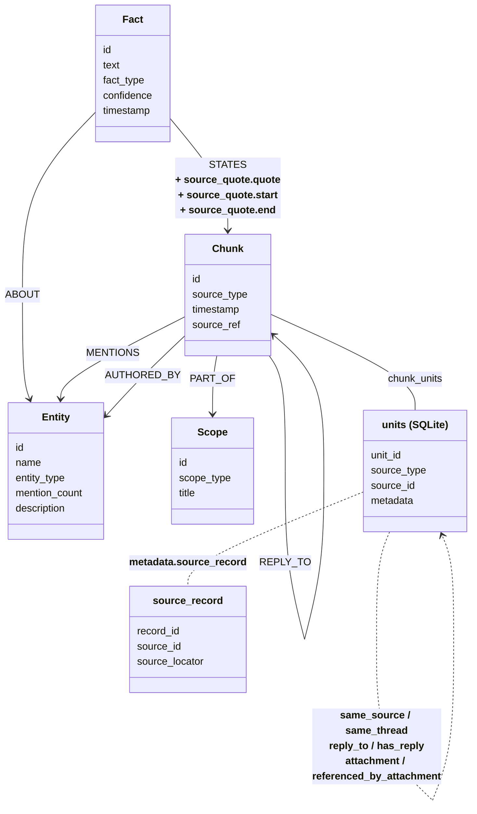

# 企业上下文能力验证

## 1. 企业上下文能力概述
什么是企业上下文？
调研业界，其核心能力：事实、图谱。

## 1. 验证目标与项目核查场景

本文关注企业上下文的两项能力：从业务材料中提炼可回查的事实，以及利用实体和来源之间的关系追查证据。验证的问题是，在相同的回答预算内，这两项能力分别能否让项目核查结论更完整。

### 1.1 为什么选择项目核查

这是Qwen办公、Microsoft WorkIQ、Glean强调的办公领域场景(需扩写)

| 项目核查场景特点 | 设想事实或图谱可能发挥的作用 |
|---|---|
| 一个限定条件就能改变决定 | **事实机制适配度高。** 把“仅预演通过”“损坏附件未测”“换模型须重验”等限制条件提炼成可单独检索的事实，再带回原句。即使提问人没有逐一列出例外，这些条件也能独立参与检索。 |
| 项目状态随时间和阶段变化 | **事实需同时保留时间、对象和状态。**“数据已恢复”“产物已重跑”“测试已通过”“批准发布”是四个可分别核实的判断，压成一句“已完成”容易误导决策。 |
| 不同材料各自只能证明一部分 | **图谱在这里最有价值。**群消息提供查找线索，附件和调用流水核实实际入口、服务或构建。图谱能沿引用找到日志，再用日志里的字段作证。 |
| 同名、同编号或共用入口容易混淆归属 | 实体关联可以找出需要对照的人员、任务和记录，核实归属还需岗位、请求、版本或时间。注：V5 里不少对象已有明确编号，F 也能独立找到依据，因此本批结果对复杂实体消歧的独立证明力有限。 |

### 1.2 V5 材料与建库范围

实际进入评测的 V5 数据有 349 条模拟记录，包括 208 条群消息、120 条文档记录、21 条会议记录。三类记录的正文长度中位数分别为 21、295、372 个字符。182 条记录带回复引用，27 条带附件引用。这个分布解释了两种典型困难：长材料里要找准一句话，短消息要结合上文才能读懂。

349 条原文全部抽取成功，形成 161 个原文片段、926 条事实、190 个实体和 2,663 条关系。每条事实均可定位到唯一的原文记录。原文、事实和实体分别有 161、926、190 条 1024 维向量。

## 2. 对照方案与评测方法

### 2.1 三种方案与能力边界

| 技术方案 | 允许使用的信息和能力 |
|---|---|
| **B：原文检索** | 对原文做关键词和向量检索。B 是三组共用的原文基线 |
| **F：B＋事实抽取与定位** | 在 B 的基础上独立检索事实，再溯源到原文选取支撑句。 |
| **G：F＋图谱召回与实体关联** | 复用 F 的事实库、事实定位。额外允许沿实体、关系召回相关事实和来源，并沿文档、线程、回复或附件扩展证据。关联路径、匹配依据和两端原文可一起进入最终回答输入，均占用证据预算。 |

✓ 表示接入，— 表示关闭。

| 环节 | 接入能力 | B | F | G | 边界或示例 |
|---|---|:---:|:---:|:---:|---|
| 原文检索 | 关键词和原文向量检索 | ✓ | ✓ | ✓ | 共用原文分段、排名融合和按原文记录 ID 去重 |
| 事实检索 | 按问句独立查找带出处的事实 | — | ✓ | ✓ | 复用同一事实库，可以经事实找到原文检索遗漏的记录 |
| 事实定位 | 从事实找到原文引句 | — | ✓ | ✓ | 保留原文位置及必要限定；定位不可靠时，以该条记录的完整正文参与预算装入 |
| 事实的回复上文 | 沿回复补齐理解事实所需的前文 | — | ✓ | ✓ | 如“按上面那个版本重跑”，可补入指出具体版本的消息；实际装入保留各条消息的来源 ID |
| 图谱召回 | 经实体、关系召回候选证据 | — | — | ✓ | 增加原文检索、事实检索之外的召回通道 |
| 共享实体关联 | 沿同一实体寻找关联来源 | — | — | ✓ | 保留共同指向的实体、匹配依据和两端原文 |
| 来源扩展 | 沿同一文档、线程、回复或附件继续查找 | — | — | ✓ | 允许多步扩展，即使当前原句已可独立理解 |
| 证据装入 | 按预先冻结的排序、去重和预算规则装入 | ✓ | ✓ | ✓ | 最终输入上限相同，关联说明和支撑原文也计入预算 |
| 多轮模型选证 | 分批初筛、全局复核、遗漏复核和按模型生成的证据组装入 | — | — | — | 统一采用简化流程 |
| 最终回答与评分 | 每题每组作答一次，匿名评判业务结论 | ✓ | ✓ | ✓ | 相同模型、提示、输出预算、引用校验和评分口径 |

### 2.2 两组对照与共用流程

**B/F 对照**在原文检索上增加事实检索、原句定位和必要的回复上文。**F/G 对照**复用同一事实库，额外启用图谱召回、共享实体关联和多步来源扩展。每组各有 20 个题号，分别统计。

核查问题 → 各方案提供证据 → 按固定规则在相同预算内装入 → 同一回答模型作答 → 对照参考答案核查必要要点。

同一对照的两组使用相同的问句、材料范围、回答提示和模型。排序、去重和超预算取舍规则预先固定。简化流程直接把装入的证据交给回答模型，省去 Demo 的分批初筛与多轮复核。

### 2.3 完整性指标

“输入可支撑”指最终交给回答模型的证据足以支持某一原子项业务要点；“答卷覆盖”指答卷实际写出该要点。所有必要要点都写全，才计作整题答全。每组的分母由本组题库决定。

## 3. 检索排名与证据装入

### 3.1 三路排名与融合

F 增加一份独立事实排名，G 在相同的原文、事实排名上再增加一份有出处的图谱排名。**按来源记录决定哪些证据值得先读，再按支持结论所需的最小完整原文决定能否装入。** 

从当前验证效果来看，大部分要点信息，进入回答模型，所以未重新引入独立的reranker模型。

1. **原文榜 O。** 同一题只生成一次 B 的原文融合结果，F、G 复用同一快照。排名单位取数据版本内的原文记录 ID（如一条群消息或一段文档），同一文档的不同段落保留各自 ID。原文榜采用现有关键词与向量的倒数排名融合（RRF），内层取K=60。
2. **事实榜 T。** 用冻结的同一向量模型，以问句独立检索事实文本，按相似度降序、事实 ID 升序。将命中映射到来源记录，同一记录只取其最佳事实命中确定名次，其余命中仍可贡献必要引句。
3. **图谱榜 H。** 仅 G 启用。收集原生图谱查询返回的有出处关系、已验证的共享实体路径，以及从种子来源沿明确回复、附件、线程或文档关系扩展出的路径。每条路径保留起点、终点、关系类型和可见的支持记录。对每条合格路径计算三个名次：起点在原文榜或事实榜的最好名次、关系的具体程度、终点引句与问句的 BM25。关系按直接回复或附件、共享实体、同线程或同文档分三级，多跳取最弱一级，同级短路径优先。每项指标内同值同名次，以 k=20 的等权 RRF 合并。最终平分时依次比较跳数、各跳标识及原文区间。每个终点保留最佳路径，支持两端的完整依据计入回答预算。
4. **统一计分。** 首版在各榜去重后各取前 50 个来源作为融合窗口；结果不足时按实际数量。这个窗口作用于检索器已经返回的候选，各路底层召回上限另行记录和冻结。B 的原文榜在窗口内保持原顺序。设来源在三榜名次为 o、t、h，从 1 开始，外层取 k=20，记 R(r)=1/(20+r)，缺席该榜取 0。**F 分数 = R(o)+R(t)；G 分数 = R(o)+R(t)+R(h)。** G 复用 F 的两项原始贡献，不把 F 的融合名次再投一票。两路提供不同检索信号可以提高选取优先级；同一原文仍然只算一份业务依据。
5. **可复现的平局。** 融合分高者先；同分先比最佳单榜名次，再按来源记录 ID 升序。平局判断用精确分数或固定精度，禁止依赖数据库返回顺序。若 H 为空，G 必须复现 F 的排名与装入；若 T 为空且没有可用事实节选或回复依赖，F 必须复现 B。

### 3.2 证据预算与取舍

- **预算口径。** 本次实验采用 8,192 token 的完整回答输入上限，实际取它与“模型上下文上限减输出预留”中较小者。
- **确定性装入。** 每个方案把自己启用的榜单统一计分，高分先试装。同源原文与事实引句的合并版太长，较短的事实引句可以连同必要上文，仅按事实榜名次重新竞争。同一条记录可以有“原文＋事实引句”和“再加图谱路径及两端依据”形式。后者可以获得图谱榜加分，也必须为路径和依据占用的空间付出预算。每步选择排名最高且完整请求能放下的候选，直接用试装前后总 token 差计算新增成本。高分组若暂放不下，继续试下一组；每次成功装入后重新检查被跳过组，因为一端可能已由另一组装入。完整组已覆盖、没有新增可引用信息时跳过。没有能放下的候选即停止，剩余空间可以留空。

## 4. 事实机制验证（B/F）

### 4.1 完整性汇总

按可交付答卷统计，B 答全 9/20 题，F 答全 13/20 题。F 有一份答卷在引用校验失败后用同一输入重试；按首次交付统计，F 答全 12/20 题。9 题双方答全，4 题仅 F 答全，7 题双方均有遗漏。

| 指标 | B | F |
| --- | ---: | ---: |
| 输入可支撑原子项业务要点 | 171/195 | 176/195 |
| 答卷覆盖原子项业务要点 | 164/195 | 171/195 |
| 答卷全题完整 | 9/20 | 13/20 |

### 4.2 逐题对照

每格按「输入 → 答卷」排列，红色粗体表示该格的答卷得分未满。例如 BF01 的 B 原子项业务要点为 7/7 → 6/7，表示输入已支撑全部 7 项，答卷写到了其中 6 项。

| BF 编号 | B 原子项业务要点 | F 原子项业务要点 |
|---|---:|---:|
| BF01 | 7/7 → $\color{red}{\mathbf{6/7}}$ | 7/7 → 7/7 |
| BF02 | 7/8 → $\color{red}{\mathbf{7/8}}$ | 7/8 → $\color{red}{\mathbf{7/8}}$ |
| BF03 | 6/6 → 6/6 | 6/6 → 6/6 |
| BF04 | 6/6 → $\color{red}{\mathbf{5/6}}$ | 6/6 → $\color{red}{\mathbf{5/6}}$ |
| BF05 | 10/10 → 10/10 | 10/10 → 10/10 |
| BF06 | 5/5 → 5/5 | 5/5 → 5/5 |
| BF07 | 6/6 → 6/6 | 6/6 → 6/6 |
| BF08 | 7/7 → 7/7 | 7/7 → 7/7 |
| BF09 | 8/8 → 8/8 | 8/8 → 8/8 |
| BF10 | 8/8 → $\color{red}{\mathbf{7/8}}$ | 8/8 → $\color{red}{\mathbf{7/8}}$ |
| BF11 | 8/8 → $\color{red}{\mathbf{7/8}}$ | 8/8 → 8/8 |
| BF12 | 8/8 → 8/8 | 8/8 → 8/8 |
| BF13 | 19/31 → $\color{red}{\mathbf{18/31}}$ | 18/31 → $\color{red}{\mathbf{18/31}}$ |
| BF14 | 7/10 → $\color{red}{\mathbf{7/10}}$ | 8/10 → $\color{red}{\mathbf{8/10}}$ |
| BF15 | 9/13 → $\color{red}{\mathbf{9/13}}$ | 11/13 → $\color{red}{\mathbf{11/13}}$ |
| BF16 | 13/14 → $\color{red}{\mathbf{13/14}}$ | 14/14 → 14/14 |
| BF17 | 12/12 → 12/12 | 12/12 → 12/12 |
| BF18 | 9/10 → $\color{red}{\mathbf{7/10}}$ | 9/10 → $\color{red}{\mathbf{6/10}}$ |
| BF19 | 6/8 → $\color{red}{\mathbf{6/8}}$ | 8/8 → 8/8 |
| BF20 | 10/10 → 10/10 | 10/10 → 10/10 |

### 4.3 得分差异分析

- **BF16、BF19：输入多了依据，答卷也多覆盖要点。** BF16 中，B 答出了要查应用派发，F 还答出要核对同一次调用的模型选路，覆盖从 13/14 提高到 14/14。BF19 中，F 找回了摘要与公函的目标语言路径仍待回归的依据，覆盖从 6/8 提高到 8/8。事实提炼使原文排名落选的关键配置仍能被找到。

- **BF01、BF11：两组输入都足以答全，最终表述有差异。** 这两题的差异出现在证据呈现方式导致答卷覆盖不全。而B因为没有召回直接引句，需要跨记录拼接，最终答卷写入业务要点遗漏。

整组 20 题中，F 的输入比 B 多支撑 5 个原子项业务要点，答卷多覆盖 7 个。事实能把长记录中一项决定或条件单独送入检索，也让模型有机会从较短的原句直接核对结论。BF01 中，F 用 86 个字符就呈现了 353 字符配置登记里的关键依据。这个例子说明单条依据可以更集中；整份回答输入的用量仍取决于其他入选材料。

### 4.4 事实机制的价值

通过建事实库，大片的原文，被提炼成一条条高信噪比的事实。有用的信息更集中，干扰更少。
在检索时，相较原文片段，事实与问题相关的信息密度更高，所以更容易匹配，并且排名靠前。
在装入时，事实相较原文片段，大大节约了最终装入token的占用，使得更多信息有机会装入。BF01中，原文定位使 F 只用 86 个字符就能提供一份 353 字符记录中的关键依据。
简单说，通过事实，原文片段有了更容易匹配的表达，匹配成功后又能用更短的原文把依据交给模型。

事实使得证据集中可能减少跨记录推理，进而降低漏答风险。
### 4.5 适用条件

**先看现有检索是否经常漏掉影响决策的限定条件，再看这些材料是否会反复使用。前者决定事实机制有没有业务增量，后者影响这份增量值不值得投入，使得预先整理的成本有机会摊薄。**

短记录中的直接查找、一次性问答，以及关键词加向量检索已经能稳定找全依据的任务，可以继续使用 B。扩大部署前，宜用其他真实项目的未知题，在相同预算下比较首次答全率、关键限定遗漏和人工回查时间，再结合事实抽取及随资料更新的维护成本判断是否值得推广。

## 5. 图谱机制验证（F/G）

F 已能从原文和事实库独立找到依据。G 复用这两条通道，并可经图谱召回事实和原文、沿共享实体或来源关系扩展候选。**F/G 主测试要回答的是，在相同输入预算下，这组图谱能力能否让核查人员更常得到有据可查的正确判断。** 两批题目覆盖图谱召回、实体关联与归属等核查任务。核心事实与证据图谱的结构及字段见文末附录。

### 5.1 完整性汇总

F 答全 17/20 题，G 答全 14/20 题。13 题双方答全，4 题仅 F 答全，1 题仅 G 答全，2 题双方均有遗漏。

| 指标 | F | G |
| --- | ---: | ---: |
| 输入可支撑原子项业务要点 | 137/141 | 137/141 |
| 答卷覆盖原子项业务要点 | 134/141 | 132/141 |
| 答卷全题完整 | 17/20 | 14/20 |

### 5.2 逐题对照

每格按 **输入支持数/该题总数 → 答卷覆盖数/该题总数** 阅读。例如，FG07 的 G 为 8/8 → 7/8，表示最终输入支撑全部 8 个原子项业务要点，答卷写出其中 7 个。红色标出未满分的分数。

| 题目 | F 原子项业务要点 | G 原子项业务要点 |
|---|---:|---:|
| FG01 晨报与周报缺陷 | 9/10 → 6/10 | 9/10 → 7/10 |
| FG02 翻译样本交接 | 8/8 → 8/8 | 8/8 → 8/8 |
| FG03 晨报取材边界 | 6/6 → 6/6 | 6/6 → 6/6 |
| FG04 评测截图归属 | 7/7 → 7/7 | 6/7 → 5/7 |
| FG05 周报风险归并 | 9/9 → 9/9 | 9/9 → 9/9 |
| FG06 摘要与润色调用 | 9/10 → 9/10 | 10/10 → 10/10 |
| FG07 润色样例交集 | 8/8 → 8/8 | 8/8 → 7/8 |
| FG08 公函签署字段 | 8/8 → 8/8 | 8/8 → 8/8 |
| FG09 摘要六例预演 | 6/6 → 6/6 | 6/6 → 6/6 |
| FG10 12包发布归属 | 3/3 → 3/3 | 3/3 → 3/3 |
| FG11 语料群里的两项待办 | 7/7 → 7/7 | 7/7 → 7/7 |
| FG12 客户询问交付范围 | 7/7 → 7/7 | 7/7 → 7/7 |
| FG13 从中文错误提示回查调用 | 7/7 → 7/7 | 7/7 → 7/7 |
| FG14 公函回归里的两位林工 | 7/7 → 7/7 | 7/7 → 7/7 |
| FG15 三条运行流水归档 | 7/7 → 7/7 | 6/7 → 6/7 |
| FG16 采购风险在哪个环节漏掉 | 8/8 → 8/8 | 8/8 → 8/8 |
| FG17 两次“压成三点”能否共用归因 | 7/7 → 7/7 | 7/7 → 6/7 |
| FG18 四类场景中的缺项 | 5/7 → 5/7 | 6/7 → 6/7 |
| FG19 预演环境的复现配置 | 5/5 → 5/5 | 5/5 → 5/5 |
| FG20 核查准备的三项责任 | 4/4 → 4/4 | 4/4 → 4/4 |

### 5.3 得分差异分析

- **FG06：附件关系提高了关键日志的装入优先级。** F 的事实检索已找到记录，但到第 55 次试装时剩余空间不足。G 通过附件关系更早装入日志，能够确认实际进入了润色技能。

- **FG04、FG15：关键登记排得靠后，装入时超出预算。** G 利用关系补充了上下文，也占用了原本可用于直接登记的空间。G中排名靠后，且图谱记录占用token较多，等轮到时装不下。FG15 的 8,192 token 预算中，最终输入里仅路径标注就占 1,431 token。

- **FG07、FG17：关键依据已进入两组输入，G 的答卷仍漏写限定。** 这两题的差异发生在作答阶段，证据的呈现和推理，导致最终答案中要点不全。

通过建事实库，大片的原文，被提炼成一条条高信噪比的事实。有用的信息更集中，干扰更少，所以要点装入后相对来说不容易遗漏。

### 5.4 适用条件

这批题没有显示全面启用 G 能提高整体答卷完整性。FG06 显示，当核查结论必须由群消息引用的附件或运行日志证实时，明确关系有机会让关键证据提前进入输入。

## 6. 后续工作（待扩写）
后续如何推进？
企业上下文适合的场景？
根据业务场景，先明确用例集

## 附录　核心事实与证据图谱

默认色表示原生已有的结构。实线箭头表示图谱中存储的边，标为 `chunk_units` 的实线表示 SQLite 中片段到来源单元的映射。**红色标出增强版新增的内容**：主 `STATES` 边的引句属性、导入时额外保存的 `source_record` 元数据组，以及查询时生成的路径。红框内的字段使用默认字色，红框标记的是这一组元数据。四类原生节点框内列出默认 Ladybug 节点表的字段，完整内容及来源字段另存于 SQLite。

四类节点的含义：

| 节点类型 | 中文含义 | 回答的问题 |
|---|---|---|
| Entity | 实体 | 涉及哪个人、项目、系统或其他对象？ |
| Fact | 事实或陈述 | 发生了什么、做了什么决定、提出了什么请求？ |
| Chunk | 原文片段 | 这条陈述从哪段内容得到，原文是什么？ |
| Scope | 来源容器 | 这段内容属于哪个群会话、文档或会议？ |

**Fact 节点的 `text` 是事实内容；`ABOUT` 是事实与对象之间的边。**例如“张三负责 A 项目”可以作为一条 Fact，分别 ABOUT 到张三和 A 项目。当前这套主要建图方式并不要求额外生成一条名为“负责”的人物到项目关系边；具体业务语义保留在事实文本中。

`AUTHORED_BY` 的名称容易被误读。当前代码会依据来源元数据，将聊天片段中的多个发言人，以及其他来源中记录的相关参与者关联为 Person 实体。因此该边应结合来源类型理解，不能一律解释为“唯一作者”或“该事实的决策者”。

**怎样读 `STATES`？** 从 Fact 沿实线到 Chunk，可以找到这条事实的出处片段。如果引句在抽取目标中逐字且唯一匹配，主 `STATES` 边的 `source_quote` 会保存三个字段：`quote` 是原句，`start` 和 `end` 是它在抽取文本中的起止位置。

**为什么把 `shared_ABOUT` 画成来源记录指回来源记录？** 和 `REPLY_TO` 一样，箭头两端属于同一种类型，实际连接的是两个实例。`REPLY_TO` 的两端是回复片段与被回复片段；`shared_ABOUT` 的两端是两条不同的来源记录，共享实体位于路径中间。例如在 FG01 中，从记录 `AWR1-S01` 的事实沿 `ABOUT` 找到消息实体 `IM-W19`，再从该实体反查另一条事实，回到记录 `AWR2-S02`。G 将这次从一条记录到另一条记录的查找记为 `shared_ABOUT`，并保留两端的事实和引句。

另一条红色回箭头列出按来源标识查找其他记录的方式。例如，FG04 从群消息中的附件号 `D06` 找到《模型构建登记》的段落，路径记为 `attachment`。

图中 Chunk 到 Chunk 的连线表示**不同原文片段实例之间**的关系，不是同一个节点连向自己的自环。TEMPORAL 从同一 session 内较早片段指向后续片段；REPLY_TO 从回复片段指向被引用消息所在片段。

图中的 `source_record` 是导入时保存来源记录元数据的字段，其中 `record_id` 标识一条消息或段落，`source_id` 标识所属来源，`source_locator` 保存原文位置。

**`source_record.source_id` 回答“这条记录来自哪份材料？”** 例如，《模型构建登记》整份文档的编号是 `D06`。V5 数据集把其中四个段落分别保存为四条记录。它们共用 `source_id = D06`，每一段有自己的 `record_id` 和原文位置。

| 来源 | `source_id`（哪份材料） | `record_id`（哪一条） | `source_locator`（原文位置） |
|---|---|---|---|
| 模型构建登记 | `D06` | `D06-S01` | `corpus/documents/D06_模型构建登记.md#D06-S01` |
| 模型构建登记 | `D06` | `D06-S02` | `corpus/documents/D06_模型构建登记.md#D06-S02` |
| 模型应用联调群 | `G3` | `T12-01` | `corpus/chat/messages.csv#T12-01` |

群消息 `T12-01` 的 `source_id` 是 `G3`，表示它发在“模型应用联调群”。这条消息的附件字段 `attachment_refs` 另存了 `D06`，表示引用整份《模型构建登记》。因此，系统沿附件能找到该文档的四条候选记录；要确定哪一段支持消息里的说法，还要核对各段原文。

当前图谱和之前的不同：不会拆成很细粒度，譬如事实可以是一整句，而不是一个个词。（需扩写）
